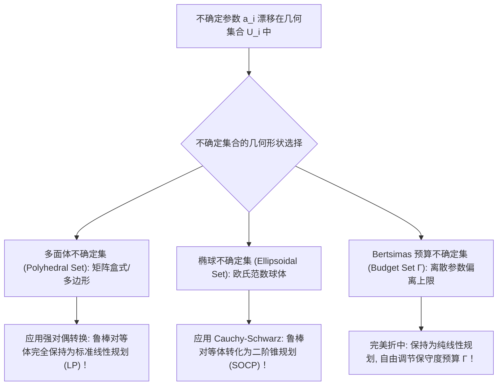

# Lec 20 不确定性优化前沿：鲁棒对等体与不确定集合 (Robust Optimization and Uncertainty Sets)

> MIT 15.094J 鲁棒系统优化建模与计算 (Systems Optimization: Models and Computation) · 授课教师：Prof. Dimitris Bertsimas / Robert Freund

## TL;DR

- 传统随机规划对先验概率分布的极度依赖在缺乏样本时面临严重的“模型拟合脆弱性”。
- 鲁棒优化（Robust Optimization）通过几何不确定集确保对最坏情况（Worst-Case）免疫。
- Bertsimas 预算不确定集（Budget of Uncertainty $\Gamma$）实现了鲁棒性与保守度的优雅线性对偶解耦。

## 概率分布的脆弱性与鲁棒革命

在前面的随机规划中，我们始终假设一个极其沉重的公理：**我们完全精确地知道未来不确定性参数的概率分布律（Probability Distribution $\mathbb{P}$）**。

然而在现实商业决策与前沿军事工程中，这种假设往往是极其天真的幻想：
- 对于一种从未上市的颠覆性创新产品，根本不存在详尽的历史销售数据供你拟合高斯或泊松分布；
- 面对俄乌地缘冲突与全球金融海啸，历史统计数据的相关性结构在数天之内发生范式崩溃。

如果盲目基于一个“充满噪声与拟合偏差的伪概率分布”去优化系统，著名的“优化估算误差放大效应（The Optimizer's Curse）”将导致求出的最优解在现实波动中发生**毁灭性的可行性违约（Infeasibility Violation）**！

1990 年代末，麻省理工学院运筹学中心（ORC）领袖 Dimitris Bertsimas 教授与 Ben-Tal、Nemirovski 等大师，开创了现代运筹优化中最重大的范式革命——**鲁棒优化（Robust Optimization, RO）**。

## 鲁棒优化哲学的公理基石

鲁棒优化彻底抛弃了脆弱的先验概率分布假设。
我们不再问“这个参数以多大概率发生？”，而是问：**“在合理的物理现实边界之内，这个参数可能在怎样的一个几何集合中随机游走？”**

设线性规划中的技术系数矩阵向量 $a_i$ 是不确定的。我们假设 $a_i$ 漫游在一个有界的**不确定集合（Uncertainty Set $\mathcal{U}_i$）**之内。
原问题要求在**面对集合 $\mathcal{U}_i$ 中可能爆发的任意最坏情况时，物理约束均能 100% 免疫且可行**：
$$
\min_{x} \quad c^T x \quad \text{s.t.} \quad a_i^T x \le b_i, \quad \forall a_i \in \mathcal{U}_i, \quad \forall i = 1, \dots, m
$$
这在数学上等价于要求对集合上的上确界成立：
$$
\max_{a_i \in \mathcal{U}_i} \{a_i^T x\} \le b_i, \quad \forall i = 1, \dots, m
$$

## 三大经典几何不确定集及其鲁棒对等体 (Robust Counterparts)

如何将包含无穷多个可能点的“半无限规划（Semi-Infinite Program）”转化为求解器可以直接计算的确定性规划？
对偶理论给出了神奇的降维钥匙。

### 1. 盒式不确定集（Box Uncertainty）与最保守模型
假设每个参数在标称值 $\bar{a}_{ij}$ 周围独立浮动：$a_{ij} \in [\bar{a}_{ij} - \hat{a}_{ij}, \bar{a}_{ij} + \hat{a}_{ij}]$。
最坏情况必然发生在所有参数同时取到最恶劣上界时刻：
$$
\sum_{j=1}^n \bar{a}_{ij} x_j + \sum_{j=1}^n \hat{a}_{ij} |x_j| \le b_i
$$
若假设变量非负 $x \ge 0$，该鲁棒对等体是一个普通的线性规划！但这被称为“索罗莫（Soyster）超保守模型”：在现实中，所有参数同时倒霉到极点的概率比被雷劈中还要小，这种过度保守会导致系统成本极度飙升。

### 2. 椭球不确定集（Ellipsoidal Uncertainty）与二阶锥规划 (SOCP)
为了消除超保守性，Ben-Tal 和 Nemirovski（1998）提出采用欧氏范数约束的椭球不确定集：
$$
\mathcal{U}_i = \{\bar{a}_i + P_i u : \|u\|_2 \le \Omega\}
$$
计算其在椭球上的极大值：
$$
\max_{\|u\|_2 \le \Omega} (\bar{a}_i + P_i u)^T x = \bar{a}_i^T x + \max_{\|u\|_2 \le \Omega} u^T (P_i^T x) = \bar{a}_i^T x + \Omega \|P_i^T x\|_2
$$
其鲁棒对等体为：
$$
\bar{a}_i^T x + \Omega \|P_i^T x\|_2 \le b_i
$$
由于出现了二范数项 $\|P_i^T x\|_2 \le b_i - \bar{a}_i^T x$，**原本的线性规划极其优美地进化为了一个标准二阶锥规划（Second-Order Cone Program, SOCP）！**

### 3. Bertsimas-Sim 预算不确定集 (The Price of Robustness)
针对 SOCP 无法直接使用纯线性单纯形法求解的痛点，Dimitris Bertsimas 与 Melvyn Sim（Operations Research, 2004）提出了享誉全球运筹学界的**预算不确定集（Budget Uncertainty Set）**。

定义无量纲扰动变量 $z_j \in [-1, 1]$，引入**鲁棒不确定性预算参数 $\Gamma_i \in [0, n]$**：
强制要求在所有 $n$ 个不确定参数中，**发生偏离的参数加权绝对值总和绝不能超过预设预算 $\Gamma_i$**：
$$
\mathcal{U}_i = \left\{a_i : a_{ij} = \bar{a}_{ij} + \hat{a}_{ij} z_{ij}, \quad |z_{ij}| \le 1, \quad \sum_{j=1}^n |z_{ij}| \le \Gamma_i\right\}
$$

为了将对偶展开，我们考察子极大化保护项：
$$
\beta_i(x) = \max \left\{\sum_{j=1}^n \hat{a}_{ij} x_j z_{ij} : \sum_{j=1}^n z_{ij} \le \Gamma_i, \quad 0 \le z_{ij} \le 1\right\}
$$
这是一个简单的连续背包规划！为其指定对偶变量 $p_i \ge 0$ 与 $q_{ij} \ge 0$。由强对偶性，该极大化子问题严格等价于其对偶极小化问题：
$$
\min_{p_i, q_{ij}} \quad \Gamma_i p_i + \sum_{j=1}^n q_{ij} \quad \text{s.t.} \quad p_i + q_{ij} \ge \hat{a}_{ij} x_j, \quad p_i \ge 0, q_{ij} \ge 0
$$

::: theorem [Bertsimas-Sim 线性对等体定理]
引入辅助对偶变量 $p_i$ 与 $q_{ij}$，带有不确定预算 $\Gamma_i$ 的鲁棒规划可以**完全无损地写为纯粹的线性规划（LP）**：
$$
\begin{aligned}
\min \quad & c^T x \\
\text{s.t.} \quad & \sum_{j=1}^n \bar{a}_{ij} x_j + \Gamma_i p_i + \sum_{j=1}^n q_{ij} \le b_i, \quad \forall i = 1, \dots, m \\
& p_i + q_{ij} \ge \hat{a}_{ij} x_j, \quad \forall i, j \\
& p_i \ge 0, \quad q_{ij} \ge 0, \quad x \ge 0
\end{aligned}
$$
:::

### 鲁棒对等体的划时代意义
1. **完全保全线性单纯形法算力**：不需要调用昂贵的非线性内点法，直接享受最顶级的商用 LP/MIP 求解速度；
2. **保守度的平滑旋钮**：当 $\Gamma = 0$ 时，退化为无保护的经典确定性模型；当 $\Gamma = n$ 时，覆盖全部最坏情况。更震撼的是：Bertsimas 严格证明了，**只需取极其温和的预算 $\Gamma = \mathcal{O}(\sqrt{n})$，系统发生违约越界的概率就已经被指数级衰减至 $10^{-6}$ 以下！**

::: pitfall 误将鲁棒优化等同于毫无作为的过度防御
平庸的工程师常批评鲁棒优化“太保守、成本太高”。Bertsimas 的“鲁棒代价（Price of Robustness）”理论证明：只要合理配置预算 $\Gamma$，通常**仅需牺牲不到 1% 到 2% 的名义理论利润，就能为系统换取高达 99.999% 的抗风险生命保障**！
:::

::: insight 鲁棒优化是人类面对无知时的最高克制与理性
在概率统计学中，人们常常自负地认为自己收集的几百个数据点足以描绘宇宙的客观规律；
而鲁棒优化的哲学彰显了一种更高级的理性谦卑：**它承认人类认知的局限性与数据的固有偏差，通过在凸多面体与几何椭球之间铸造一道刚性的防波堤，使系统即便面对未曾见过的风暴冲击，也能岿然不动**。这种从脆弱走向反脆弱的思想跃迁，是现代系统优化科学最辉煌的里程碑。
:::
