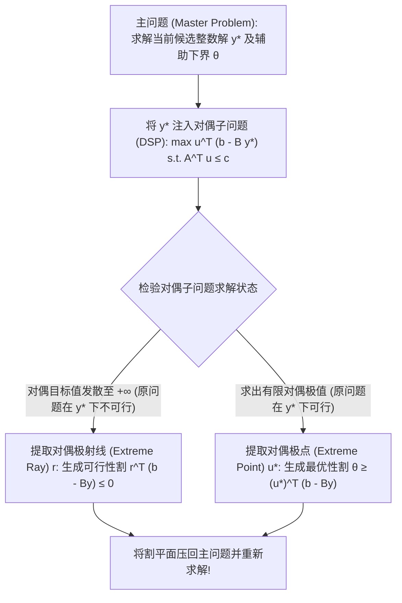

# Lec 21 Benders 分解算法在结构化大规模规划中的工程实践 (Benders Decomposition in Practice)

> MIT 15.094J 鲁棒系统优化建模与计算 (Systems Optimization: Models and Computation) · 授课教师：Prof. Dimitris Bertsimas / Robert Freund

## TL;DR

- Benders 分解算法是求解带有“复杂解耦变量”的混合整数规划的绝对工业重器。
- 主问题（Master）与对偶子问题（Subproblem）通过最优性割与可行性割建立割平面交替逼近。
- 现代多核并行与 Pareto 优化割（Magnanti-Wong 割）彻底消除了经典 Benders 的慢收敛病态。

## 应对混合变量纠缠的战略解耦

在前面的课程中，我们见识了 Dantzig-Wolfe 列生成算法（通过将约束行移入子问题，化解变量数过多的危机）。
而在工业界中，我们更频繁遭遇的是另一种相反的**结构化灾难——“变量性质严重不对称”**：
- **第一类变量 $y$**：极其困难、充满组合复杂性的 0-1 离散整数变量（如工厂基建选址、航线航班开辟、发电机组启闭状态）；
- **第二类变量 $x$**：极其庞大但相对容易求解的连续物理变量（如各工厂向各市场的连续物料调拨流量、网络连续电流）。

若将这两类变量强行打包进一个单体 MIP 求解器中，分支定界树会被连续流量变量拖得极其沉重；而连续松弛又被离散 0-1 变量反复打碎。

1962 年，荷兰数学家雅克·本德斯（Jacques F. Benders）提出了现代大规模优化历史上最著名的战略解耦框架——**Benders 分解（Benders Decomposition，在约束规划界又称逻辑 Benders 分解）**。

## 变量投影与 Benders 原理推导

考虑通用的混合整数线性规划模型：
$$
\begin{aligned}
\min_{x, y} \quad & c^T x + f^T y \\
\text{s.t.} \quad & A x + B y \ge b \\
& x \ge 0, \quad y \in \mathcal{Y} \subset \mathbb{Z}^p
\end{aligned}
$$
其核心哲学是**变量投影（Projection）**：
假设我们暂时“冻结”离散变量 $y$ 的取值（令 $y = \bar{y}$）。
此时，原问题退化为一个关于连续变量 $x$ 的极纯净、极速可解的**连续线性规划子问题（Subproblem, SP）**：
$$
\begin{aligned}
v(\bar{y}) = \min_{x \ge 0} \quad & c^T x \\
\text{s.t.} \quad & A x \ge b - B \bar{y}
\end{aligned}
$$

写出该子问题的标准线性规划**对偶问题（Dual Subproblem, DSP）**，引入对偶变量 $u \ge 0$：
$$
\begin{aligned}
v(\bar{y}) = \max_{u \ge 0} \quad & u^T (b - B \bar{y}) \\
\text{s.t.} \quad & A^T u \le c
\end{aligned}
$$

注意对偶可行域多胞形：
$$
\mathcal{D} = \{u \ge 0 : A^T u \le c\}
$$
**这个对偶可行域 $\mathcal{D}$ 竟然完全不依赖于离散变量 $\bar{y}$！** $\bar{y}$ 的变动仅仅改变了对偶目标函数的斜率！
根据多面体表示定理，多面体 $\mathcal{D}$ 由有限个极点集合 $\mathcal{E}$ 与有限个极方向（极射线）集合 $\mathcal{R}$ 唯一完全表征。

## 两类经典 Benders 割平面的代数定义

根据强对偶性，原问题可以严密重构为关于离散变量 $y$ 与辅助标量 $\theta$ 的**完全主问题（Full Master Problem）**：
$$
\begin{aligned}
\min_{y \in \mathcal{Y}, \theta} \quad & f^T y + \theta \\
\text{s.t.} \quad & \theta \ge u^T (b - B y), \quad \forall u \in \mathcal{E} \quad (\text{Benders 最优性割 Optimality Cuts}) \\
& 0 \ge r^T (b - B y), \quad \forall r \in \mathcal{R} \quad (\text{Benders 可行性割 Feasibility Cuts})
\end{aligned}
$$

::: definition [两大割平面的物理意义]
1. **可行性割（Feasibility Cut）**：
若子问题不可行，意味着对偶问题发散至正无穷（存在极射线 $r \in \mathcal{R}$ 满足 $r^T (b - B \bar{y}) > 0$）。
将割平面 $r^T (b - B y) \le 0$ 回传给主问题，强行切除所有会导致物理生产无法落地的非法离散布局方案 $\bar{y}$！
2. **最优性割（Optimality Cut）**：
若子问题可行且有界，求得极点最优解 $u^* \in \mathcal{E}$。
若当前主问题中的下界估计 $\theta < (u^*)^T (b - B \bar{y})$，将割平面 $\theta \ge (u^*)^T (b - B y)$ 注入主问题，强行推高未来真实成本的全局下界！
:::

## 工业实战加速关键：Magnanti-Wong 帕累托最优割

经典 Benders 分解在工业界最饱受诟病的痛点是：**收敛极慢（Tail-off Effect）**。
这是因为对偶子问题往往存在严重的**对偶退化（Dual Degeneracy）**——存在多个不同的对偶极点 $u^*$ 能够达到相同的最优值。
若盲目选取一个次优的对偶极点，生成的割平面在主问题空间中非常平缓，支配力极其微弱。

1981 年，麻省理工学院斯隆管理学院副院长、运筹学大师 Thomas L. Magnanti 与 Richard Wong 提出了著名的 **Magnanti-Wong 帕累托最优割（Pareto-Optimal Cuts）**：
在所有能达到子问题最优值的对偶最优解集合中，额外引入一个处于定义域内部的**核心参考点（Core Point $y^{\text{core}}$）**，求解二次辅助问题：
$$
\max_{u \in \text{Optimal Dual Set}} \quad u^T (b - B y^{\text{core}})
$$
该技术选出的对偶极点生成的割平面，在整个高维空间中能够严格**全局支配（Dominate）**其他任意割平面，使得 Benders 分解的迭代收敛速度通常提升数十倍！

::: pitfall 将 Benders 分解与传统多阶段分支割平面割裂运行
过去工程师习惯于每次主问题都从头运行一次完整的分支定界（Multi-Tree Benders），浪费大量算力。现代标准工程架构采用 **单树 Benders（Branch-and-Benders-Cut / Modern Single-Tree Benders）**：仅在主问题分支定界的一棵搜索树上，通过 `LazyConstraintCallback` 在每个整数节点就地动态求解子问题并注入割平面！
:::

::: insight Benders 分解是领导者与执行者之间的理性契约
Benders 分解展现了一种极具美感的层级决策结构：
主问题犹如高瞻远瞩的董事会，专心决策重资产战略重构；
子问题犹如精益求精的车间主管，在既定战略下高效出清日常运营流；
**董事会不插手车间的微观调度，车间用对偶影子价格向董事会呈递成本边界反馈**。两者在对偶割平面的交互穿梭中，合力推动整台庞大机器逼近全局最优的彼岸。
:::
