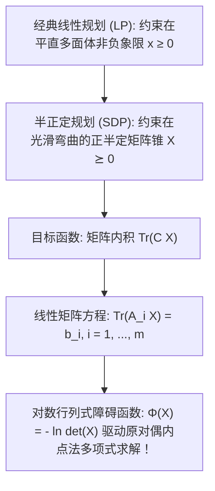

# Lec 22 半正定规划与线性矩阵不等式前沿基础 (Introduction to SDP and LMIs)

> MIT 15.094J 鲁棒系统优化建模与计算 (Systems Optimization: Models and Computation) · 授课教师：Prof. Dimitris Bertsimas / Robert Freund

## TL;DR

- 半正定规划（SDP）将经典线性规划的向量非负半轴推广至对称矩阵正半定锥（PSD Cone）。
- 线性矩阵不等式（LMI）以统一凸分析语言兼收并蓄二次约束、特征值优化与控制李雅普诺夫方程。
- 原对偶矩阵内点法通过自协调障碍函数 $\Phi(X) = -\ln \det(X)$ 在多项式时间内精确求解。

## 突破平直多胞形：锥优化的高阶王国

在线性规划中，决策变量被约束在非负实数第一象限（Non-negative Orthant $\mathbb{R}_+^n$）之内。
然而，在控制理论、量子信息计算、结构力学特征值优化与图论组合近似算法中，核心决策对象往往不再是一组孤立的离散标量，而是一整张**对称矩阵（Symmetric Matrix $X \in \mathbb{S}^n$）**，且物理规律要求该矩阵在全空间保持**正半定性（Positive Semidefiniteness, $X \succeq 0$）**。

1990 年代初，随着内点法的革命性拓展，运筹学界迎来了 20 世纪下半叶最具突破性的数学分支——**半正定规划（Semidefinite Programming, SDP）与锥优化（Conic Optimization）**。
它不仅将经典线性规划视为自身的平庸特例，更以不可思议的统一包容力，征服了原本被视为极其难解的大量非凸二次极值问题。

## 正半定锥与半正定规划标准型 (SDP Standard Form)

设 $\mathbb{S}^n$ 为 $n \times n$ 阶实对称矩阵空间。空间赋予标准 Frobenius 内积：
$$
\langle A, B \rangle = \text{Tr}(A^T B) = \text{Tr}(A B) = \sum_{i=1}^n \sum_{j=1}^n A_{ij} B_{ij}
$$

::: definition [对称正半定锥 (PSD Cone)]
对称矩阵子集：
$$
\mathbb{S}_+^n = \{X \in \mathbb{S}^n : X \succeq 0\} \iff \{X \in \mathbb{S}^n : z^T X z \ge 0, \forall z \in \mathbb{R}^n\}
$$
构成一个自对偶（Self-Dual）、尖锐且具有非空内部的**闭凸锥（Proper Convex Cone）**。
其边界表面极其光滑弯曲，但在任意截面上完全满足凸分析公理！
:::

标准**半正定规划原问题（Primal SDP）**：
$$
\begin{aligned}
\min_{X \in \mathbb{S}^n} \quad & \text{Tr}(C X) \\
\text{s.t.} \quad & \text{Tr}(A_i X) = b_i, \quad i = 1, \dots, m \\
& X \succeq 0
\end{aligned}
$$
其对称**对偶问题（Dual SDP）**，引入标量乘子向量 $y \in \mathbb{R}^m$ 与对偶松弛矩阵 $S \in \mathbb{S}^n$：
$$
\begin{aligned}
\max_{y \in \mathbb{R}^m, S \in \mathbb{S}^n} \quad & b^T y \\
\text{s.t.} \quad & \sum_{i=1}^m y_i A_i + S = C \\
& S \succeq 0
\end{aligned}
$$
注意对偶约束：$C - \sum_{i=1}^m y_i A_i \succeq 0$。这种形式被称为经典的**线性矩阵不等式（Linear Matrix Inequality, LMI）**！

## 线性矩阵不等式 (LMI) 的全能表达张力

线性矩阵不等式（LMI）在现代系统控制工程（如卡尔曼滤波、鲁棒 $H_\infty$ 控制、Lyapunov 稳定性分析）中无处不在。
许多看似高度非线性的复杂不等式，借助著名的 **Schur 补引理（Schur Complement Lemma）**，可以瞬间无损转化为一个等价的纯粹 LMI！

::: theorem [Schur 补引理与凸转化]
设对称分块矩阵 $M$ 形式如下（假设 $A$ 正定 $A \succ 0$）：
$$
M = \begin{bmatrix}
A & B \\
B^T & C
\end{bmatrix}
$$
则矩阵 $M$ 正半定（$M \succeq 0$）**当且仅当**其 Schur 补正半定：
$$
C - B^T A^{-1} B \succeq 0
$$
:::

### 经典应用示例
1. **二次不等式凸化**：
考虑非线性约束 $x^T P x \le 1$（$P \succ 0$）。直接使用 Schur 补，其充要等价于简单的线性分块 LMI：
$$
\begin{bmatrix}
P^{-1} & x \\
x^T & 1
\end{bmatrix}
\succeq 0
$$
2. **矩阵最大特征值极小化**：
优化目标 $\min \lambda_{\max}(A(x))$。
引入标量 $\gamma$。条件 $\lambda_{\max}(A(x)) \le \gamma$ 严格充要等价于：
$$
\gamma I - A(x) \succeq 0
$$
原本不可导的特征值极值函数，被瞬间化为一个标准平滑的对偶 SDP！

## 原对偶内点法与对数行列式障碍函数

为什么半正定规划能够像线性规划一样在多项式时间内秒级精确求解？
答案在于**自协调对数行列式障碍函数（Log-Determinant Barrier）**：
$$
\Phi(X) = -\ln \det(X)
$$
当矩阵 $X$ 逼近半正定锥的边界时，其最小特征值趋近于零，导致行列式 $\det(X) \to 0$，障碍函数值 $\Phi(X) \to +\infty$ 产生强大的排斥力。

在每一次原对偶内点迭代中，算法求解线性化的修正互补松弛方程组：
$$
X S = \mu I
$$
利用 Alizadeh-Haeberly-Overton（AHO）或 Nesterov-Todd（NT）对称化投影方向，原对偶内点法保证在 $\mathcal{O}(\sqrt{n} \ln(1/\epsilon))$ 次牛顿迭代之内，收敛至全局绝对机器精度！

::: pitfall 忽视 SDP 强对偶性弱于 LP 的病态间距陷阱
注意：在线性规划中，只要原问题或对偶问题有一方可行，强对偶定理必然成立且对偶间距为 0。
但在半正定规划中，**强对偶性需要满足 Slater 条件（严格内点存在性条件：存在 $X \succ 0$）**！若原问题与对偶问题均只在奇异边界相切，SDP 可能会出现极罕见的非零对偶间距（Duality Gap > 0）。
:::

::: insight 正半定锥是几何世界中最完美的非线性拓扑奇迹
从标量不等式走向矩阵正半定性，人类数学完成了一次伟大的升维破壁。
半正定规划向世人宣告：**非线性并不意味着失控与混沌。正半定锥以其自对偶的光滑曲面，将代数、矩阵分析与微积分融铸为一个完美的几何连续体**。它是 21 世纪应用数学处理高维复杂系统最锋利的战略重器。
:::
