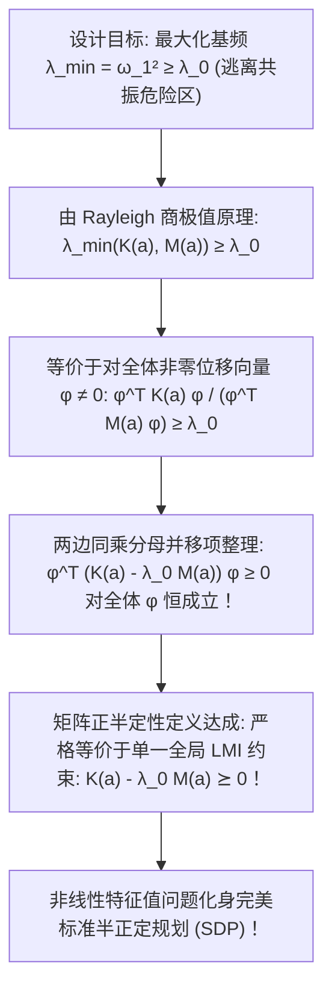

# Lec 23 桁架结构动力学：基于 SDP 的固有频率优化 (Truss Natural Frequency Manipulation via SDP)

> MIT 15.094J 鲁棒系统优化建模与计算 (Systems Optimization: Models and Computation) · 授课教师：Prof. Dimitris Bertsimas / Robert Freund

## TL;DR

- 机械结构共振与动态荷载破坏要求结构基频（Fundamental Frequency）避开危险激励频段。
- 广义特征值极小化在动力学方程中呈现高度非线性与非凸耦合。
- 通过将质量矩阵与刚度矩阵比值映射为线性矩阵不等式（LMI）实现基于 SDP 的全局严密求解。

## 避免共振灾难：动力学维度的严苛考验

在第 17 讲中，我们解决了结构力学在静态载荷下的拓扑优化。
然而，在真实物理世界中，许多重大灾难并非源于静态重力超载，而是源于可怕的**动力学周期共振（Dynamic Resonance）**：
- 1940 年美国塔科马海峡大桥（Tacoma Narrows Bridge）在微风吹拂下发生剧烈卡门涡街共振，数分钟内全桥撕裂坍塌；
- 现代航空航天火箭发射与卫星展开机构，必须抵抗发动机火箭助推器喷气引发的剧烈高频宽带声震振动；
- 高速铁路桥梁在动车组轮对高频敲击下，桥梁的自然固有频率必须严格避开列车的激振频率走廊。

**结构固有频率优化（Natural Frequency Manipulation）**的核心任务是：
在总结构质量上限严格约束下，**如何通过优化桁架杆件的尺寸分布，使得结构的最低一阶固有振动频率（Fundamental Frequency $\omega_1$）最大化，彻底脱离外部危险共振频带？**

## 结构无阻尼自由振动与广义特征值方程

根据结构动力学达朗贝尔动静法与有限元分析，包含 $n$ 个自由度的弹性桁架系统的无阻尼自由振动微分方程为：
$$
M(a) \ddot{u}(t) + K(a) u(t) = 0
$$
其中：
- $u(t) \in \mathbb{R}^n$ 为节点动态位移响应向量；
- $K(a) \in \mathbb{S}_+^n$ 为我们在第 17 讲定义的全局对称刚度矩阵；
- $M(a) \in \mathbb{S}_{++}^n$ 为结构**全局对称正定质量矩阵（Global Mass Matrix）**。

设杆件截面积向量为 $a = (a_1, \dots, a_m)^T \ge 0$。结构不仅包含杆件自身的自重分布质量，通常还在特定承重节点悬挂有固定的非结构附加死重质量（如桥面铺装、仪器舱载荷，对应对称正定常量矩阵 $M_0 \succ 0$）。
因此质量矩阵关于截面积 $a$ 同样呈线性对称结构：
$$
M(a) = M_0 + \sum_{i=1}^m a_i M_i \succ 0
$$
设简谐振动特解为 $u(t) = \phi \sin(\omega t)$，代入微分方程，瞬间导出结构振动的**广义特征值方程（Generalized Eigenvalue Problem）**：
$$
K(a) \phi = \omega^2 M(a) \phi \iff \left(K(a) - \lambda M(a)\right) \phi = 0
$$
其中特征值 $\lambda = \omega^2$ 为固有角频率的平方，特征向量 $\phi \ne 0$ 为对应的**振动模态主型（Mode Shape）**。

## 广义 Rayleigh 商与线性矩阵不等式转化

根据对称矩阵极小极大定理（Courant-Fischer Min-Max Theorem），最低一阶基频的平方等于 **Rayleigh 商在全空间的全局最小值**：
$$
\lambda_1(a) = \omega_1^2 = \min_{\phi \ne 0} \frac{\phi^T K(a) \phi}{\phi^T M(a) \phi}
$$

假设工程抗震规范要求结构基频必须大于等于安全安全阈值 $\omega_0$（记 $\lambda_0 = \omega_0^2$）：
$$
\lambda_1(a) \ge \lambda_0 \iff \min_{\phi \ne 0} \frac{\phi^T K(a) \phi}{\phi^T M(a) \phi} \ge \lambda_0
$$
由于质量矩阵 $M(a) \succ 0$ 严格正定，分母 $\phi^T M(a) \phi > 0$ 恒为严格正实数。
两边同乘分母：
$$
\phi^T K(a) \phi \ge \lambda_0 \phi^T M(a) \phi, \quad \forall \phi \ne 0
$$
移项合并整理：
$$
\phi^T \left(K(a) - \lambda_0 M(a)\right) \phi \ge 0, \quad \forall \phi \in \mathbb{R}^n
$$

::: theorem [基频约束的 LMI 充要等价定理]
根据正半定矩阵的公理化定义，上述关于任意向量二次型非负的陈述，**严格充要等价于一个单一、标准的线性矩阵不等式（LMI）**：
$$
K(a) - \lambda_0 M(a) \succeq 0
$$
:::

因为 $K(a)$ 与 $M(a)$ 均为截面积向量 $a$ 的纯线性仿射函数：
$$
K(a) - \lambda_0 M(a) = \left(\sum_{i=1}^m a_i K_i\right) - \lambda_0 \left(M_0 + \sum_{i=1}^m a_i M_i\right) = \sum_{i=1}^m a_i (K_i - \lambda_0 M_i) - \lambda_0 M_0 \succeq 0
$$
原本带有微分方程与特征值求根的极难物理动力学约束，被瞬间化为纯度 100% 的标标准准 LMI！

## 最小结构自重 SDP 规划模型

结合材料总重量最小化目标，整个桁架防共振动力学优化模型表述为：
$$
\begin{aligned}
\min_{a \in \mathbb{R}^m} \quad & \sum_{i=1}^m \rho_i L_i a_i \\
\text{s.t.} \quad & \sum_{i=1}^m a_i (K_i - \lambda_0 M_i) \succeq \lambda_0 M_0 \\
& a_i^{\min} \le a_i \le a_i^{\max}, \quad \forall i = 1, \dots, m
\end{aligned}
$$
其中 $\rho_i$ 为材料密度，$L_i$ 为杆长。
这是一个变量维度适中、约束极度紧凑的标准半正定规划。调用现代 SDP 求解器（如 MOSEK 或 SeDuMi），即使面对包含数千个自由度的复杂航空航天卫星支架，亦可在几秒内输出经受过严格数学证明的全局最优截面积配置！

::: pitfall 试图同时最大化高阶多模态频率导致的非凸交叉
上述模型针对的是最低一阶基频 $\lambda_1$。如果工程要求同时优化高阶模态（例如使第二阶、第三阶模态之间形成频带隔离），特征值之间的距离函数会呈现出复杂的非凸非光滑分叉（Eigenvalue Crossing），此时需要引入半正定锥的二阶复合切片。
:::

::: insight 矩阵正半定性是物理稳定性在代数中的灵魂显现
在物理世界中，能量必须有下界，系统才能保持稳定平衡；
广义特征值方程与正半定锥的碰撞向我们揭示了这一宇宙铁律：**$K - \lambda_0 M \succeq 0$ 这道优雅的矩阵不等式，不仅是一行冰冷的代数代码，更是工程师在代数空间中为整座宏伟物理建筑筑起的一堵坚不可摧的防共振防火墙**。数学规划在物理动力学中的力量，莫过于此。
:::
