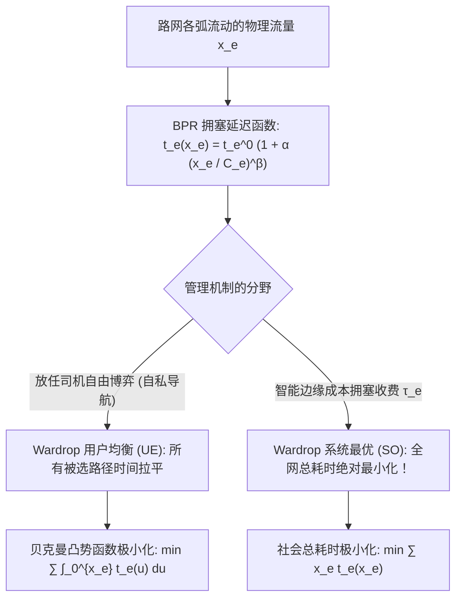

# Lec 24 交通流平衡、Wardrop 原则与拥塞收费优化 (Traffic Equilibrium and Wardrop Principles)

> MIT 15.094J 鲁棒系统优化建模与计算 (Systems Optimization: Models and Computation) · 授课教师：Prof. Dimitris Bertsimas / Robert Freund

## TL;DR

- Wardrop 第一原则（用户均衡 UE）刻画了私家车主自私贪心选择下的纳什均衡状态。
- Beckmann 积分势函数将非线性的变分交通网络均衡转化为严格凸优化极值问题。
- 边缘成本拥塞收费（Pigou 庇古收费）彻底消解了布雷斯佯谬（Braess's Paradox）实现系统最优。

## 城市大动脉的博弈论与运筹学审判

每天清晨，全球各大特大城市（如北京、纽约、伦敦、东京）的数百万市民发动汽车驶入城市路网。
每一位驾驶员都是极其自私、理性的自利个体：
- 他们打开手机导航软件，寻找当前路况下从家到办公室阻抗最小、耗时最短的路径；
- 然而，当成千上万名司机同时涌入同一条看似捷径的立交桥时，该路段的通行速度迅速发生非线性雪崩，引发严重的世纪大堵车！

一个令人困惑而深思的问题摆在城市交通规划大师面前：
- **当所有人都自私地追求个人通勤时间最短时，城市路网最终会自发收敛至怎样的稳态？**
- **新建一条更宽阔的高速公路，是否真能缓解城市的拥堵（震惊世界的布雷斯佯谬 Braess's Paradox）？**
- **政府如何通过精准设计智能拥塞收费（Congestion Pricing），引导自私的车流自发实现全社会总通勤时间最优？**

麻省理工学院 15.094J 课程大轴，以交通工程网络中著名的 **Wardrop 平衡原则与 Beckmann 凸势函数规划**，为整个系统优化与计算体系写下最壮丽的终章。

## Wardrop 用户均衡与系统最优两大原则

1952 年英国交通统计学家约翰·格伦·沃德罗普（John Glen Wardrop）提出了城市路网分析的两大根本公理：

::: definition [Wardrop 第一原则：用户均衡 (User Equilibrium, UE)]
在网络交通流稳态下，在任意给定的起讫点（OD 对）之间，**所有被实际使用的路径，其旅行行程时间（阻抗）必须完全相等，且严格小于等于任意未被使用的备选路径的旅行时间**！
在博弈论语境下，Wardrop 用户均衡在数学上精确等价于连续玩家种群博弈中的**纳什均衡（Nash Equilibrium）**：没有任何单一司机能够通过单方面单方面改变自身的行驶路线来缩短自己的通勤时间！
:::

::: definition [Wardrop 第二原则：系统最优 (System Optimum, SO)]
全网车流的路由配置方案，应当使**全网所有出行者的总旅行时间（Total Network Travel Time）之和达到全局最小**！
在福利经济学中，这代表了中央规划者追求的最高帕累托社会福利状态。
:::

## 美国联邦公路局 BPR 拥塞延迟函数

在交通工程中，通过某条路段（弧 $e \in E$）的实际通行时间 $t_e(x_e)$ 随着该路段上的车流负荷 $x_e$ 的增加而呈强烈的非线性攀升。
最广泛采纳的工业标准是**美国联邦公路局 BPR 函数（Bureau of Public Roads Formula）**：
$$
t_e(x_e) = t_e^0 \left[1 + \alpha \left(\frac{x_e}{C_e}\right)^\beta\right]
$$
其中 $t_e^0$ 为自由流旅行时间（Free-Flow Travel Time），$C_e$ 为道路设计实际通行能力，标准推荐经验参数通常取 $\alpha = 0.15, \beta = 4$。
注意：当流量 $x_e$ 逼近甚至超越容量 $C_e$ 时，四次方项 $(x_e / C_e)^4$ 会导致路段耗时发生爆炸式的指数级激增！

## 贝克曼凸势函数规划 (The Beckmann Formulation)

用户均衡（UE）表面上看是一个由数百万司机的自私决策交织而成的非线性互补变分不等式系统，似乎根本不存在一个全局的优化目标。
然而，1956 年马丁·贝克曼（Martin Beckmann）发表了运筹学历史上最不可思议的天才发现：
**整个用户均衡的纳什博弈稳态，可以被完美等价为求解一个单一、严格凸函数的连续极值规划！**

::: theorem [Beckmann 等价凸规划模型 (Beckmann, McGuire, Winsten, 1956)]
$$
\begin{aligned}
\min_{x} \quad & \Psi(x) = \sum_{e \in E} \int_0^{x_e} t_e(u) du \\
\text{s.t.} \quad & \sum_{p \in \mathcal{P}_w} f_p = d_w, \quad \forall w \in \mathcal{W} \quad (\text{各 OD 对交通出行总需求必须满足}) \\
& x_e = \sum_{w \in \mathcal{W}} \sum_{p \in \mathcal{P}_w} \delta_{ep} f_p, \quad \forall e \in E \quad (\text{路径流量与弧流量映射}) \\
& f_p \ge 0, \quad \forall p \in \mathcal{P}_w
\end{aligned}
$$
其中目标函数 $\Psi(x)$ 为各路段拥塞积分之和（称为**贝克曼势函数**）。
:::

### 惊世证明：KKT 条件精准复现 Wardrop 平衡
对贝克曼目标函数求偏导：
$$
\frac{\partial \Psi}{\partial x_e} = t_e(x_e)
$$
根据复合链式法则，关于路径流量 $f_p$ 的偏导数为：
$$
\frac{\partial \Psi}{\partial f_p} = \sum_{e \in E} \frac{\partial \Psi}{\partial x_e} \frac{\partial x_e}{\partial f_p} = \sum_{e \in p} t_e(x_e) = c_p
$$
这恰恰精确等于**整条路径 $p$ 上的物理旅行总时间 $c_p$**！
写出其关于需求约束的 KKT 互补松弛条件：
$$
f_p \cdot (c_p - \mu_w) = 0, \quad c_p \ge \mu_w
$$
这以数学的无上严密性宣告：**只有当路径耗时 $c_p$ 精确等于最低时间 $\mu_w$ 时，该路径才可能有流量通过（$f_p > 0$）；凡是耗时更长的路径，流量强制为 0！**
自私司机的纳什博弈，在微观物理层面上竟然是在合力最小化全宇宙的贝克曼势函数！

## 庇古拥塞收费 (Pigou-First-Best Tolls) 消除布雷斯悖论

在没有外部干预时，自私的用户均衡（UE）通常远远劣于社会全局系统最优（SO）。
更令人惊愕的是**布雷斯悖论（Braess's Paradox）**：在某些网络拓扑中，政府斥巨资新建了一条高等级捷径道路，结果由于诱发了更多司机的贪心拥堵，**最终导致全网每一个司机的通勤时间不降反升，全网交通彻底大瘫痪！**

如何将自私的 UE 引导至高尚的 SO？
福利经济学家阿瑟·庇古（Arthur Pigou）提出了**边际外部成本拥塞收费（First-Best Congestion Pricing）**：
单个司机的驶入，给后续所有司机带来的外部边际拥堵延迟损害为：
$$
\tau_e^* = x_e \cdot t_e'(x_e)
$$
如果政府在道路 $e$ 上设立智能电子收费龙门架，对每辆通过的汽车强制征收等于该边际拥堵损害的虚拟通行费 $\tau_e^*$：
司机的综合阻抗变为 $t_e(x_e) + \tau_e^* = t_e(x_e) + x_e t_e'(x_e) = \frac{d}{dx_e}(x_e t_e(x_e))$。
此时，司机的自私选择被精准内化！**征收拥塞费后的用户均衡状态，在数学上奇迹般地与系统最优（SO）完全重合！**
伦敦、新加坡与斯德哥尔摩市中心的成功治堵实践，正是这一运筹学原理的伟大胜利。

::: pitfall 忽视收入再分配导致的不平等社会公平反弹
拥塞收费在经济学上是最高效的，但在政治学上极易被批评为“富人花钱买路权、穷人被迫绕远路”。成功的智慧城市治理必须将收取的拥塞费全额返还并补贴进公共交通（地铁、BRT），实现社会全阶层的共赢平衡。
:::

::: insight 运筹优化的终极使命是重构自私与崇高的契约
在自由放任的混沌中，个体理性的自私往往导向集体非理性的深渊（公地悲剧与大堵车）；
而系统优化科学的至高荣耀，就在于此：**它不靠道德说教，而是依靠对微观博弈动力的深刻洞察，用最精妙的数学机制设计（影子价格与边际收费），在个体自由与全社会最优福利之间搭起一座天堑通途**。
从放射治疗拯救生命，到算法网络出清交通，运筹之道，始终如一。
:::
