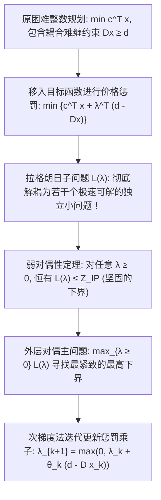

# Lec 3 应用拉格朗日对偶与约束松弛技术 (Applied Lagrange Duality for Constrained Optimization)

> MIT 15.094J 鲁棒系统优化建模与计算 (Systems Optimization: Models and Computation) · 授课教师：Prof. Dimitris Bertsimas / Robert Freund

## TL;DR

- 拉格朗日松弛（Lagrangian Relaxation）通过对复杂约束施加价格惩罚将原问题解耦为独立子问题。
- 弱对偶性为极小化问题提供无条件的刚性下界、精确量化当前启发式解的绝对误差界。
- 次梯度优化（Subgradient Method）与 Polyak 步长法则有效攻克非光滑凸对偶函数寻优。

## 面对“难缠约束”的分而治之智慧

在运筹优化建模中，我们经常遇到这样一类结构：
模型的大部分约束具有极其优美的独立解耦结构（例如各个工厂独立的物料平衡、各个仓库独立的库存上限，这些子问题极其容易求解）；
然而，**少数几条全局性的“耦合约束（Complicating Constraints）”**（例如全集团共享的年度总资金预算、全网共享的单一通信干线带宽）将所有子问题死死捆绑在一起，使得整个模型变成了极度难解的 NP-hard 巨兽。

面对这种困境，运筹学大师们发明了应用数学中最具启发性的解耦技术——**拉格朗日松弛（Lagrangian Relaxation）与对偶理论**。

## 拉格朗日松弛机制与下界原理

考虑通用的困难优化问题（原问题 Primal）：
$$
\begin{aligned}
Z_{\text{IP}} = \min_{x} \quad & c^T x \\
\text{s.t.} \quad & A x \ge b \quad (\text{简单约束: 具有容易求解的特殊组合结构, 如多重背包或网络流}) \\
& D x \ge d \quad (\text{难缠约束: 破坏解耦特性的复杂全局约束}) \\
& x \in \mathcal{X} \subset \mathbb{Z}^n
\end{aligned}
$$

我们不把难缠约束 $D x \ge d$ 作为刚性硬约束强行拦截，而是将它们“松弛”并以价格惩罚的形式移入目标函数：
引入拉格朗日乘子向量（影子惩罚价格）$\lambda \ge 0$。定义**拉格朗日松弛子问题**：
$$
L(\lambda) = \min_{x \in \mathcal{X}, A x \ge b} \left\{c^T x + \lambda^T (d - D x)\right\}
$$
注意到：当 $x$ 违反难缠约束（即 $D x < d \iff d - D x > 0$）时，由于 $\lambda \ge 0$，目标函数将遭受沉重的正向惩罚！

::: theorem [弱对偶定理与万能下界]
对于任意非负乘子向量 $\lambda \ge 0$，拉格朗日松弛子问题的最优值必然小于等于原整数规划的真实最优值：
$$
L(\lambda) \le Z_{\text{IP}}, \quad \forall \lambda \ge 0
$$
:::

**证明极其优雅直观**：
设 $x^*$ 为原问题的真实最优解。由于 $x^*$ 必然满足难缠约束 $D x^* \ge d \implies d - D x^* \le 0$。
由于 $\lambda \ge 0$，乘积 $\lambda^T (d - D x^*) \le 0$。因此：
$$
L(\lambda) = \min_{x \in \text{Feasible}} \{c^T x + \lambda^T (d - D x)\} \le c^T x^* + \lambda^T (d - D x^*) \le c^T x^* = Z_{\text{IP}}
$$
定理得证！

## 拉格朗日对偶问题 (The Lagrangian Dual Problem)

既然对于每一个给定的乘子 $\lambda$，函数 $L(\lambda)$ 都提供了一个合法的下界，那么最自然的追求就是寻找**所有下界中最紧致、最高的那一个**！
这就引出了**拉格朗日对偶问题（Lagrangian Dual）**：
$$
Z_{\text{LD}} = \max_{\lambda \ge 0} L(\lambda)
$$
显然满足：
$$
Z_{\text{LD}} \le Z_{\text{IP}}
$$
若 $Z_{\text{LD}} < Z_{\text{IP}}$，两者之间的正向差额 $\Delta = Z_{\text{IP}} - Z_{\text{LD}}$ 称为**对偶间距（Duality Gap）**。在整数规划中，对偶间距的存在是离散非凸性的天然烙印。

## 次梯度优化算法求解对偶主问题 (Subgradient Optimization)

函数 $L(\lambda)$ 作为一族线性仿射函数的下确界（极小值），在数学上是一个**处处非光滑、带折角的凹函数（Concave Function）**。
传统的微积分导数不存在，我们必须借助凸分析中的**次梯度（Subgradient）**概念。

::: definition [次梯度向量]
设 $x_\lambda^*$ 为当前乘子 $\lambda$ 下解出的松弛子问题最优解。
则向量：
$$
g(\lambda) = d - D x_\lambda^*
$$
是凹函数 $L(\lambda)$ 在点 $\lambda$ 处的合法次梯度，即对任意 $\mu \ge 0$ 恒满足：
$$
L(\mu) \le L(\lambda) + g(\lambda)^T (\mu - \lambda)
$$
:::

### Polyak 步长次梯度迭代法则
算法按照以下迭代格式更新乘子向量：
$$
\lambda_{k+1} = \max\left(0, \lambda_k + \theta_k (d - D x_k^*)\right)
$$
其中步长 $\theta_k$ 采用著名的 **Polyak 步长公式**：
$$
\theta_k = \frac{\alpha_k (\hat{Z}_{\text{UB}} - L(\lambda_k))}{\|d - D x_k^*\|_2^2}
$$
其中 $\hat{Z}_{\text{UB}}$ 为当前已知的最好上界估计，参数 $\alpha_k \in (0, 2]$ 随着迭代无法改进而减半衰减。该算法在紧致凸空间中具有严格的全局收敛保证！

::: pitfall 误以为次梯度是上升方向（Ascent Direction）
初学者常犯的理论错误：误以为次梯度方向 $g(\lambda)$ 必然是一个使函数值单调上升的方向。非光滑优化中次梯度方向**不一定是局部单调上升方向**！它仅仅保证了随着步长趋近于零，迭代点与真正全局最优解 $\lambda^*$ 之间的欧氏空间距离是严格单调缩小的。
:::

::: insight 价格惩罚是去中心化分布式协同的灵魂
拉格朗日对偶不仅是一个计算算法，更是一套极其深刻的去中心化管理哲学：
中央决策者（主问题）根本不需要越俎代庖去替下属每一个部门（子问题）事无巨细地排兵布阵；
**中央只需要根据当前稀缺资源的供需拥堵情况，动态发布一组内部虚拟影子价格 $\lambda$**。各个部门在各自追求自身成本最低的本能驱使下，会自动调整生产策略，使得全系统的资源消耗在宏观上自发逼近全局社会福利的最优点。
:::
