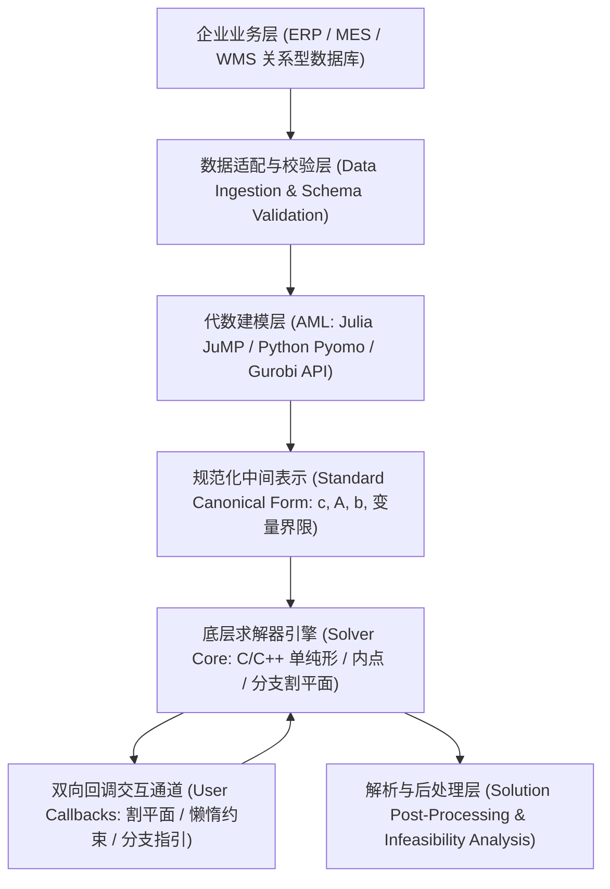

# Lec 4 系统优化软件架构与计算实践例程 (Optimization Software Architecture & Routines)

> MIT 15.094J 鲁棒系统优化建模与计算 (Systems Optimization: Models and Computation) · 授课教师：Prof. Dimitris Bertsimas / Robert Freund

## TL;DR

- 现代代数建模语言（AML，如 JuMP / Pyomo）实现了数学模型与底层求解引擎的完全解耦。
- 矩阵向量化构建与稀疏指针三元组（CSR/CSC）是构建大规模高性能模型的关键规范。
- 回调函数（Callbacks）为分支割平面、懒惰约束注入与启发式热启动提供了底层交互通道。

## 从黑板公式到万行工程代码的蜕变

在学术论文与教科书中，运筹优化通常以紧凑优美的数学公式呈现：
$$
\min \{c^T x : A x \le b, x \in \{0, 1\}^n\}
$$
然而，当一位资深软件架构师试图在跨国企业的高并发生产系统中落地这套模型时，必须直面极为繁重的**软件工程与计算系统架构挑战**：
- 底层生产数据库（PostgreSQL / Snowflake）中存在数千万条工单记录，如何以毫秒级的速度将其装配为求解器内存结构，避免出现数据搬运耗时远超求解耗时的尴尬局面？
- 如何在不重写核心业务逻辑的前提下，无缝在商业闭源求解器（Gurobi / CPLEX）与开源学术求解器（HiGHS / SCIP）之间平滑热切换？
- 如何在求解器内部遍历搜索树的毫秒瞬间，动态拦截并注入特定领域的业务经验（懒惰约束 Lazy Constraints 与启发式解热启动 Warm-Start）？

麻省理工学院 15.094J 专门开辟实战架构专题，解构现代**代数建模系统（Algebraic Modeling Languages, AML）**与大型求解器底层 C/C++ API 的工程契约。

## 现代优化系统的三层分层解耦架构

任何工业级现代运筹系统的软件工程架构，都应当遵循严谨的职责分离（Separation of Concerns）。在企业级架构实践中，模型开发往往面临快速迭代与高性能执行的双重矛盾：数据科学家与算法研究员习惯于在交互式环境中探索数学表述，追求极高抽象层级的代数可读性；而生产环境的工程服务则必须直面吞吐量、垃圾回收停顿（GC Pauses）与跨语言调用开销（FFI Overhead）。

若直接将业务逻辑硬编码进底层求解器的 C API 专有接口中，会导致模型与特定求解器供应商形成深度锁定，且一旦业务规则微调，就需要重写底层的指针数组逻辑。现代工业运筹架构通过建立标准化的代数建模中间层，在人类可读的高阶建模语言与底层极致优化的稀疏计算核心之间构筑起清晰的三层分水岭：

在这套清晰的分层架构中，系统通过明确的数据契约完成高内聚与低耦合：
1. **企业业务与数据适配层（Data Layer）**：负责从关系型数据库、数据湖与流计算平台抽取原始订单与传感器时序数据，完成缺失值填补、异常值剔除与强类型结构体序列化，生成标准化的业务数据传输对象（DTO），确保进入运筹内核的数据满足严格的定义域要求；
2. **代数建模抽象层（Algebraic Modeling Layer）**：利用 JuMP、Pyomo 等现代建模系统，以符号化代数语法声明决策变量、目标函数与约束多面体，在内存中自动构建抽象语法树（AST），并将其无缝编译为求解器中立的标准规范型（Canonical Form）；
3. **底层求解引擎与双向回调总线（Solver Core & Callbacks）**：通过高性能 C-ABI 绑定将编译后的稀疏矩阵直接送入底层求解内核，同时在分支定界与内点迭代的关键生命周期节点上，通过非阻塞回调插槽向外暴露拦截接口，允许高层业务策略在微秒级别动态注入特定领域的割平面与局部启发式解。

## 稀疏矩阵内存布局：CSR 与 CSC 结构

在底层求解器内部，绝对禁止使用二维原生数组 `double A[m][n]` 存储约束矩阵，必须采用高效的**压缩稀疏列（Compressed Sparse Column, CSC）**或**压缩稀疏行（CSR）**格式。

以 CSC 格式为例，一个包含 $nnz$ 个非零元的稀疏矩阵仅由三个极紧凑的一维数组完全表达：
- `colptr`（长度 $n+1$）：记录每一列在非零元数组中的起始与终止偏移索引；
- `rowval`（长度 $nnz$）：记录每个非零元对应的实际行号；
- `nzval`（长度 $nnz$）：记录非零元对应的浮点双精度数值。

在构建百万维模型时，如果程序员通过循环逐个单元格追加约束 `model.add_constraint(x[i] + ...)`，会导致内存发生严重的二次方复制；**正确的架构规范必须采用向量化批处理构建（Vectorized Matrix Assembly）**，直接向求解器管道泵入 CSC 数组！

## 工业级高阶特性：回调函数机制 (Solver Callbacks)

现代求解器最强大的高级开发接口是**用户回调函数（User Callbacks）**。
在分支定界树搜索过程中，求解器会周期性地暂停底层 C++ 线程，将当前节点的控制权交还给用户的自定义业务逻辑：

::: definition [三大核心回调触发钩子]
1. **懒惰约束注入（Lazy Constraints Callback）**：
在旅行商问题（TSP）或车辆路径问题（VRP）中，子回路消除约束（Subtour Elimination Constraints）具有指数级规模（$2^n$ 条），不可能预先全部加入模型。
通过设置懒惰约束回调：**模型在初始阶段一条子回路约束都不加；只有当求解器在某个节点求出一个整数解时，回调函数才被唤醒，瞬时运行一次多项式时间的最小割（Min-Cut）算法检测是否存在子回路；若存在，则仅将违规的那一条子回路约束精准追加进求解器内存！**
2. **割平面分离回调（User Cut Callback）**：
当连续 LP 松弛求出一个分数解时，注入基于业务特殊结构的多面体有效不等式，强行收紧局部多面体；
3. **启发式可行解注入（Heuristic Callback）**：
在树搜索过程中，将当前分数解送入领域局部搜索算法（如第 10 讲学到的 LNS 启发式），一旦找到更优的纯整数解，立即通过回调通道将其作为新的全局下界（Incumbent）回传给求解器，瞬间引发全树大面积剪枝！
:::

::: pitfall 忽视模型不可行时的 IIS 自动诊断
在生产系统中，外部输入数据的微小异常极易导致模型报告 `INFEASIBLE`（无可行解）。平庸的程序会直接向用户抛出异常崩溃；工业级架构必须在捕获不可行状态后，自动触发**不可行不可约子集算法（Irreducible Inconsistent Subsystem, IIS）**，精准定位究竟是哪两条物理约束发生了冲突，并以业务友好的自然语言提示调度员。
:::

::: insight 优秀的代码架构让数学算法真正具备长青的生命力
一个优秀的运筹模型绝不是一次性的科研原型脚本。
**它必须像现代操作系统的内核一样，具备严密的分层解耦、标准化的数据流管道与高扩展性的回调插槽**。唯有建立在健壮软件工程之上的优化系统，才能在跨国企业的高并发生产环境中稳定运转数十年，承载千亿产值的实时调度决策。
:::
