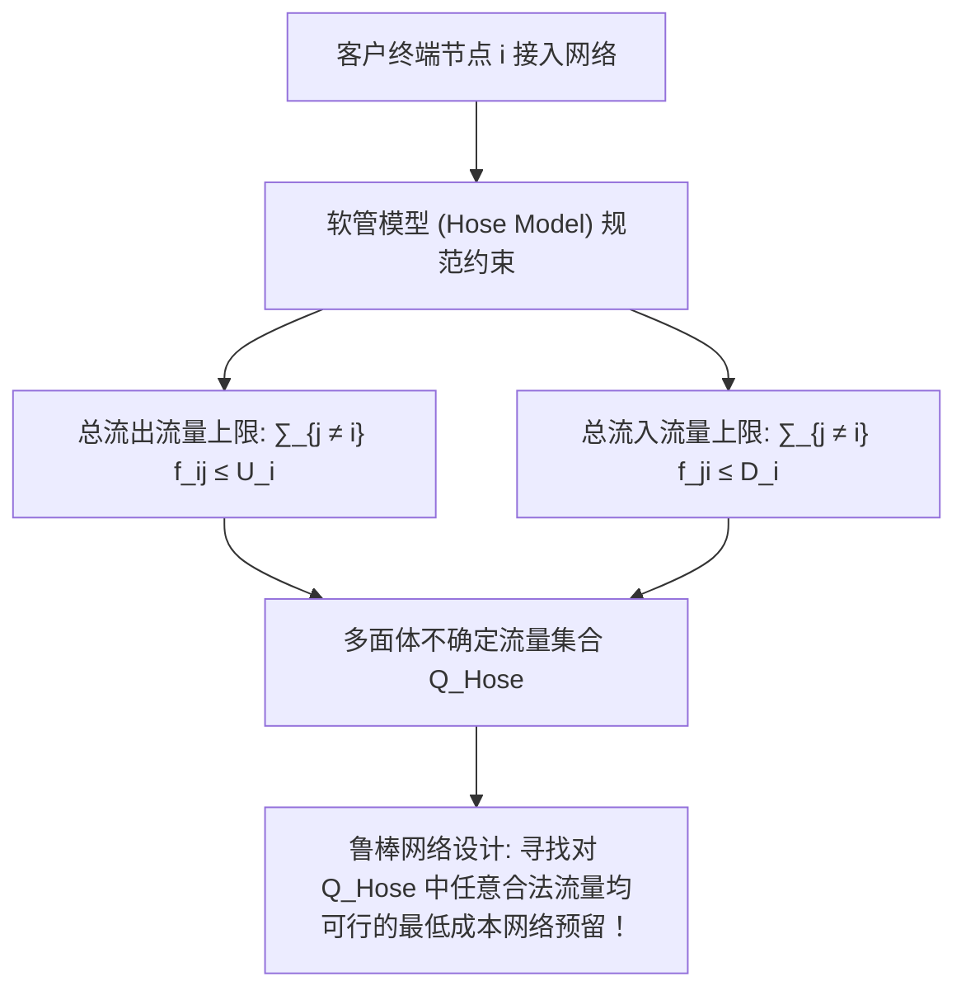

# Lec 5 电信网络拓扑设计：最低成本可靠 VPN 嵌入 (Telecommunications: Minimum-Cost VPN Embeddings)

> MIT 15.094J 鲁棒系统优化建模与计算 (Systems Optimization: Models and Computation) · 授课教师：Prof. Dimitris Bertsimas / Robert Freund

## TL;DR

- 虚拟专用网络（VPN）嵌入问题在共享物理底层物理链路上优化逻辑拓扑的带宽预留。
- 软管模型（Hose Model）克服了传统点对点流量矩阵不可测的现实瓶颈。
- 混合整数树形路由（Tree Routing）与多商品流约束展现了拓扑连通性与容量瓶颈的协同求解。

## 全球数字化互联的物理与逻辑拓扑映射

现代互联网、跨国企业专网与云计算数据中心的基础设施，建立在一套高度复杂的双层网络架构之上：
1. **底层物理承载网络（Substrate Physical Network）**：由埋设在地下的光纤电缆、海底光缆、DWDM 波分复用设备与核心物理路由器构成的复杂图拓扑；
2. **上层逻辑虚拟网络（Virtual Private Networks, VPN）**：跨国企业租户或云客户申请建立的逻辑通信拓扑（例如连接纽约总部、伦敦分部与东京研发中心的端到端保密通信管道）。

**虚拟专用网络嵌入问题（VPN Embedding Problem）**的核心任务是：
在满足客户动态通信服务等级协议（SLA）带宽保证与高可靠性容灾要求的前提下，**如何将一组逻辑租户请求，以全网最低的链路铺设与带宽预留成本，映射嵌入到底层物理网络之中？**

## 软管模型与不确定流量矩阵 (The Hose Model)

在传统网络规划中，工程师假设已知任意两个端点 $(u, v)$ 之间的精确点对点通信流量矩阵 $f_{uv}$。
然而在现实互联网中，用户访问具有极强的突发性与不可预测性，要求企业提供静态点对点流量矩阵是极其不切实际的。

1999 年 Duffield 等人提出了革命性的**软管模型（Hose Model）**：
客户不再需要声明复杂的端对端点对点矩阵，只需为每个接入终端节点 $i \in \mathcal{P}$ 声明其接入网络的**总上行带宽上限 $U_i$（Ingress Bandwidth）**与**总下行带宽上限 $D_i$（Egress Bandwidth）**：

合法流量矩阵集合构成一个紧致的**多面体不确定集**：
$$
\mathcal{Q}_{\text{Hose}} = \left\{f \ge 0 : \sum_{j \in \mathcal{P}, j \ne i} f_{ij} \le U_i, \quad \sum_{j \in \mathcal{P}, j \ne i} f_{ji} \le D_i, \quad \forall i \in \mathcal{P}\right\}
$$
网络规划的核心使命：在物理网络上为各链路预留容量 $C_e$，使得**对于多面体 $\mathcal{Q}_{\text{Hose}}$ 中的任意合法流量需求，物理网络都能无阻塞畅通路由！**

## 树形路由拓扑的数学规划模型 (Tree Routing)

在电信工程中，为了避免在路由器中维护海量复杂的逐流路由表，各大运营商普遍偏好**树形路由（Tree Routing）**：
即整个虚拟专用网络的所有终端节点，通过底层物理网络中的一棵**生成树（Steiner Tree）**进行无圈通信。在树形拓扑中，任意两点之间的路由路径是唯一的！

设物理网络为无向图 $G = (V, E)$，终端终端节点子集为 $\mathcal{P} \subset V$。
物理链路 $e \in E$ 的单位带宽租赁/铺设成本为 $c_e$。

设树的拓扑由 0-1 变量 $y_e \in \{0, 1\}$ 表示（$y_e = 1$ 表示链路 $e$ 被纳入 VPN 生成树）。
在树形拓扑中，移除任意一条树边 $e$，生成树将被瞬间分割为两个不相交的连通分支：记包含终端节点的子集分别为 $\mathcal{P}_1(e)$ 与 $\mathcal{P}_2(e) = \mathcal{P} \setminus \mathcal{P}_1(e)$。

根据软管模型，穿过链路 $e$ 的最大可能恶劣流量，发生在一个子集的所有节点全力向另一个子集的所有节点发送数据的时刻：
$$
F_{\text{max}}(e) = \min\left(\sum_{i \in \mathcal{P}_1(e)} U_i, \quad \sum_{j \in \mathcal{P}_2(e)} D_j\right)
$$
因此，链路 $e$ 必须预留的最小安全物理带宽为：
$$
C_e \ge F_{\text{max}}(e) \cdot y_e
$$

总成本优化混合整数规划为：
$$
\begin{aligned}
\min_{y, C} \quad & \sum_{e \in E} c_e C_e \\
\text{s.t.} \quad & \text{边集合 } \{e \in E : y_e = 1\} \text{ 构成覆盖所有终端 } \mathcal{P} \text{ 的连通无圈子图} \\
& C_e \ge \min\left(\sum_{i \in \mathcal{P}_1(e)} U_i, \sum_{j \in \mathcal{P}_2(e)} D_j\right) y_e, \quad \forall e \in E \\
& y_e \in \{0, 1\}, \quad C_e \ge 0
\end{aligned}
$$

## 树形连通性割集约束与多源流等价

如何用线性不等式严密表达“图是连通的且覆盖所有终端点”？
经典的方法是引入**有向割集不等式（Directed Cut Formulation）**：
将无向图双向有向化。选取某一个固定的终端节点 $r \in \mathcal{P}$ 作为根节点（Root）。
要求从根节点 $r$ 到任意其他终端节点 $t \in \mathcal{P} \setminus \{r\}$，必须存在至少一条连通路径：
对于任意将 $r$ 与 $t$ 分离的空间割集 $S \subset V$（满足 $r \in S, t \in V \setminus S$）：
$$
\sum_{e \in \delta^+(S)} y_e \ge 1
$$
由于割集的数量是关于节点数指数级膨胀的（$2^{|V|}$ 个），在计算求解时，必须直接调用我们在第 4 讲建立的**懒惰约束回调（Lazy Constraint Callback）**：在搜索过程中动态运行最大流/最小割算法进行按需割分离！

::: pitfall 忽视单点光纤切断容灾（Single Link Failure）
树形拓扑的最大死穴在于**缺乏拓扑冗余**：树上的任何一条光纤被挖掘机挖断，整个 VPN 将瞬间被劈成两半发生全网通信中断。高可靠性电信设计必须升级为**双连通网络设计（2-Connected / Survivable Network Design）**，强制要求任意两点间存在两条物理不相交的保护备用路由（1+1 保护倒换）。
:::

::: insight 鲁棒软管模型消灭了盲目预测的执念
传统网络工程师竭尽全力去预测“明天下午 3 点用户会发送多少兆字节”，结果永远被网络拥塞打脸；
软管模型与运筹规划展现了一种更高阶的抽象之美：**它不关心微观点对点流量的具体数值，而是把不确定性封装为一个凸多面体，并在多面体极值的最坏情况下设计出具备天然抗震阻尼的物理骨架**。这种以不变应万变的鲁棒拓扑，是现代全球互联网架构的基石。
:::
