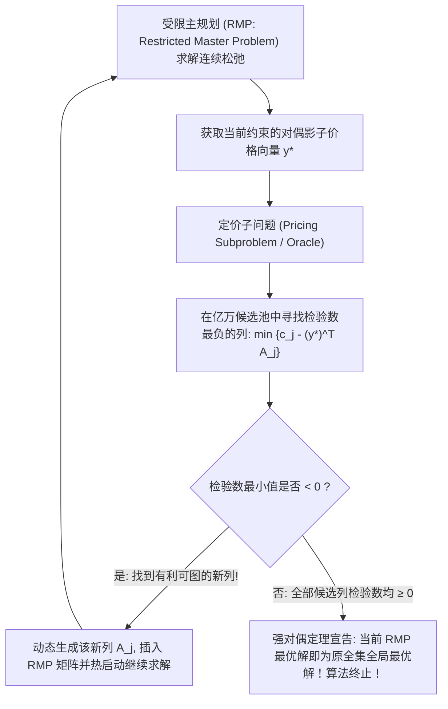

# Lec 6 大规模列生成算法基础与 Dantzig-Wolfe 分解原理 (Column Generation Foundations)

> MIT 15.094J 鲁棒系统优化建模与计算 (Systems Optimization: Models and Computation) · 授课教师：Prof. Dimitris Bertsimas / Robert Freund

## TL;DR

- 列生成算法（Column Generation）彻底打破变量数过多导致内存爆炸的维度灾难。
- 受限主规划（RMP）与定价子问题（Pricing Subproblem）通过检验数负性建立动态通信。
- 经典卷材下料问题（Cutting-Stock Problem）展现了列生成相对暴力大 M 模型的绝对秒杀优势。

## 当变量数量超越宇宙粒子总数

在传统的线性规划思维中，我们习惯于在建模初始阶段，就将模型所有的决策变量 $x_1, x_2, \dots, x_n$ 全部声明并放入矩阵中。
然而，在许多世界级的大规模运筹问题中（例如航空公司机组人员排班 Airline Crew Scheduling、卷材下料切割 Cutting Stock、大规模车辆路径规划 VRP）：
**潜在的可行路径或生产模式（Patterns）的数量，是随系统规模呈指数级甚至是阶乘级爆炸的！**
变量的个数可能高达 $10^{15}$ 甚至 $10^{30}$。我们根本不可能将全部变量列显式加载进任何超级计算机的内存之中。

1958 年与 1960 年，乔治·丹齐格（George Dantzig）与菲利普·沃尔夫（Philip Wolfe）建立了现代大规模优化历史上最璀璨的丰碑——**Dantzig-Wolfe 分解原理与延迟列生成算法（Delayed Column Generation）**。

## 核心哲学：绝大多数变量在最优解中终身沉睡

列生成的核心洞察极其深刻而实用：
虽然理论上有几十亿个潜在的决策变量，但根据线性规划基本定理，**最优基可行解（BFS）中至多只有 $m$ 个基变量严格为非零实数**（$m$ 为约束行数，通常仅为几百到几千级别）！
这意味着：**有超过 99.999999% 的变量列，在最优解中根本就不会被使用，其取值始终为 0！**

既然它们终身都不会被用到，我们何必从一开始就费尽心机去生成它们？
我们只需要在模型中保留一个极小规模的“活跃变量子集”，只在算法真正需要某一列时，再“按需生成”该列！

## 列生成的数学架构两步走

### 1. 受限主规划 (Restricted Master Problem, RMP)
设原问题包含指数级变量列全集 $\mathcal{J}$。我们仅选取一个很小的初始可行子集 $\mathcal{J}_{\text{sub}} \subset \mathcal{J}$（甚至只包含几条人工列）：
$$
\begin{aligned}
\min \quad & \sum_{j \in \mathcal{J}_{\text{sub}}} c_j x_j \\
\text{s.t.} \quad & \sum_{j \in \mathcal{J}_{\text{sub}}} A_j x_j = b \quad (\text{对偶变量 } y) \\
& x_j \ge 0, \quad \forall j \in \mathcal{J}_{\text{sub}}
\end{aligned}
$$
求解该小规模 RMP，输出当前的最优对偶解向量 $y^*$。

### 2. 定价子问题 (Pricing Subproblem)
根据单纯形法最优性准则，只有当某个非基变量的检验数（Reduced Cost）严格为负时，将其引入基中才能继续降低目标成本：
$$
\bar{c}_j = c_j - (y^*)^T A_j < 0
$$
我们无需遍历所有列，而是**将寻找“检验数最负的列”本身构建为一个独立的子优化问题**！
设一个通用列向量 $A_j$ 由内部组合规则 $z \in \mathcal{Z}$ 决定：
$$
\min_{z \in \mathcal{Z}} \quad \bar{c}(z) = c(z) - (y^*)^T A(z)
$$
- 若求出的最小目标值 $\bar{c}_{\min} < 0$：该子问题输出的最优解 $z^*$ 精确对应了一列“具有极大降本潜力”的新列！立即将其加入 $\mathcal{J}_{\text{sub}}$；
- 若求出的最小目标值 $\bar{c}_{\min} \ge 0$：这以无可辩驳的数学逻辑向我们证明：**在外部未生成的几亿个沉睡变量中，没有任何一列能够继续改善当前目标**！当前 RMP 的最优解必然已经是全集全局最优解！

## 经典丰碑案例：Gilmore-Gomory 卷材下料优化 (Cutting Stock)

某大型造纸厂生产宽度固定为 $W = 100$ 英寸的标准母卷钢卷或原纸。客户订购了以下宽度的较窄子卷规格：
- 需求 1：宽度 45 英寸，需要 90 卷；
- 需求 2：宽度 36 英寸，需要 120 卷；
- 需求 3：宽度 16 英寸，需要 210 卷。
如何决定大卷的切割下料模式（Patterns），以使用最少数量的标准母卷？

一个合法的切割模式向量 $a = (a_1, a_2, a_3)^T$ 必须满足宽度物理限制：
$$
45 a_1 + 36 a_2 + 16 a_3 \le 100, \quad a_i \in \mathbb{Z}_{\ge 0}
$$
潜在的切割组合模式有成千上万种。
在列生成框架下：
- **RMP 主问题**：在当前几种切割模式中决定各模式的使用张数，输出对偶价格 $y_1^*, y_2^*, y_3^*$；
- **定价子问题**：寻找使检验数最负的切割模式：
$$
\min \quad 1 - \sum_{i=1}^3 y_i^* a_i \iff \max_{a} \quad \sum_{i=1}^3 y_i^* a_i
$$
$$
\text{s.t.} \quad 45 a_1 + 36 a_2 + 16 a_3 \le 100, \quad a_i \in \mathbb{Z}_{\ge 0}
$$
**定价子问题竟然是一个极其经典的单背包问题（Knapsack Problem）！**
背包问题的容量为母卷总宽 100，各物品的“价值”恰恰是主问题传过来的对偶影子价格 $y_i^*$！利用动态规划（DP），子问题在微秒级内即可秒解出最优新切割模式。

::: pitfall 忽视列生成在整数规划中的分支难题（Branch-and-Price）
注意：列生成直接求解的是连续松弛。如果要求解纯整数解，绝不能直接对 RMP 的分数解做四舍五入。如果在传统变量 $x_j$ 上分支（例如强制 $x_j = 0$），会彻底破坏定价子问题的背包结构！必须在原始物理物理维度上分支（例如 Ryan-Foster 变量配对分支法则），引出**分支割平面列定价（Branch-Cut-and-Price）**高阶体系。
:::

::: insight 列生成将维度灾难化解为优雅的对偶对话
面对指数级爆炸的高维空间，凡人的本能是感到恐惧与绝望；
而 Dantzig-Wolfe 列生成算法展现了顶尖数学家举重若轻的非凡智慧：**它在主规划的“宏观资源出清”与子问题的“微观最优模式生成”之间，建立了一场极其优美的对偶对话**。主问题用影子价格为世界定价，子问题用动态规划回应最优供给，双方交替迭代，在极少轮次内征服看似不可攀登的算力绝壁。
:::
