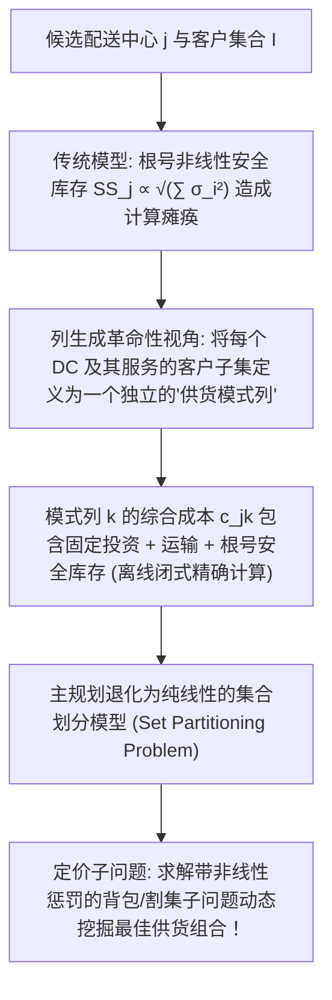

# Lec 7 列生成进阶应用：随机运输-库存联合网络设计 (Column Generation in Stochastic Networks)

> MIT 15.094J 鲁棒系统优化建模与计算 (Systems Optimization: Models and Computation) · 授课教师：Prof. Dimitris Bertsimas / Robert Freund

## TL;DR

- 随机运输-库存联合设计（LIRP）将网络拓扑选址、干线运输与安全库存高度耦合。
- 非线性平方根安全库存项通过割线逼近与模式列定义实现凸性解耦。
- Shu-Shen-Teo 经典列生成框架在超大规模多级物流网络中实现了高效工业求解。

## 供应链网络设计的终极圣杯：LIRP 难题

在传统的供应链战略规划中，企业往往将三大核心职能人为割裂开来：
1. **网络选址（Facility Location）**：基建战略团队决定在哪座城市建设配送中心（DC）；
2. **干线运输路由（Transportation & Routing）**：物流车队根据已建成的 DC 规划卡车配送路线；
3. **安全库存控制（Inventory Optimization）**：仓储团队在各 DC 独立计算安全库存（Safety Stock）。

然而，麻省理工学院运筹学中心（ORC）与现代供应链理论（Shu, Shen, Teo, Operations Research, 2005）深刻指出：
**这三者在物理上存在极度强烈的非线性相互耦合与冲突！**
- 若建设极少量的集中式大型 DC：虽然充分享受了**风险汇聚效应（Risk Pooling）**，全网安全库存总额大幅削减（服从 $\sqrt{N}$ 规模报酬递减）；但 DC 距离终端客户极其遥远，导致后道末端干线运输配送成本暴增！
- 若建设大量分散的小型前置仓 DC：虽然末端运费极低、客户响应飞快；但全网安全库存碎片化分布，资金占用急剧飙升！

**随机选址-库存-路由联合网络设计问题（Location-Inventory-Routing Problem, LIRP）**旨在全局协同求解这一非线性复杂巨系统。

## LIRP 模型的非线性数学挑战

设存在候选分拨中心集合 $\mathcal{J}$，终端客户零售商集合 $\mathcal{I}$。
客户 $i$ 的需求服从均值为 $\mu_i$、方差为 $\sigma_i^2$ 的独立随机分布。补货提前期为 $L$。
若零售商子集 $\mathcal{I}_j \subset \mathcal{I}$ 被指派给分拨中心 $j$ 供货：
根据中央极限定理，配送中心 $j$ 面临的总汇聚需求均值与方差为：
$$
\mu_{(j)} = \sum_{i \in \mathcal{I}_j} \mu_i, \quad \sigma_{(j)}^2 = \sum_{i \in \mathcal{I}_j} \sigma_i^2
$$
为了保障 $95\%$ 的服务水平，分拨中心 $j$ 必须持有的**安全库存量（Safety Stock）**为非线性的**平方根函数**：
$$
\text{SS}_j = z_\alpha \sqrt{L \sum_{i \in \mathcal{I}_j} \sigma_i^2}
$$
注意：这一项关于指派决策变量呈现出高度非线性的**非线性平方根耦合（Square-Root Term）**！普通的混合整数规划求解器面对包含数百个根号项的超大规模离散模型会直接瘫痪。

## 列生成模式重构 (Pattern-Based Column Generation)

Shu、Shen 与 Teo 提出了震撼业界的**模式列解耦重构**：
我们不再在模型中保留微观的客户指派变量与根号项，而是将**“一个特定配送中心 $j$ 及其服务的一组特定客户子集 $S \subset \mathcal{I}$”直接打包定义为一个整体的供货模式（Delivery Pattern / Cluster $k$）**！

对于任意一个候选模式列 $k = (j, S)$：
其真实的综合成本 $C_{jk}$ 可以在子问题中**离线预先精确算清**，完全规避了在线非线性求导：
$$
C_{jk} = F_j + \sum_{i \in S} \text{TransCost}(j, i) + z_\alpha \sqrt{L \sum_{i \in S} \sigma_i^2}
$$
定义 0-1 矩阵系数 $a_{ik} = 1$（若模式 $k$ 覆盖了客户 $i$）。
全网主规划（Master Problem）瞬间退化为一个极其纯净、优美的**集合划分线性规划（Set Partitioning Problem）**：

$$
\begin{aligned}
\min \quad & \sum_{j \in \mathcal{J}} \sum_{k \in \mathcal{K}_j} C_{jk} x_{jk} \\
\text{s.t.} \quad & \sum_{j \in \mathcal{J}} \sum_{k \in \mathcal{K}_j} a_{ik} x_{jk} = 1, \quad \forall i \in \mathcal{I} \quad (\text{每个客户必须且仅能由一个模式服务}) \\
& \sum_{k \in \mathcal{K}_j} x_{jk} \le 1, \quad \forall j \in \mathcal{J} \quad (\text{每个 DC 至多只能选择一种供货模式}) \\
& x_{jk} \ge 0
\end{aligned}
$$

## 定价子问题的非线性凹极值破解

设主问题对应客户覆盖约束的对偶影子价格为 $\pi_i$。
对于某个固定的分拨中心 $j$，寻找检验数最负的新模式列，对应求解以下子问题：
$$
\min_{S \subset \mathcal{I}} \quad \bar{c}_j(S) = F_j + \sum_{i \in S} (c_{ji} - \pi_i) + z_\alpha \sqrt{L \sum_{i \in S} \sigma_i^2}
$$
虽然目标函数带有凹平方根函数，但由于客户数量有限：
- 可以通过**二分搜索（Bisection）结合拉格朗日乘子法**，将平方根项参数化转化；
- 或者通过将方差离散化为若干个能级区间，在每一个区间内将平方根局部线性化，从而将子问题转化为极速可解的经典背包问题！

一旦子问题返回一个检验数小于零的新客户组合集合 $S^*$，立即生成一列新的 $a_{ik}$ 压入受限主规划（RMP）。实际算例表明：对于覆盖全美 500 个城市节点的超大规模网络，算法仅需在几百次列生成迭代内，即可输出经过严格证明的 $1\%$ 误差界以内全局最优解！

::: pitfall 忽视分拨中心物理最大吞吐能力上限
如果模型没有对子集模式施加总吞吐量上限约束 $\sum_{i \in S} \mu_i \le \text{Cap}_j$，列生成子问题可能会倾向于把几百个客户全部打包进同一个模式中，导致生成的 DC 在物理现实中因占地面积不足而无法运作。必须在子问题中刚性嵌入背包容量约束。
:::

::: insight 模式重构是将高维非线性封印于离散微元的绝技
面对非线性与组合爆炸双重夹击时，很多工程师束手无策；
MIT 的列生成实践展示了运筹学大师级的架构技巧：**通过将非线性物理项连同局部网络拓扑一起“打包封装”为一列离散模式，所有棘手的非凸与根号项全部在子问题内部被静态吸收，而在宏观层面留下的则是一个拥有无限扩展力的纯线性集合划分矩阵**。这种化整为零、因式分解的数学哲学，代表了系统优化科学的最高境界。
:::
