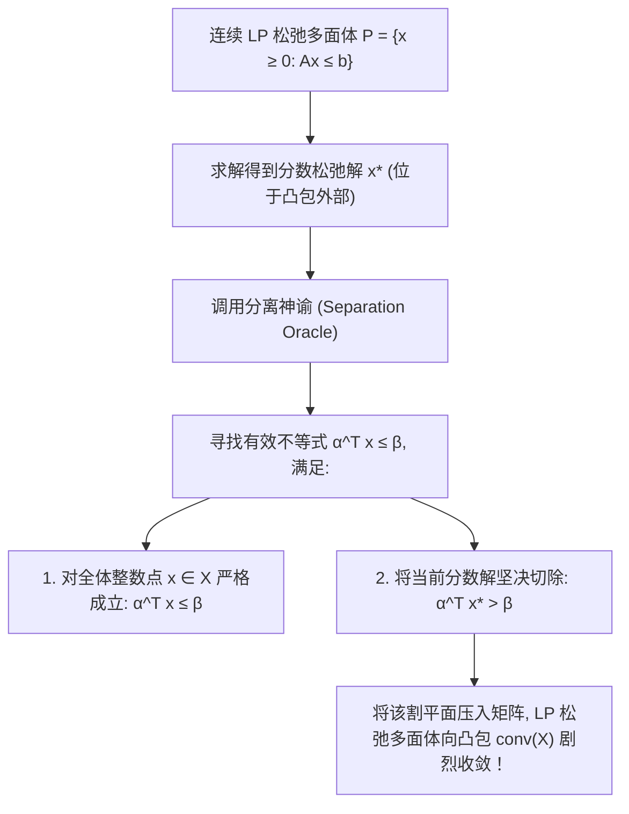

# Lec 8 大规模整数规划与有效不等式生成 (Large-Scale Integer Programming & Valid Inequalities)

> MIT 15.094J 鲁棒系统优化建模与计算 (Systems Optimization: Models and Computation) · 授课教师：Prof. Dimitris Bertsimas / Robert Freund

## TL;DR

- 有效不等式（Valid Inequalities）在不误杀任何可行整数点的前提下极致收紧多面体松弛凸包。
- Chvátal-Gomory 割与最大权覆盖割（Knapsack Covers）通过分离神谕（Separation Oracle）多项式生成。
- 现代工业 MIP 求解器通过多层有效割平面组合将大型调度与选址问题的求解效率提升万倍。

## 从单纯枚举到多面体组合学的维度飞跃

在处理大规模工业混合整数规划（MIP）时，初学者往往陷入一种误区：以为求解速度的提升完全依赖于计算机 CPU 主频的提高与分支定界树的多线程并发能力。

然而，运筹优化界权威统计表明：在过去三十年中，MIP 求解速度实现了超过 **$10^7$ 倍（千万倍）**的惊天加速！
在这千万倍的算力飞跃中，计算机硬件性能提升的贡献仅占约 $10^3$ 倍；
而**真正贡献了超过 $10^4$ 倍巨幅加速的，是算法理论的突破——尤其是多面体组合学（Polyhedral Combinatorics）与有效不等式（Valid Inequalities / Cutting Planes）的深度研发！**

麻省理工学院 15.094J 大规模整数规划模块，系统解析如何从业务模型的代数肌理中，自动分离出最紧致的半空间切片。

## 有效不等式的几何公理定义

设整数规划的可行整数点集合为：
$$
X = \{x \in \mathbb{Z}^n : A x \le b\}
$$
其在连续欧氏空间中的凸闭包记为 $\text{conv}(X)$（Convex Hull）。
根据多面体理论，$\text{conv}(X)$ 是一个具有有限个面（Facets）的真正凸多面体。**如果我们能预先写出构成 $\text{conv}(X)$ 的所有全套面超平面方程，那么整数规划就可以直接作为一个普通的连续线性规划一次性秒解！**

然而，描绘完整凸包通常需要指数级的约束方程。因此，现代运筹学的战术是：**按需生成有效不等式**。

::: definition [有效不等式 (Valid Inequality)]
一个线性不等式 $\alpha^T x \le \beta$ 称为集合 $X$ 的**有效不等式**，若对所有 $x \in X$，该不等式均恒成立。
若该有效不等式所诱导的超平面与 $\text{conv}(X)$ 相交的维数达到 $\dim(\text{conv}(X)) - 1$，则称该不等式构成了凸包的一个**极大面（Facet-Defining Inequality）**，具有最强的代数剪切力！
:::

## 经典有效不等式家族

在现代求解器（如 Gurobi、CPLEX）内部，驻留着数十个高度专业的自动割平面分离器：

### 1. 背包覆盖割 (Knapsack Cover Inequalities)
考虑 0-1 背包约束：$\sum_{j \in N} a_j x_j \le b$，$x_j \in \{0, 1\}$。
若存在一个指标子集 $C \subset N$，满足其系数之和严格超过背包容量：
$$
\sum_{j \in C} a_j > b
$$
则集合 $C$ 被称为一个**覆盖（Cover）**。
显然，由于所有变量只能取 0 或 1，我们绝不可能同时选中集合 $C$ 中的所有物品！
由此立即推导出极为强大的**覆盖不等式**：
$$
\sum_{j \in C} x_j \le |C| - 1
$$
若对于集合 $C$ 中的任意单个元素 $k$，移除后均不再构成覆盖（$\sum_{j \in C \setminus \{k\}} a_j \le b$），则称 $C$ 为**极小覆盖（Minimal Cover）**。通过**序列提升（Sequential Lifting）**技术，极小覆盖割可以被无损升级为支撑凸包的极大面！

### 2. 流覆盖割 (Flow Cover Inequalities)
在供应链网络与多设施选址中，普遍存在形如 $x_j \le M_j y_j$ 的大 M 门禁约束。
流覆盖割通过组合多条流入流出弧，将大 M 约束与连续流量守恒联运，直接推导出切除分数门禁变量的紧致凸割，彻底消灭大 M 带来的下界软瘫。

### 3. 混合整数舍入割 (Mixed-Integer Rounding, MIR)
对于包含连续变量与整数变量的通用混合约束：
$$
x + s \ge b, \quad x \in \mathbb{Z}, \quad s \ge 0
$$
设 $f_0 = b - \lfloor b \rfloor \in (0, 1)$。MIR 基础函数定理证明了以下不等式对全体可行解有效：
$$
x + \frac{1}{1 - f_0} s \ge \lceil b \rceil
$$
MIR 割是目前工业求解器中击碎连续松弛分数解最锋利的普适通义大杀器。

## 分离神谕与多项式等价性 (The Separation Problem)

如何判断当前的分数解 $x^*$ 是否可以被某个有效不等式切除？
这在计算复杂性理论中对应著名的**分离问题（Separation Problem）**：
- 给定点 $x^*$，判定 $x^* \in \text{conv}(X)$ 是否成立；
- 若不成立，寻找一个超平面 $(\alpha, \beta)$ 使得 $\alpha^T x \le \beta$ 对所有 $x \in X$ 成立，但 $\alpha^T x^* > \beta$。

::: theorem [Grötschel-Lovász-Schrijver 优化与分离等价定理 (GLS Theorem, 1981)]
利用椭球法（Ellipsoid Method）可以严格证明：
**一个多面体族上的线性优化问题在多项式时间内可解，当且仅当其对应的分离问题在多项式时间内可解！**
:::
这一定理确立了现代整数规划的核心方法论：**只要我们能为某种特殊结构的有效不等式设计出快速的多项式分离算法，我们就能在多项式时间内将其全部割平面能量毫无保留地注入大规模求解引擎之中！**

::: pitfall 盲目加入高稠密割平面导致数值条件数恶化
并不是割得越狠越好。若分离出的割平面系数范围极大（例如既有 $10^5$ 又有 $10^{-4}$），将其加入基矩阵会导致条件数（Condition Number）恶化至 $10^{14}$ 以上，单纯形法会频繁出现数值溢出与奇异基（Singular Basis）。商业求解器对割平面的正交性、稀疏度与数值动态范围有着极其严苛的工程筛选门禁。
:::

::: insight 凸包是离散世界在连续几何中的终极投影
整数规划的困难，源于离散格点构成的可行域打破了微积分的连续平滑性。
而多面体组合学与有效不等式的伟大，在于它向世人证明：**人类无需在黑暗的离散迷宫中盲目摸索；通过一道道精巧的有效不等式割平面，我们可以在离散点阵的外围，为其严丝合缝地打造出一座宛如水晶般剔透的连续凸多面体外壳**。这种以连续征服离散的数学美感，是 20 世纪运筹学最辉煌的智力勋章。
:::
