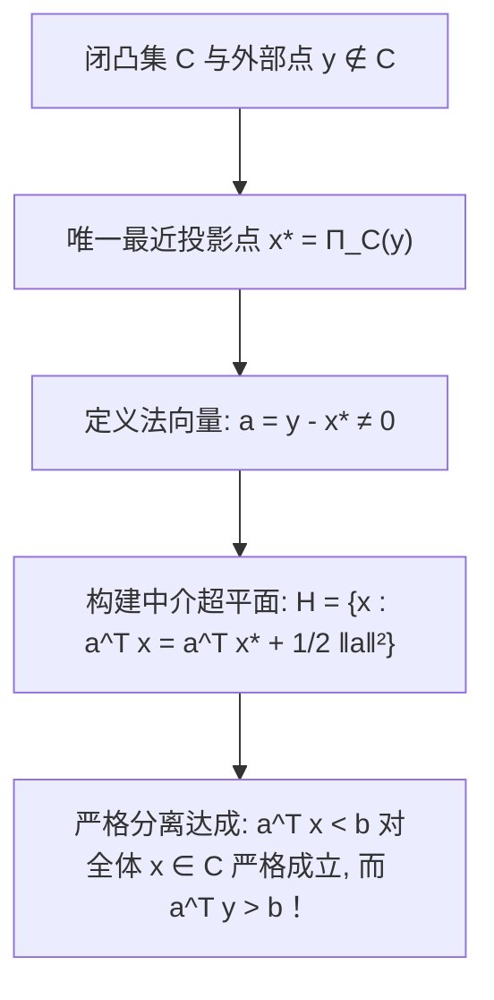

# Lec 9 凸约束优化基础与几何分离超平面定理 (Convex Constrained Optimization)

> MIT 15.094J 鲁棒系统优化建模与计算 (Systems Optimization: Models and Computation) · 授课教师：Prof. Dimitris Bertsimas / Robert Freund

## TL;DR

- 凸集与凸函数为现代高维非线性优化提供了唯一的无假局部极小值几何庇护所。
- 严格分离超平面定理（Separating Hyperplane Theorem）构成了对偶理论与 Farkas 引理的几何源头。
- 支持超平面（Supporting Hyperplane）为次梯度计算与凸外逼近算法奠定了公理基石。

## 凸性：最优化世界真正的分水岭

在应用数学的历史上，人们曾长期认为线性与非线性是最优化问题的核心分水岭。
然而，美国著名数学家、凸分析奠基人特里·洛克法拉（R. Tyrrell Rockafellar）在 1993 年写下了广为传诵的名言：
> **“最优化问题的真正分水岭，绝不是线性与非线性，而是凸性（Convexity）与非凸性（Non-Convexity）。”**

在线性规划与一般的非凸非线性规划之间，**凸优化（Convex Optimization）**占据了至高无上的黄金生态位：它不仅能够容纳极其丰富复杂的非线性物理规律（如二阶锥、半正定矩阵与对数障碍项），更在数学上继承了线性规划最纯粹的优良基因——**任何局部最优解必然是全局最优解，且强对偶性在极弱的正则条件下必然严格成立！**

## 凸集、极凸性与投影定理

::: definition [凸集与凸函数 (Convex Sets and Functions)]
集合 $C \subset \mathbb{R}^n$ 称为**凸集**，若对任意 $x, y \in C$ 以及任意 $\alpha \in [0, 1]$，均有：
$$
\alpha x + (1 - \alpha) y \in C
$$
函数 $f: C \to \mathbb{R}$ 称为定义在凸集 $C$ 上的**凸函数**，若其上方图（Epigraph）$\text{epi}(f) = \{(x, t) \in C \times \mathbb{R} : f(x) \le t\}$ 是 $\mathbb{R}^{n+1}$ 中的凸集。
:::

凸集拥有一个至关重要的拓扑性质——**闭凸集上的唯一正交投影**：

::: theorem [Hilbert 投影定理]
设 $C \subset \mathbb{R}^n$ 为非空闭凸集。对于空间中任意给定的点 $y \notin C$，在 $C$ 中存在**唯一的一个点** $x^* = \Pi_C(y)$，使得 $y$ 到 $C$ 的欧氏距离达到全局严格最小：
$$
\|y - x^*\|_2 = \min_{x \in C} \|y - x\|_2
$$
且该最优投影点由以下一阶变分不等式充要刻画：
$$
\langle y - x^*, x - x^* \rangle \le 0, \quad \forall x \in C
$$
几何上，这意味着向量 $y - x^*$ 与从 $x^*$ 指向集合 $C$ 内部任意其他点 $x$ 的方向向量之间的夹角，恒为钝角（大于等于 90 度）！
:::

## 严格分离超平面定理 (Separating Hyperplane Theorem)

投影定理直接催生了现代对偶理论的绝对奠基石——**分离超平面定理**。

::: theorem [严格分离超平面定理]
设 $C \subset \mathbb{R}^n$ 为非空闭凸集，点 $y \notin C$。
则必存在一个非零法向量 $a \in \mathbb{R}^n$（$a \ne 0$）与实数 $b \in \mathbb{R}$，使得超平面 $H = \{x : a^T x = b\}$ 将点 $y$ 与凸集 $C$ 严格在几何上隔开：
$$
a^T x < b, \quad \forall x \in C \quad \text{且} \quad a^T y > b
$$
:::

### 推广：两个不相交凸集的分离
若 $C_1$ 与 $C_2$ 为两个不相交的非空凸集（$C_1 \cap C_2 = \emptyset$），则必然存在非零向量 $a$ 使得：
$$
\sup_{x \in C_1} a^T x \le \inf_{y \in C_2} a^T y
$$
这一几何事实，在代数上直接推导出了线性代数中的法卡斯引理（Farkas' Lemma）、线性规划的强对偶定理，以及非线性规划的 KKT 乘子存在性！

## 支持超平面与次微分几何 (Supporting Hyperplanes)

若点 $x_0$ 位于闭凸集 $C$ 的边界上（$x_0 \in \partial C$），虽然无法严格分离，但必然存在一个“紧贴”该边界的超平面：

::: theorem [支持超平面定理]
设 $C$ 为非空凸集，$x_0 \in \partial C$。
则必存在非零向量 $a \ne 0$，使得：
$$
a^T x \le a^T x_0, \quad \forall x \in C
$$
超平面 $\{x : a^T (x - x_0) = 0\}$ 称为集合 $C$ 在边界点 $x_0$ 处的**支持超平面**。
:::

对于凸函数 $f(x)$，支持超平面的法向量恰恰对应了其在点 $x_0$ 处的**次梯度（Subgradient）** $g \in \partial f(x_0)$：
$$
f(x) \ge f(x_0) + g^T (x - x_0), \quad \forall x \in \text{dom}(f)
$$
次梯度的几何意义无比直观：**它给出了一个在全空间处处从下方全局紧紧托住凸函数图像的仿射切超平面**！

::: pitfall 误将非凸集的局部极小点当做全局最优
对于非凸函数，即使当前点的梯度为零且 Hessian 矩阵正定，它也极有可能只是陷入了一个局部的深坑。只有在凸约束与凸目标的前提下，局部一阶驻点才具备全局绝对排他的真理效力。
:::

::: insight 凸性是高维空间中几何直觉的最终守护神
在三维以上的欧氏空间中，人类的大脑无法直接视觉想象高维曲面的折叠。
**分离超平面定理向我们庄严保证：只要世界是凸的，无论维度上升到一万维还是一亿维，一个点与一个凸集合之间，永远可以被一刀平整地切开**。这种高维几何的不可被欺骗性，构成了所有现代机器学习算法与鲁棒系统优化的理论定海神针。
:::
