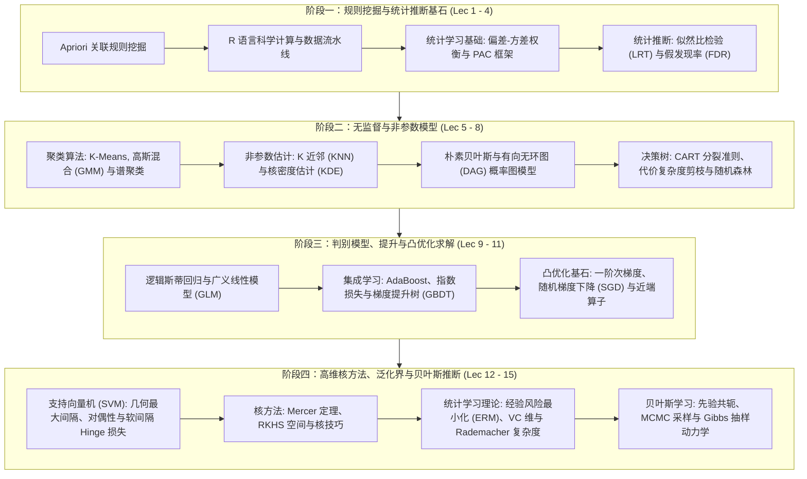

# 15.097 预测：机器学习与统计学 (Prediction: Machine Learning and Statistics)

> MIT Course 15 · Operations Research & Statistics · 课号 15.097

## TL;DR

- 融合计算机科学的统计学习理论（PAC、泛化界、VC 维）与统计推断（假设检验、FDR 控制、贝叶斯分析）。
- 深入拆解关联规则、非参数聚类、KNN/KDE、贝叶斯网络与决策树 CART 剪枝的算法内核与计算复杂度。
- 阐明逻辑斯蒂回归 GLM、AdaBoost/GBDT 梯度提升与 SVM/再生核希尔伯特空间（RKHS）的凸优化统一性。

## 课程全景与知识体系

本课程由麻省理工学院斯隆管理学院与运筹学中心（ORC）教授联合讲授，旨在打破统计学（Statistics）与人工智能机器学习（Machine Learning）长达数十年的学科壁垒。
虽然统计学侧重于参数推断、假设检验、渐近正态性与置信区间，而机器学习更关注高维预测精度、非凸泛化性能与大规模算法可扩展性，但两者的底层灵魂完全同一：**如何在有限的高维含噪样本中提取真实的底层规律，并在未知的未来数据上实现稳健预测（Generalization）**。

在整体知识演进架构上，课程严密组织为四大递进模块：
首先从非监督规则挖掘和统计推断（假设检验与多重假设校正）切入，奠定数据清洗与显著性检验的严谨底色；接着过渡到非参数平滑与树状归纳，剖析高维空间下的邻域估计与决策边界；第三阶段全面切入判别式加性模型与一阶凸优化理论，揭开梯度提升与近端算法的数学面纱；最终在高维几何间隔、核空间与统计学习泛化界中实现全景闭环。

这种横跨统计推断与运筹优化的交叉体系赋予了学习者双重視野：一方面具备对高维稀疏特征与几何间隔进行大样本理论刻画的能力，另一方面能熟练将复杂的统计目标函数转化为凸二次规划（QP）、半正定规划（SDP）或随机近端梯度下降，以工程级效率完成大规模并行求解。

::: insight [统计推断与机器学习的同一性哲学]
在许多传统教材中，支持向量机（SVM）被视作一种纯粹的几何二次规划，而逻辑斯蒂回归被视作广义线性模型（GLM）的最大似然估计。
但在现代运筹与统计视角下，两者具有高度优雅的统一结构：它们均是**经验风险最小化（ERM）加上凸正则化惩罚**的变体，唯一的区别在于对真实分类间隔（Margin）的损失函数选择：
- 逻辑斯蒂回归采用平滑的对数似然损失 $\ln(1 + e^{-y f(x)})$，赋予极端误判样本平滑递增的惩罚；
- 软间隔 SVM 采用分段线性的 Hinge 损失 $\max(0, 1 - y f(x))$，具有零梯度平坦区，从而诱导出了支持向量的稀疏性（Sparsity）。
运筹优化不仅是机器学习的计算工具，更是理解统计泛化界与几何间隔的唯一统一语言。
:::

## 讲义全集与教学大纲

| 讲次 | 中文主题 | 核心数学与运筹机制 | 状态 | 笔记链接 |
| :--- | :--- | :--- | :--- | :--- |
| **Lec 01** | 规则挖掘与 Apriori 算法 | 支持度-置信度框架、向下封闭单调性剪枝、关联规则生成 | `complete` | [规则挖掘与 Apriori 算法](lec1.md) |
| **Lec 02** | 机器学习中的 R 语言与数据分析 | 向量化计算、S3/S4 类体系、模型拟合流水线、高维稀疏矩阵 | `complete` | [R 语言与数据分析](lec2.md) |
| **Lec 03** | 统计学习基础与偏差-方差权衡 | 期望泛化误差分解、欠拟合/过拟合临界、PAC 理论雏形 | `complete` | [统计学习基础与偏差-方差权衡](lec3.md) |
| **Lec 04** | 统计推断与高维多重假设检验 | Neyman-Pearson 引理、Wilks 定理、Bonferroni 与 BH-FDR 算法 | `complete` | [统计推断与高维多重假设检验](lec4.md) |
| **Lec 05** | 聚类算法：几何、概率与图论视角 | K-Means 局部极小、EM 算法与 GMM、谱聚类与图拉普拉斯特征分解 | `complete` | [聚类算法全景](lec5.md) |
| **Lec 06** | K 近邻与核密度估计 | 非参数回归一致性、维度诅咒、KD-Tree/Ball-Tree、带宽自适应 KDE | `complete` | [K 近邻与核密度估计](lec6.md) |
| **Lec 07** | 朴素贝叶斯与贝叶斯网络 | 条件独立性假设、D-分离、最大似然参数估计、拉普拉斯平滑 | `complete` | [朴素贝叶斯与贝叶斯网络](lec7.md) |
| **Lec 08** | 决策树与 CART 算法 | 经验熵与基尼不纯度、信息增益、代价复杂度极小化剪枝（CCP） | `complete` | [决策树与 CART 算法](lec8.md) |
| **Lec 09** | 逻辑斯蒂回归与广义线性模型 (GLM) | 指数族分布、规范连接函数、IRLS/牛顿-拉夫逊法、高维正规方程 | `complete` | [逻辑斯蒂回归与 GLM](lec9.md) |
| **Lec 10** | 提升算法：AdaBoost 与梯度提升 (GBDT) | 指数损失前向分步加性模型、函数空间梯度下降、伪残差决策树拟合 | `complete` | [提升算法与梯度提升](lec10.md) |
| **Lec 11** | 机器学习中的凸优化与数值求解 | 强凸性、Lipschitz 连续梯度、随机梯度下降 (SGD)、近端梯度法 (Prox-GD) | `complete` | [凸优化与数值求解](lec11.md) |
| **Lec 12** | 支持向量机 (SVM) 与二次规划 | 几何最大间隔、KKT 对偶定理、软间隔松弛、SMO 序列最小优化 | `complete` | [支持向量机与对偶优化](lec12.md) |
| **Lec 13** | 核方法与再生核希尔伯特空间 (RKHS) | Mercer 展开正定核定理、核技巧内积映射、Representer 表示定理 | `complete` | [核方法与 RKHS 空间](lec13.md) |
| **Lec 14** | 统计学习理论与泛化误差界 | 经验过程理论、Shattering 与 VC 维、Rademacher 复杂度、McDiarmid 界 | `complete` | [统计学习理论与泛化界](lec14.md) |
| **Lec 15** | 贝叶斯统计分析与 MCMC 采样计算 | 共轭共轭先验、Metropolis-Hastings 转移核、细致平衡条件、Gibbs 采样 | `complete` | [贝叶斯分析与 MCMC 计算](lec15.md) |

::: pitfall [大数定律在经验风险最小化中的失效陷阱]
初学者常常误认为由于大数定律（LLN），当样本量 $n \to \infty$ 时，经验风险 $\hat{R}_n(h) = \frac{1}{n} \sum_{i=1}^n L(h(x_i), y_i)$ 必然逐点收敛于真实风险 $R(h)$，因而最小化训练误差绝不会出错。
然而，**算法选出的最优分类器 $\hat{h}_n$ 本身依赖于样本数据**！
此时逐点大数定律彻底失效，必须借助于**一致大数定律（Uniform Law of Large Numbers, ULLN）**。如果假设空间 $\mathcal{H}$ 容量无穷大（如 VC 维为无穷的深度神经网络或未加限制的高阶多项式），即便样本趋向无穷，经验风险极小值也会产生灾难性的过拟合偏倚。这就是为何必须严格证明关于上确界 $\sup_{h \in \mathcal{H}} |R(h) - \hat{R}_n(h)|$ 的一致泛化界。
:::

---

本资料根据 [MIT OpenCourseWare (15.097)](https://ocw.mit.edu/courses/15-097-prediction-machine-learning-and-statistics-spring-2012/) 深度重构，遵循 CC BY-NC-SA 4.0 协议。
