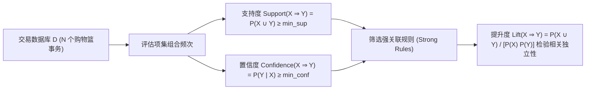

# Lec 1 关联规则挖掘与 Apriori 频繁项集算法 (Rule Mining and the Apriori Algorithm)

> MIT 15.097 统计与机器学习前沿研讨 (Prediction: Machine Learning and Statistics) · 授课教师：Prof. Roy Welsch

## TL;DR

- 关联规则挖掘从大规模离散交易事务数据库中挖掘非显然的商品共现模式。
- 支持度（Support）与置信度（Confidence）建立了评估关联规则显著性的双重度量。
- Apriori 向下闭包性质（Anti-monotonicity）通过剪除超集极大化压缩搜索空间。

## 从购物篮到知识发现的大数据启航

在信息时代，零售商与互联网平台每天记录数十亿条用户交易流水（Shopping Baskets / Transactions）。面对“顾客购买啤酒的同时，是否更倾向于同时购买尿布？”这类商业猜想，传统统计回归分析往往无能为力，因为交易数据是**高维、离散、高度稀疏且缺乏显式因果标签的**。

1993 年 Rakesh Agrawal 等人提出的**关联规则挖掘（Association Rule Mining）**与 **Apriori 算法**，正式拉开了现代数据挖掘（Data Mining）与预测学习的序幕。

麻省理工学院 15.097（由国际著名统计学家与运筹学家 Roy Welsch 教授开设）以此作为第一讲，剖析离散组合搜索与统计支持度的深层平衡。

## 关联规则的核心度量公理

设项目集合 $\mathcal{I} = \{i_1, i_2, \dots, i_m\}$，交易数据库 $\mathcal{D} = \{T_1, T_2, \dots, T_N\}$，其中每个交易事务 $T_k \subset \mathcal{I}$ 是一个项集（Itemset）。
一条关联规则表达为形如 $X \Rightarrow Y$ 的蕴涵式，其中 $X, Y \subset \mathcal{I}$ 且 $X \cap Y = \emptyset$。

::: definition [三大核心统计度量]
1. **支持度（Support）**：全网交易中同时包含项集 $X$ 与 $Y$ 的相对频率概率：
$$
\text{Support}(X \Rightarrow Y) = \mathbb{P}(X \cup Y) = \frac{|\{T \in \mathcal{D} : X \cup Y \subset T\}|}{N}
$$
2. **置信度（Confidence）**：在购买了 $X$ 的条件下，顾客也购买了 $Y$ 的条件概率：
$$
\text{Confidence}(X \Rightarrow Y) = \mathbb{P}(Y \mid X) = \frac{\text{Support}(X \cup Y)}{\text{Support}(X)}
$$
3. **提升度（Lift）**：度量 $X$ 的出现对 $Y$ 出现概率的真正提升乘数：
$$
\text{Lift}(X \Rightarrow Y) = \frac{\mathbb{P}(X \cup Y)}{\mathbb{P}(X)\mathbb{P}(Y)} = \frac{\text{Confidence}(X \Rightarrow Y)}{\text{Support}(Y)}
$$
- 若 $\text{Lift} = 1$：说明 $X$ 与 $Y$ 统计相互独立，两者没有任何实质关联；
- 若 $\text{Lift} > 1$：说明 $X$ 与 $Y$ 呈现强烈的正相关互补效应；
- 若 $\text{Lift} < 1$：说明两者呈现负相关排他替代效应。
:::

## 组合爆炸与 Apriori 剪枝性质 (Anti-Monotonicity)

如果数据库包含 $m$ 种不同商品，潜在的候选非空项集组合数为 $2^m - 1$。
若 $m = 1000$，$2^{1000} \approx 10^{300}$，暴力扫描全集在物理上是绝对不可能的。

Apriori 算法通过一条颠扑不破的**单调性下闭公理（Apriori Property / Anti-monotone Property）**，实现了对搜索树的巨额剪枝：

::: theorem [Apriori 向下闭包性质]
**若一个项集是频繁项集（Frequent Itemset，即满足 $\text{Support} \ge \text{min\_sup}$），则它的所有非空子集必然全部都是频繁项集！**
其等价逆否命题为：
**若一个项集是非频繁的，则它的所有超集（Supersets）必然全部是非频繁的！**
:::

**算法逐层迭代机制（Level-wise Search）**：
1. 扫描数据库，找出所有满足门槛的频繁 1-项集 $L_1$；
2. **连接步（Join Step）**：将 $L_{k-1}$ 与自身连接，生成候选 $k$-项集集合 $C_k$；
3. **剪枝步（Prune Step）**：检查 $C_k$ 中的每个候选集，若发现其存在任何一个大小为 $k-1$ 的子集不在 $L_{k-1}$ 中，立即无情将其剔除，无需扫描数据库！
4. 扫描数据库，统计剩余候选集的实际支持度，生成 $L_k$；循环直到无新项集产生。

::: pitfall 仅凭高置信度误判无关伪相关规则
假设 90% 的顾客都购买了牛奶（高基础支持度）。若某种罕见商品 $X$ 的顾客中有 90% 也买了牛奶，规则 $X \Rightarrow \text{牛奶}$ 的置信度高达 90%，但其提升度 $\text{Lift} = \frac{0.9}{0.9} = 1.0$！这说明该规则毫无信息增益。必须将提升度与卡方检验（$\chi^2$）联合作为显著性硬指标。
:::

::: insight 关联分析是大数据时代的非参数模式探索
传统的统计推断要求研究者预先提出明确的假说（$H_0$ 与 $H_1$）；
而 Apriori 关联规则挖掘开启了一种全新的数据探索范式：**它不带任何预设立场，让海量离散交易流水自己在高维格点空间中发声，通过向下闭包修剪掉虚空噪点，自然浮现出人类专家未曾预料的微观群体行为模式**。这是数据挖掘走向智能预测的第一块基石。
:::
