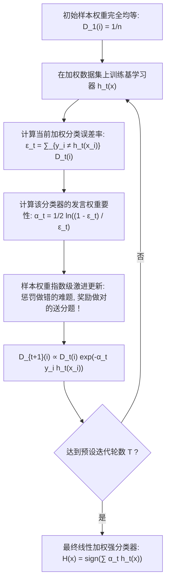
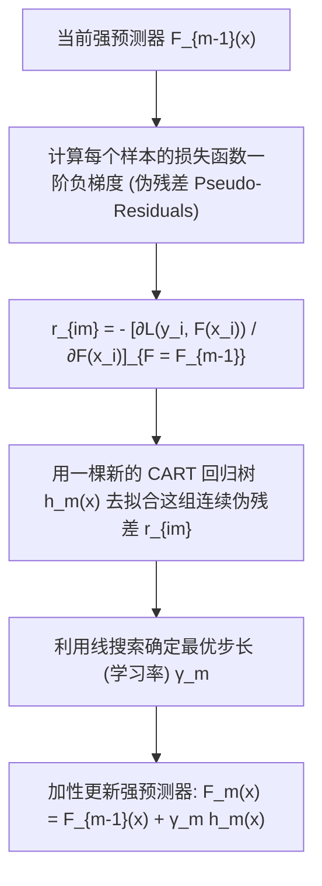

# Lec 10 集成提升学习理论：从 AdaBoost 到梯度提升树 (Boosting Algorithms and GBDT)

> MIT 15.097 统计与机器学习前沿研讨 (Prediction: Machine Learning and Statistics) · 授课教师：Prof. Roy Welsch

## TL;DR

- 提升算法（Boosting）通过加权样本自适应迭代将多个弱学习器（Weak Learners）聚合成强学习器。
- AdaBoost 在数学上等价于利用前向分步加性模型（Additive Model）极小化指数损失函数。
- 梯度提升树（GBDT）将梯度下降推广至函数空间、利用决策树递归拟合伪残差（Pseudo-residuals）。

## 三个臭皮匠与诸葛亮的数学证明

在计算学习理论（Computational Learning Theory）的早期，莱斯利·瓦利安特（Leslie Valiant）提出了著名的 PAC 学习模型（Probably Approximately Correct）。随后迈克尔·科恩斯（Michael Kearns）提出了一个困扰人工智能界数十年的核心猜想：
> **“一个在二分类任务上仅仅比随机瞎猜（50% 抛硬币）略微优秀一点点的弱分类器（Weak Learner），是否在数学上必然可以被某种机制提升为一个拥有任意极高精度的强分类器（Strong Learner）？”**

1990 年罗伯特·夏皮尔（Robert Schapire）与约阿夫·弗罗因德（Yoav Freund）给出了肯定的回答，并在 1995 年推出了夺得哥德尔奖的划时代算法——**AdaBoost（Adaptive Boosting）**。
这一理论不仅彻底解决了 PAC 猜想，更直接孕育了今日横扫 Kaggle 竞赛与全网工业级推荐搜索系统的最高王者——**梯度提升树（Gradient Boosted Decision Trees, GBDT / XGBoost / LightGBM）**。

## AdaBoost 的样本权重自适应机制

设训练集为 $\mathcal{D} = \{(x_i, y_i)\}_{i=1}^n$，$y_i \in \{-1, +1\}$。与 Bagging 或 Random Forest 在各树之间完全独立、互不通信的并行抽样模式截然不同，AdaBoost 采用严格的序列串行迭代架构（Sequential Boosting）。

在每一轮训练中，算法动态调整每个样本在损失计算中的重要程度，即**采样权重（Sample Weights $D_t(i)$）**。整个算法流程从均等先验出发，经历加权训练、加权评估、模型赋权、指数级重分布和归一化五个严格受控的数学步骤：

其工程直觉与教育学逻辑高度契合：
在每一轮迭代结束后，算法**大幅提高那些被当前基分类器误分类的样本的权重**，同时降低那些已经被正确分类的样本的权重。在下一轮中，新的基学习器将被迫把绝大多数注意力投入到那些最棘手的“顽固错题”之上。

数学上，权重更新项为 $D_{t+1}(i) = \frac{D_t(i)}{Z_t} \exp(-\alpha_t y_i h_t(x_i))$，其中归一化常数 $Z_t = \sum_{i=1}^n D_t(i) \exp(-\alpha_t y_i h_t(x_i))$ 确保权重向量始终位于单纯形 $\Delta^n$ 内。当分类器正确预测样本（$y_i h_t(x_i) = 1$）时，指数因子小于 1，样本权重按比例缩减；当误判时（$y_i h_t(x_i) = -1$），指数因子显著大于 1，样本在下一轮的有效影响力成倍放大。由此构成了闭环自适应纠错动力学。

## 前向分步加性模型与指数损失极小化

在很长一段时间里，计算机科学家认为 AdaBoost 是一种神奇的“启发式花招”。
直到 2000 年，斯坦福统计学三剑客（Jerome Friedman, Trevor Hastie, Robert Tibshirani）发表了统计学巨著《Additive Logistic Regression: A Statistical View of Boosting》，为 AdaBoost 揭示了不可思议的优化本质：
**AdaBoost 绝非玄学，它在数学上严格等价于利用前向分步算法（Forward Stagewise Additive Modeling）极小化指数损失函数（Exponential Loss）！**

定义强学习器为 $M$ 个基树的线性加性模型：
$$
F(x) = \sum_{m=1}^M \alpha_m h_m(x)
$$
目标损失函数为指数损失：
$$
L(y, F(x)) = \exp(-y F(x))
$$
在第 $m$ 步，我们固定已经训练好的前 $m-1$ 棵树 $F_{m-1}(x)$，寻找最优的新树 $h_m$ 与新权重 $\alpha_m$：
$$
(\alpha_m, h_m) = \arg\min_{\alpha, h} \sum_{i=1}^n \exp\left(-y_i [F_{m-1}(x_i) + \alpha h(x_i)]\right)
$$
定义未归一化样本权重 $w_i^{(m)} = \exp(-y_i F_{m-1}(x_i))$，目标展开为：
$$
\sum_{i=1}^n w_i^{(m)} \exp(-y_i \alpha h(x_i)) = e^{-\alpha} \sum_{y_i = h(x_i)} w_i^{(m)} + e^\alpha \sum_{y_i \ne h(x_i)} w_i^{(m)}
$$
对 $\alpha$ 求导并令导数置零，瞬间推导出完全一致的发言权公式：
$$
\alpha_m^* = \frac{1}{2}\ln\left(\frac{1 - \epsilon_m}{\epsilon_m}\right)
$$
AdaBoost 的神秘面纱被数学统计理论彻底解开！

## 梯度提升树：函数空间中的最速下降法 (GBDT)

既然提升算法是在极小化损失函数，为什么一定要局限于指数损失？如果面对回归问题（平方损失）或鲁棒 Huber 损失呢？
杰罗姆·弗里德曼（Jerome Friedman, 2001）提出了现代机器学习的巅峰杰作——**梯度提升机（Gradient Boosting Machine, GBM）**。

在传统的数值优化中，我们在参数空间 $\theta$ 沿着负梯度方向更新参数：$\theta_{k+1} = \theta_k - \eta \nabla_\theta J$；
而在梯度提升中，我们直接**在无穷维的函数空间 $F(x)$ 中，将新基学习器作为负梯度步长进行拟合！**

### 为什么负梯度等价于残差？
考察最简单的平方误差损失 $L(y, F(x)) = \frac{1}{2}(y - F(x))^2$。
计算负梯度：
$$
r_i = -\left[\frac{\partial L(y_i, F(x_i))}{\partial F(x_i)}\right] = y_i - F(x_i)
$$
负梯度在代数上**精确等于真实的预测残差（Residuals）**！
对于任意复杂的通用损失函数（如逻辑损失、绝对值损失、分位数回归损失），负梯度 $r_{im}$ 被称为**伪残差（Pseudo-Residuals）**。
**GBDT 的核心：每一棵新生成的决策树，都是为了去全力纠正、弥补上一轮模型遗留下的负梯度残差！**

::: pitfall 忽视学习率收缩（Shrinkage）导致 GBDT 极速过拟合
若在更新时直接使用全步长 $\gamma = 1.0$，GBDT 会迅速过拟合训练集中的微观噪声。必须引入**学习率收缩因子 $\eta \in (0.01, 0.1]$**：
$$
F_m(x) = F_{m-1}(x) + \eta \sum \gamma_{jm} \mathbf{1}_{\{x \in R_{jm}\}}
$$
结合行采样与列采样（Subsampling），通常能使测试集泛化能力获得质的飞跃。
:::

::: insight 提升算法是将微弱火种汇聚成燎原烈火的奇迹
单个决策树深度受限，只能做出粗糙幼稚的判断；
而梯度提升算法以其无与伦比的残差迭代逻辑向世人展示：**只要每一个弱者能为系统提供哪怕极其微小的一点点正向梯度修正，通过成百上千次前向加性叠加，这支由弱者组成的军团就能汇聚成攻无不克的超级智能**。这是统计优化理论献给工业界最锋利的重刃。
:::
