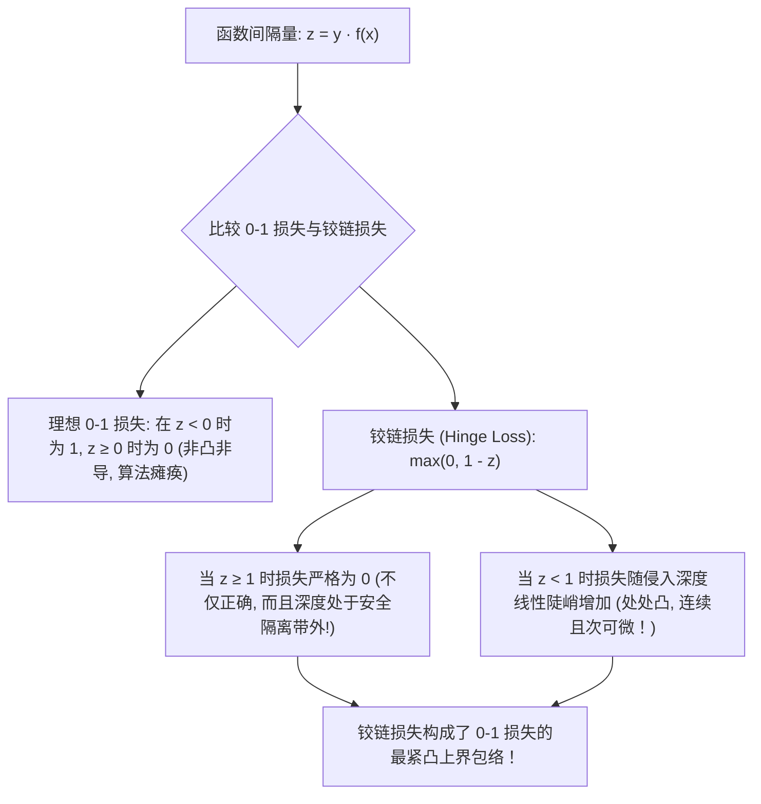

# Lec 12 支持向量机最大间隔理论与铰链损失对偶 (SVM Max-Margin and Hinge Loss)

> MIT 15.097 统计与机器学习前沿研讨 (Prediction: Machine Learning and Statistics) · 授课教师：Prof. Roy Welsch

## TL;DR

- 支持向量机通过最大化样本超平面几何间隔最小化结构风险界。
- 铰链损失（Hinge Loss）为二分类理想 0-1 损失提供了最紧致的凸上界包络。
- 原问题松弛罚项与 Wolfe 对偶二次规划通过 KKT 互补松弛性建立严格对偶映射。

## 结构风险最小化与最大间隔的数学公理

在第 3 讲中，我们学习了经验风险最小化（ERM）容易导致严重过拟合。
为了给机器学习模型注入强大的抗过拟合抗噪能力，弗拉基米尔·瓦普尼克（Vladimir Vapnik）提出了著名的**结构风险最小化原则（Structural Risk Minimization, SRM）**：
$$
\text{真实泛化风险 } R(f) \le \text{经验训练风险 } \hat{R}(f) + \text{置信界惩罚项 } \mathcal{O}\left(\sqrt{\frac{h}{n}}\right)
$$
其中 $h$ 为分类器函数族的 **VC 维（Vapnik-Chervonenkis Dimension）**。
瓦普尼克证明了一个惊天几何定理：
**对于线性分离超平面族，其 VC 维严格受限于分离超平面的物理几何间隔（Margin $\gamma$）！间隔越大，VC 维越低，泛化误差界就越坚固！**

支持向量机（SVM）正是这一理论的最完美数学载体。

## 铰链损失函数 (Hinge Loss) 的凸替代艺术

在理想的二分类问题中，我们最希望极小化的是真实误分类个数——**0-1 损失函数**：
$$
L_{0-1}(y, f(x)) = \mathbf{1}_{\{y \cdot f(x) < 0\}} = \begin{cases}
1, & y f(x) < 0 \quad (\text{分类错误}) \\
0, & y f(x) \ge 0 \quad (\text{分类正确})
\end{cases}
$$
然而，0-1 损失在数学上是一个阶梯跳跃函数：处处梯度为零，在原点不连续！直接极小化 0-1 损失属于极其困难的强 NP-hard 离散组合优化问题。

支持向量机提出了天才的凸替代方案——**铰链损失（Hinge Loss）**：
$$
L_{\text{Hinge}}(y, f(x)) = \max(0, 1 - y f(x)) = (1 - y f(x))^+
$$

## 无约束经验风险视角下的 SVM 等价性

许多初学者容易被 SVM 复杂的带有约束条件的二次规划表述弄糊涂。
实际上，软间隔支持向量机在数学上完全等价于一个极其纯粹的**无约束正则化经验风险最小化规划**：

::: theorem [SVM 软间隔经验风险等价定理]
软间隔 SVM 二次规划原问题：
$$
\min_{w, b, \xi} \quad \frac{1}{2}\|w\|_2^2 + C \sum_{i=1}^n \xi_i \quad \text{s.t.} \quad y_i(w^T x_i + b) \ge 1 - \xi_i, \quad \xi_i \ge 0
$$
在代数上严格充要等价于以下带有 $L_2$ 正则化惩罚项的无约束非光滑凸优化模型：
$$
\min_{w, b} \quad \frac{1}{n}\sum_{i=1}^n \max\left(0, 1 - y_i (w^T x_i + b)\right) + \frac{1}{2 C n}\|w\|_2^2
$$
即：**全样本平均铰链损失 + 权重二范数抗震荡收缩正则化！**
:::

令正则化参数 $\lambda = \frac{1}{C n}$，这与岭回归（Ridge Regression）和逻辑回归的结构完全呈现神圣的对称性！

## 次梯度优化求解无约束 SVM (Pegasos 算法)

既然 SVM 可以写成无约束凸目标函数 $J(w)$，我们为什么一定要动用昂贵的内点二次规划求解器？
2007 年沙莱夫-施瓦茨（Shai Shalev-Shwartz）等人提出了震动学术界的 **Pegasos 算法（Primal Estimated sub-GrAdient SOlver for SVM）**：直接在原问题上运行随机次梯度下降！

计算单个样本 $i$ 上的铰链损失关于 $w$ 的次梯度：
$$
\partial_w \max(0, 1 - y_i w^T x_i) = \begin{cases}
-y_i x_i, & y_i w^T x_i < 1 \quad (\text{落在间隔带内或分类错误}) \\
0, & y_i w^T x_i \ge 1 \quad (\text{安全落在间隔带外})
\end{cases}
$$

Pegasos 单步极简更新法则：
随机抽取样本 $(x_i, y_i)$，在步长 $\eta_t = \frac{1}{\lambda t}$ 下：
$$
w_{t+1/2} = (1 - \eta_t \lambda) w_t + \begin{cases}
\eta_t y_i x_i, & y_i w_t^T x_i < 1 \\
0, & y_i w_t^T x_i \ge 1
\end{cases}
$$
接着将更新后的向量投影回有界球空间：$w_{t+1} = \min\left(1, \frac{1/\sqrt{\lambda}}{\|w_{t+1/2}\|}\right) w_{t+1/2}$。
算法仅需十几行代码，能在几秒钟内轻而易举征服数百万样本的巨型线性分类任务！

::: pitfall 忽视数据不平衡（Class Imbalance）对决策超平面的偏移
若正样本仅占 1%，负样本占 99%。标准 SVM 会将超平面推向极度偏近正样本的一侧，导致正样本召回率惨跌至零。必须在铰链损失中为不同类别赋予不对称的加权代价权重 $C_+$ 与 $C_-$（Cost-Sensitive SVM）。
:::

::: insight 铰链损失是守住安全边际的刚性法印
普通逻辑回归对正确分类的样本永远贪婪：即便你已经预测得很好了，它依然试图把概率从 99% 推到 99.99%，为此不惜扭曲全系统的权重；
而 SVM 铰链损失展现了一种极具定力的哲学克制：**只要你安全退到了间隔带之外（$y f(x) \ge 1$），损失瞬间彻底归零，系统对你毫不苛求，从而把全部宝贵的模型能力，坚决留给那些真正处于危险边缘的生死之交**。
:::
