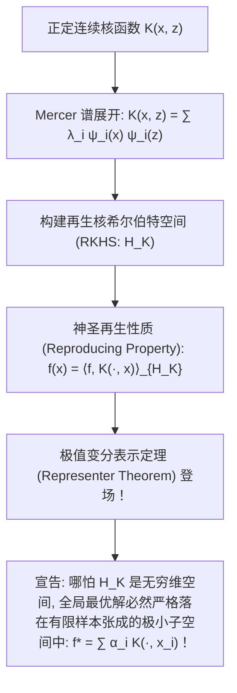

# Lec 13 核方法深度解析：Mercer 定理与再生核希尔伯特空间 (Kernel Methods and RKHS)

> MIT 15.097 统计与机器学习前沿研讨 (Prediction: Machine Learning and Statistics) · 授课教师：Prof. Roy Welsch

## TL;DR

- 再生核希尔伯特空间（RKHS）为非线性特征隐式高维映射提供了严格的泛函分析底座。
- 再生核性质（Reproducing Property）将抽象抽象函数求值点等价转化为空间内积计算。
- 表示定理（Representer Theorem）严格证明了无限维空间经验风险极值解必可由有限样本核基线性展开。

## 从代数技巧到抽象泛函分析

在前面的课程中，我们了解了核技巧（Kernel Trick）的奇妙应用：通过将对偶二次规划中的点积 $\langle x_i, x_j \rangle$ 替换为核函数 $K(x_i, x_j)$，算法瞬间获得了处理非线性流形的能力。

然而，在严肃的数学物理学家眼中，这一过程留下了巨大的理论疑问：
- 这个神秘的高维特征空间究竟是什么？它有多大？
- 我们如何断定某种数学形式的核函数（如高斯核或有理二次核）在几何上必然对应着某个真实存在的高维空间？
- 在这个可能是无穷维的抽象函数空间中求解优化，为什么最优解不会发散，而是能够被有限个已知样本数据精确表达？

麻省理工学院 15.097 第十三讲深入现代统计学习最优雅的数学圣殿——**再生核希尔伯特空间（Reproducing Kernel Hilbert Space, RKHS）与表示定理（Representer Theorem）**。

## 连续正定核与 Mercer 谱展开定理

设 $\mathcal{X} \subset \mathbb{R}^d$ 为紧致子集。函数 $K: \mathcal{X} \times \mathcal{X} \to \mathbb{R}$ 连续且对称。

::: definition [连续正定核 (Positive Definite Kernel)]
称核函数 $K$ 是**正定的**，若对任意有限样本集 $\{x_1, \dots, x_n\} \subset \mathcal{X}$ 以及任意非全零实数列 $c_1, \dots, c_n \in \mathbb{R}$，均满足：
$$
\sum_{i=1}^n \sum_{j=1}^n c_i c_j K(x_i, x_j) \ge 0
$$
即对应的 Gram 矩阵处处半正定。
:::

1909 年英国数学家詹姆斯·默瑟（James Mercer）建立了积分算子谱理论的宏伟定理：

::: theorem [Mercer 积分展开定理 (Mercer's Theorem)]
考虑由核函数 $K$ 诱导的自共轭紧积分算子 $T_K: L^2(\mathcal{X}) \to L^2(\mathcal{X})$：
$$
(T_K f)(x) = \int_{\mathcal{X}} K(x, z) f(z) dz
$$
若核函数 $K$ 正定连续，则存在一族可数无穷的非负特征值单调递减序列 $\lambda_1 \ge \lambda_2 \ge \dots \ge 0$，以及一组正交规范的连续特征函数基底 $\{\psi_i(x)\}_{i=1}^\infty \subset L^2(\mathcal{X})$，使得核函数可以在全空间被**一致且绝对收敛地展开为无限维特征谱级数**：
$$
K(x, z) = \sum_{i=1}^\infty \lambda_i \psi_i(x) \psi_i(z)
$$
由此定义显式的高维特征映射向量（可以是无穷维序列）：
$$
\phi(x) = \left(\sqrt{\lambda_1}\psi_1(x), \sqrt{\lambda_2}\psi_2(x), \dots, \sqrt{\lambda_i}\psi_i(x), \dots\right)^T
$$
其在空间 $\ell^2$ 上的内积严格恒等于核函数：$\langle \phi(x), \phi(z) \rangle_{\ell^2} = K(x, z)$！
:::

## 再生核希尔伯特空间 (RKHS) 的神圣再生性质

定义由以单点为中心的核切片函数线性组合构成的预完备空间：
$$
f(x) = \sum_{i=1}^m \alpha_i K(x, x_i)
$$
在空间中定义内积诱导范数：
$$
\langle f, g \rangle_{\mathcal{H}_K} = \left\langle \sum_{i=1}^m \alpha_i K(\cdot, x_i), \sum_{j=1}^l \beta_j K(\cdot, z_j) \right\rangle = \sum_{i=1}^m \sum_{j=1}^l \alpha_i \beta_j K(x_i, z_j)
$$
将其完备化为完备的 Hilbert 空间，该空间被称为**再生核希尔伯特空间（RKHS）$\mathcal{H}_K$**。

::: definition [神圣再生核性质 (The Reproducing Property)]
对于空间 $\mathcal{H}_K$ 中的任意函数 $f$，以及输入空间中的任意点 $x \in \mathcal{X}$，函数在点 $x$ 处的单点求值，严格等于该函数与核函数切片 $K_x = K(\cdot, x)$ 在希尔伯特空间中的内积：
$$
f(x) = \langle f, K(\cdot, x) \rangle_{\mathcal{H}_K}
$$
特别地，当取 $f = K(\cdot, z)$ 时：
$$
K(x, z) = \langle K(\cdot, x), K(\cdot, z) \rangle_{\mathcal{H}_K}
$$
:::
这解释了为什么它被称为“再生（Reproducing）”：核函数切片不仅充当了空间的基底生成器，其自身在空间内积下精准再生了函数在每一个点处的取值！根据 Riesz 表示定理，这等价于空间上的逐点求值泛函是连续有界的。

## 崇高的极值化简：表示定理 (The Representer Theorem)

我们如何在一个可能是无限维的复杂函数空间 $\mathcal{H}_K$ 中求解带正则化的经验风险最小化问题？
1971 年乔治·金博尔道夫（George Kimeldorf）与格蕾丝·瓦巴（Grace Wahba），以及 2001 年伯恩哈德·斯科尔科普夫（Bernhard Schölkopf）证明了现代统计学习最重要的结构定理——**表示定理**。

::: theorem [广义表示定理 (Representer Theorem)]
设 $\Omega([0, \infty) \to \mathbb{R})$ 为严格单调严格递增的单调函数（正则化惩罚）。
考虑定义在无限维 RKHS 空间 $\mathcal{H}_K$ 上的优化问题：
$$
\min_{f \in \mathcal{H}_K} \quad J(f) = \frac{1}{n}\sum_{i=1}^n L(y_i, f(x_i)) + \Omega(\|f\|_{\mathcal{H}_K}^2)
$$
则无论空间 $\mathcal{H}_K$ 的维度有多大（哪怕是无限维），**该优化问题的全局唯一最优解 $f^*$，必然可以完全由这有限个 $n$ 个训练样本点处的核切片做线性组合表达！**
$$
f^*(x) = \sum_{i=1}^n \alpha_i K(x, x_i)
$$
其中 $\alpha = (\alpha_1, \dots, \alpha_n)^T \in \mathbb{R}^n$ 为有限维系数向量！
:::

**数学严密证明（几何正交投影的纯粹之美）**：
记由样本点张成的有限维子空间为 $\mathcal{H}_0 = \text{span}\{K(\cdot, x_1), \dots, K(\cdot, x_n)\} \subset \mathcal{H}_K$。
任意一个候选函数 $f \in \mathcal{H}_K$ 可以正交分解为：
$$
f = f_{\parallel} + f_{\perp}
$$
其中 $f_{\parallel} \in \mathcal{H}_0$，$f_{\perp} \perp \mathcal{H}_0$。
考察样本点处的值，利用再生性质：
$$
f(x_i) = \langle f, K(\cdot, x_i) \rangle = \langle f_{\parallel} + f_{\perp}, K(\cdot, x_i) \rangle = \langle f_{\parallel}, K(\cdot, x_i) \rangle + 0 = f_{\parallel}(x_i)
$$
注意：**正交垂直分量 $f_{\perp}$ 对所有样本点处的预测值毫无丝毫贡献！它完全不改变经验经验损失项的值！**
再考察正则化惩罚项：由勾股正交定理：
$$
\|f\|_{\mathcal{H}_K}^2 = \|f_{\parallel}\|_{\mathcal{H}_K}^2 + \|f_{\perp}\|_{\mathcal{H}_K}^2 \ge \|f_{\parallel}\|_{\mathcal{H}_K}^2
$$
若 $f_{\perp} \ne 0$，正则化惩罚项将严格增加！因此，为了最小化目标函数，最优解必须满足 $f_{\perp} = 0$，即 $f^* = f_{\parallel} \in \mathcal{H}_0$！
定理彻底获证！

::: pitfall 忽视 Gram 矩阵求逆在海量样本下的 O(n³) 瓶颈
虽然表示定理将无限维问题化为有限维，但系数矩阵求逆复杂度为 $\mathcal{O}(n^3)$。当样本量突破百万时，精确核方法宣告瘫痪。现代工程通常结合 **Nyström 随机采样逼近** 或 **随机傅里叶特征（Random Fourier Features, Rahimi & Recht 2007）** 进行降维加速。
:::

::: insight 正交投影将无限维度驯服在有限数据的掌心
表示定理是泛函分析在机器学习中最震撼的展示：
即使目标函数生长在无限维度的浩瀚星空中，正交投影的几何法则瞬间击穿了一切幻觉：**样本没有观测到的正交虚空维度，除了白白增加模型复杂度范数之外毫无价值；最优的真理，必然且只能完全凝聚在已知有限样本所张成的狭小线性空间之内**。
:::
