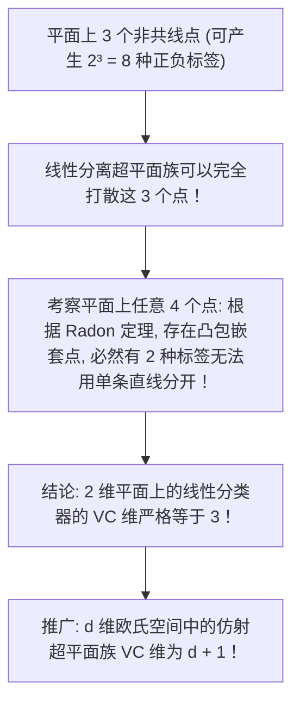

# Lec 14 统计学习理论：VC 维、Rademacher 复杂度与泛化误差界 (Statistical Learning Theory)

> MIT 15.097 统计与机器学习前沿研讨 (Prediction: Machine Learning and Statistics) · 授课教师：Prof. Roy Welsch

## TL;DR

- 统计学习理论为经验风险与真实泛化风险之间的差距建立无条件严格概率上界。
- VC 维（Vapnik-Chervonenkis Dimension）通过打散（Shattering）能力量化假设空间的本征容量。
- Rademacher 复杂性通过数据相关经验对称化克服了传统独立组合界的过分悲观保守。

## 机器学习最底层的数学审判

在工程实践中，工程师们训练出了无数复杂的深度网络与集成模型。在测试集上测出的错误率是 2.5%。
然而，一个冰冷严肃的科学拷问始终悬挂在头顶：
- **凭什么断定这 2.5% 的错误率在明天面对数百万未知客户时依然有效？**
- **模型会不会只是在测试集上碰巧运气好？**
- **在数学公理的层面上，究竟需要多少训练样本，才能以 $99.9\%$ 的置信概率保证泛化误差不超过 $\epsilon$？**

这正是**统计学习理论（Statistical Learning Theory）**所要回答的终极问题。

麻省理工学院 15.097 第十四讲，系统攀登由瓦普尼克（Vapnik）、切尔沃宁基斯（Chervonenkis）与巴特利特（Bartlett）构筑的严密误差界大厦。

## 假说空间打散与 VC 维定义 (VC Dimension)

设假说空间为一族二分类函数集合 $\mathcal{H} = \{h: \mathcal{X} \to \{-1, +1\}\}$。
对于任意一个包含 $n$ 个样本的集合 $S = \{x_1, \dots, x_n\}$，假说空间 $\mathcal{H}$ 在该点集上所能诱导出的所有可能二进制标签排列组合集合为：
$$
\mathcal{H}(S) = \{(h(x_1), \dots, h(x_n)) : h \in \mathcal{H}\} \subset \{-1, +1\}^n
$$
显然组合数 $|\mathcal{H}(S)| \le 2^n$。

::: definition [打散 (Shattering) 与 VC 维]
1. 若点集 $S$ 上所能产生的所有标签组合数达到了理论最大值，即：
$$
|\mathcal{H}(S)| = 2^n
$$
则称假说空间 $\mathcal{H}$ 能够**完全打散（Shatter）**样本集 $S$；这意味着：**无论上帝如何恶意给这 $n$ 个点随意打上 $+1$ 或 $-1$ 的标签，假说空间中都必然存在至少一个函数能够将它们完美 100% 分对！**
2. 假说空间 $\mathcal{H}$ 的 **VC 维（VC Dimension, 记为 $\text{VCdim}(\mathcal{H})$）** 定义为：**能够被 $\mathcal{H}$ 完全打散的最大样本点集的基数大小 $d$**！
若对任意大的正整数 $n$，都存在包含 $n$ 个点的集合能被 $\mathcal{H}$ 打散，则 $\text{VCdim}(\mathcal{H}) = \infty$。
:::

## Sauer-Shelah 引理与多项式生长函数

若 $\text{VCdim}(\mathcal{H}) = d < \infty$ 是有限的。当样本容量 $n > d$ 突破临界点时，组合数会发生怎样的突变？
诺伯特·索尔（Norbert Sauer）与萨哈隆·谢拉赫（Saharon Shelah）在 1972 年证明了组合极值论中最伟大的引理：

::: theorem [Sauer-Shelah 引理]
定义生长函数（Growth Function）为在大小为 $n$ 的样本集上所能诱导的最大组合数：$\Pi_{\mathcal{H}}(n) = \max_{|S|=n} |\mathcal{H}(S)|$。
若 $\text{VCdim}(\mathcal{H}) = d$，则对所有 $n \ge d$：
$$
\Pi_{\mathcal{H}}(n) \le \sum_{i=0}^d \binom{n}{i} \le \left(\frac{e n}{d}\right)^d = \mathcal{O}(n^d)
$$
:::

### 宇宙相变的壮丽启示
注意这个惊天突变：
- 当 $n \le d$ 时，生长函数以 $2^n$ 的极其恐怖的指数级全速狂飙；
- **一旦样本量超越 VC 维临界点（$n > d$），生长函数的膨胀速度被硬生生降维为多项式阶数 $\mathcal{O}(n^d)$！**
正是这个多项式塌缩，为一致收敛大数定律的成立打开了大门！

## Vapnik-Chervonenkis 经典泛化误差界

利用重对偶幽灵样本（Ghost Samples）与对称化技巧，瓦普尼克推导出了机器学习历史上最著名的泛化上界：

::: theorem [经典 VC 泛化误差界 (Vapnik, 1995)]
设假说空间 $\mathcal{H}$ 的 VC 维为 $d < \infty$。
对于任意底层未知的数据分布 $\mathbb{P}$，以及任意显著性水平 $\delta \in (0, 1)$：
在由分布 $\mathbb{P}$ 独立抽样的训练集上，以至少 $1 - \delta$ 的极高概率保证，**对假说空间中的任意函数 $h \in \mathcal{H}$（包括训练误差最小的那个解），其真实泛化风险 $R(h)$ 一致满足**：
$$
R(h) \le \hat{R}_n(h) + 2 \sqrt{\frac{2 d \ln(2e n / d) + 2 \ln(4 / \delta)}{n}}
$$
:::
该界随样本量以 $\mathcal{O}\left(\sqrt{\frac{d \ln n}{n}}\right)$ 速率稳健收敛至零！

## Rademacher 复杂度：数据依赖的高阶理论 (Rademacher Complexity)

VC 维考虑的是最坏情况下的组合打散，其推导出的误差界在很多现实大模型中往往显得过度悲观。
现代统计学习理论全面升级为**Rademacher 复杂性（Rademacher Complexity）**：
它度量了假说空间拟合**纯粹随机高斯/均匀噪声（Rademacher 随机变量 $\sigma_i \in \{-1, +1\}$）的能力**。

::: definition [经验 Rademacher 复杂度]
给定固定数据集 $S = (x_1, \dots, x_n)$。实值函数族 $\mathcal{F}$ 在该数据集上的经验 Rademacher 复杂度定义为：
$$
\hat{\mathfrak{R}}_S(\mathcal{F}) = \mathbb{E}_{\sigma}\left[\sup_{f \in \mathcal{F}} \frac{1}{n}\sum_{i=1}^n \sigma_i f(x_i)\right]
$$
其中 $\sigma_1, \dots, \sigma_n$ 为相互独立的 Rademacher 随机变量（以各 $50\%$ 的概率取 $\pm 1$）。
:::

若一个函数族极其庞大（容量过大），它连完全随机生成的白噪声都能完美拟合，其 $\hat{\mathfrak{R}}_S(\mathcal{F}) \approx 1$；
若函数族结构稳健，它无法拟合噪声，其 $\hat{\mathfrak{R}}_S(\mathcal{F}) \to 0$。

::: theorem [基于 Rademacher 复杂度的紧致泛化界 (Bartlett & Mendelson, 2002)]
对于任意 $[0, 1]$ 范围内的损失函数族，以至少 $1 - \delta$ 的概率一致成立：
$$
R(f) \le \hat{R}_n(f) + 2 \hat{\mathfrak{R}}_S(\mathcal{F}) + 3 \sqrt{\frac{\ln(2/\delta)}{2n}}
$$
:::
与 VC 维不同，**Rademacher 复杂度是完全依赖于当前具体训练数据集的经验量！** 它可以直接在数据上通过采样数值计算，为高维核方法与深度神经网络提供更贴合物理真实的泛化保证。

::: pitfall 误以为参数越多 VC 维必然越大
直觉上常以为参数个数等于模型自由度。这是致命的错误！
著名的反例：单参数分类器 $f_\theta(x) = \text{sign}(\sin(\theta x))$，参数仅有 1 个（标量 $\theta \in \mathbb{R}$），但它的 VC 维是**无穷大（$\infty$）！它可以在实数轴上打散任意任意多的点集！** 决定模型容量的是函数的几何弯曲弹性，绝非单纯的参数计数。
:::

::: insight 统计学习理论为人类在概率迷雾中点亮了灯塔
为什么人类能够从有限的学习中获取认识全宇宙规律的能力？
VC 维与 Rademacher 复杂度用最坚固的测度集中不等式给出了回答：**学习的奇迹之所以能够发生，是因为优秀的模型自我限制了拟合纯粹随机混沌的能力；正是这种在复杂度上的自我约束，使得经验训练的微小火花，能够穿透抽样方差的迷雾，照亮宏观全局的普遍真理**。
:::
