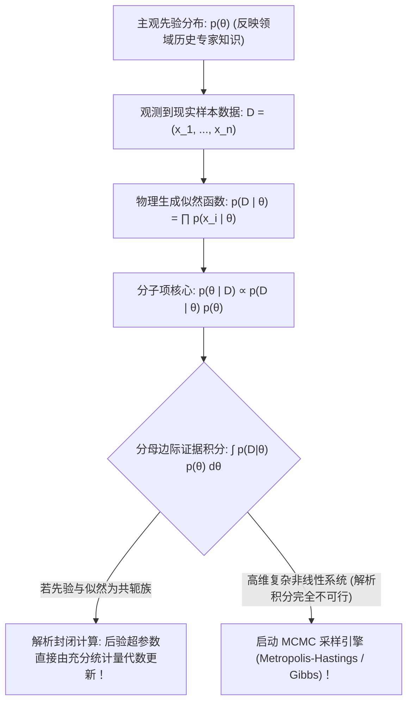

# Lec 15 贝叶斯统计推断、共轭先验与 MCMC 采样 (Bayesian Learning and MCMC)

> MIT 15.097 统计与机器学习前沿研讨 (Prediction: Machine Learning and Statistics) · 授课教师：Prof. Roy Welsch

## TL;DR

- 贝叶斯范式将未知模型参数视为带有主观先验与后验概率分布的随机变量。
- 共轭先验（Conjugate Priors）保持了先验与后验在同一分布族内的代数封闭迭代。
- 马尔可夫链蒙特卡洛（MCMC，Metropolis-Hastings 与 Gibbs 采样）攻克了高维未归一化后验积分。

## 频率学派 vs 贝叶斯学派：统计哲学的终极对话

在经典频率学派（Frequentist Paradigm）的世界观中：
未知真实参数 $\theta^*$ 是宇宙中一个**客观存在、固定不变的确定性常数**；我们所谓的概率，是随机试验在相同条件下进行无限次重复时，事件发生的极限相对频率。

而在**贝叶斯学派（Bayesian Paradigm）**的世界观中：
参数 $\theta$ 本身是一个**随机变量**；概率不是客观频率，而是**理性决策者基于当前掌握的所有证据信息，对某个未知命题所持有的主观信念置信度（Degree of Belief）**！
随着新的观测数据 $D$ 连续流入，贝叶斯分析通过概率法则，实现了人类信念的理性迭代更新：
$$
\text{后验信念 (Posterior)} \propto \text{似然数据 (Likelihood)} \times \text{先验信念 (Prior)}
$$

麻省理工学院 15.097 第十五讲以此收官，融汇**先验共轭性**与**马尔可夫链蒙特卡洛（MCMC）**现代计算前沿。

## 贝叶斯推断公理与分母归一化积分困境

设参数先验概率密度为 $p(\theta)$，观测数据集为 $D = (x_1, \dots, x_n)$。
似然函数为 $p(D \mid \theta) = \prod_{i=1}^n p(x_i \mid \theta)$。
根据连续形式贝叶斯定理，后验概率分布为：
$$
p(\theta \mid D) = \frac{p(D \mid \theta) p(\theta)}{p(D)} = \frac{p(D \mid \theta) p(\theta)}{\int_{\Theta} p(D \mid \theta) p(\theta) d\theta}
$$

在贝叶斯分析中，最大的数学灾难在于分母——**边际似然证据项（Evidence / Marginal Likelihood）**：
$$
p(D) = \int_{\Theta} p(D \mid \theta) p(\theta) d\theta
$$
当参数 $\theta$ 拥有数百个维度时，在连续空间上执行 $d$ 重多重连续积分在解析与数值上均遭遇毁灭性的维数灾难。

## 共轭先验的代数封闭之美 (Conjugate Priors)

在计算机出现之前，贝叶斯统计学家发明了巧妙的**共轭先验（Conjugate Priors）**：
若先验分布 $p(\theta)$ 与后验分布 $p(\theta \mid D)$ 属于**完全相同的概率分布族**，则该先验被称为该似然函数的共轭先验。

经典共轭配对：
1. **Beta - 二项共轭**：
设硬币正面朝上概率为 $\theta \sim \text{Beta}(\alpha, \beta)$。观测到 $n$ 次抛掷中出现 $k$ 次正面。
后验分布依然是严格的 Beta 分布，超参数直接简单相加更新：
$$
\theta \mid D \sim \text{Beta}(\alpha + k, \quad \beta + n - k)
$$
先验参数 $\alpha, \beta$ 极其优美地具象化为“虚拟的历史伪计数（Pseudo-counts）”！
2. **Dirichlet - 多项共轭**：多分类问题中多项分布的天然共轭；
3. **高斯 - 高斯共轭**：若似然为正态分布，共轭先验亦为正态分布，后验均值为先验均值与样本均值的精度加权调和平均！

## 马尔可夫链蒙特卡洛采样 (MCMC)

当面对复杂的深度层次模型、变分自编码器或非共轭系统时，解析后验不可得。
现代贝叶斯革命的核心引擎是 **MCMC（Markov Chain Monte Carlo）**：
其核心思想是：**我们根本不需要计算分母那极度复杂的积分 $p(D)$！我们构造一条遍历平稳马尔可夫链，使其平稳稳态分布恰好等于目标后验分布 $p(\theta \mid D)$，然后在该链上游走抽样！**

### 1. Metropolis-Hastings (MH) 算法
在当前状态 $\theta_t$，从提议候选分布 $q(\theta^* \mid \theta_t)$ 中抽取候选点 $\theta^*$。
计算**接受概率（Acceptance Probability）**：
$$
\alpha(\theta_t, \theta^*) = \min\left(1, \frac{p(\theta^* \mid D) q(\theta_t \mid \theta^*)}{p(\theta_t \mid D) q(\theta^* \mid \theta_t)}\right) = \min\left(1, \frac{p(D \mid \theta^*) p(\theta^*) q(\theta_t \mid \theta^*)}{p(D \mid \theta_t) p(\theta_t) q(\theta^* \mid \theta_t)}\right)
$$
注意：**分母未知的常数 $p(D)$ 在分子分母的比值中被完全对消抵消！**
以概率 $\alpha$ 接受新候选点 $\theta_{t+1} = \theta^*$，否则拒绝并停留在原地 $\theta_{t+1} = \theta_t$。
该接受率严格满足**细致平衡条件（Detailed Balance Condition）**，保证马尔可夫链稳态收敛！

### 2. 吉布斯采样 (Gibbs Sampling)
当多维联合提议难以设计时，吉布斯采样是 MH 算法在多维空间的极致特化：
在每一次迭代中，轮流固定其他所有变量，仅从**单变量满条件分布（Full Conditional Distribution）**中精确抽样：
$$
\theta_j^{(t+1)} \sim p\left(\theta_j \mid \theta_1^{(t+1)}, \dots, \theta_{j-1}^{(t+1)}, \theta_{j+1}^{(t)}, \dots, \theta_d^{(t)}, D\right)
$$
其接受概率恒为 100%，在高维层次贝叶斯网络与隐狄利克雷分布（LDA）主题模型中大放异彩。

::: pitfall 忽视 MCMC 链条自相关与未达到平稳分布的燃烧期（Burn-in）
MCMC 采样的样本绝非相互独立的 i.i.d. 样本，相邻状态存在强烈的马尔可夫自相关。必须丢弃初始未收敛的“燃烧期（Burn-in Period）”样本，并通过**Gelman-Rubin 诊断量 $\hat{R} \le 1.05$** 严格检验多条平行链的潜在收敛标度。
:::

::: insight 贝叶斯推断是用概率分布拥抱未知全貌的终极慈悲
频率学派追求唯一的极值估计点 $\hat{\theta}_{\text{MLE}}$，仿佛给出了绝对确定性的答案；
而贝叶斯学派以其特有的深邃指出：**在有限数据的世界里，任何声称拥有唯一确定真理的断言都是虚妄的。通过输出一整条完整的后验概率分布曲面，贝叶斯主义赋予了决策者量化全部不确定性风险的终极能力**。这种包容万千可能性的智慧，是统计预测科学的最高峰。
:::
