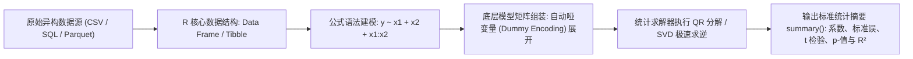

# Lec 2 统计学习计算基础与 R 语言建模实践 (R for Machine Learning & Statistical Computing)

> MIT 15.097 统计与机器学习前沿研讨 (Prediction: Machine Learning and Statistics) · 授课教师：Prof. Roy Welsch

## TL;DR

- R 语言以向量化计算（Vectorization）与数据框（Data Frame）构筑现代统计分析第一生态。
- 方差分析表、线性模型对象（lm/glm）与公式符号（Formula Syntax）奠定计量建模规范。
- 重抽样评估（Bootstrapping & K-Fold CV）为避免样本内过拟合提供了标准流程。

## 统计学家的原生编程宇宙

在机器学习的发展史上，Python 凭借其作为通用胶水语言与深度学习框架的繁荣而广为人知；
然而，在现代概率统计学、生物信息学与计量经济学领域，**R 语言（由 Ross Ihaka 与 Robert Gentleman 创立）**始终是全球顶尖统计学家表达数学思想的原生母语。

R 语言不是一门从软件工程衍生出来的通用语言，它从诞生的第一天起，每一个语法设计都是为**处理矩阵、向量、概率分布、假设检验与可视化图谱**量身定做的。

麻省理工学院 15.097 第二讲，系统确立贯穿全课的统计计算范式与数据操纵规范。

## 向量化计算与因子数据结构 (Vectorization and Factors)

在传统命令式编程（如 C++ 或 Java）中，对数组的每一个元素加 1 需要编写显式的 `for` 循环：
```r
# 传统显式循环 (低效且冗长)
for (i in 1:length(x)) { y[i] <- x[i] + 1 }
```
而在 R 语言中，底层 C 语言优化直接支持**向量化广播（Vectorized Arithmetic）**：
```r
# R 原生向量化 (底层直接调用 BLAS/LAPACK 线性代数库)
y <- x + 1
```



::: definition [因子变量与自动哑变量展开 (Factors & Design Matrix)]
在实际分类与回归中，变量往往是名义分类变量（Categorical Variables，如机器型号 `{"Type_A", "Type_B", "Type_C"}`）。
在 R 中将其定义为 `factor(x)` 后，在拟合模型 `lm(y ~ x)` 时，R 会自动依据**处理对比编码（Treatment Contrasts）**将其无损展开为 $k-1$ 个 0-1 哑变量（Dummy Variables），自动避开多重共线性导致的奇异设计矩阵（Dummy Variable Trap）！
:::

## 优雅的公式语法体系 (R Formula Syntax)

R 语言最伟大的设计之一是其紧凑优美的**公式语法（Formula Notation）**：
- `y ~ x1 + x2`：表示标准多元线性加和效应 $\beta_0 + \beta_1 x_1 + \beta_2 x_2$；
- `y ~ x1 * x2`：等价于 `y ~ x1 + x2 + x1:x2`，自动包含两个变量的**二阶乘积交互效应（Interaction Term）**；
- `y ~ . - x3`：表示使用数据集中除 `x3` 之外的所有可用自变量；
- `y ~ poly(x, 2, raw = TRUE)`：自动正交多项式展开。

模型拟合后输出的 `summary(model)` 提供了严谨的统计全息体检：
包含残差分位数、每个特征系数的无偏估计 $\hat{\beta}_i$、异方差稳健标准误 $\text{SE}(\hat{\beta}_i)$、$t$-统计量、双尾 $p$-值（`Pr(>|t|)`）、调整后确定系数 $R_{\text{adj}}^2$ 与全模型联合 $F$-检验显著性。

## 自助重抽样法与模型泛化验证 (Bootstrapping)

统计学习的灵魂是评估估计量的方差不确定性。当样本总体分布未知、无法使用经典渐近正态公式时，布拉德利·埃夫隆（Bradley Efron, 1979）发明的**自助法（Bootstrapping）**成为了万能利器。

从大小为 $n$ 的原始训练集 $\mathcal{D}$ 中，进行**有放回的等概率随机抽样（Sampling with Replacement）**，重复抽取 $n$ 次构成一个 Bootstrap 样本集 $\mathcal{D}^*$。
重复该过程 $B = 1000$ 次，生成 1000 个平行的估计量副本 $\{\hat{\theta}^{*b}\}_{b=1}^B$。
估计量的标准误差直接由这 1000 个副本的样本标准差无偏给出：
$$
\text{SE}_{\text{boot}}(\hat{\theta}) = \sqrt{\frac{1}{B - 1}\sum_{b=1}^B \left(\hat{\theta}^{*b} - \bar{\theta}^*\right)^2}
$$

::: pitfall 忽视训练集与测试集的数据泄漏（Data Leakage）
在 R 语言进行特征标准化（如 `scale(x)`）或主成分提取（PCA）时，若在划分训练集与测试集之前对全量数据执行归一化，测试集的均值与方差信息会悄悄“渗透”进训练集，导致交叉验证报告出极其乐观但完全虚假的超高测试精度。
:::

::: insight 编程语言塑造了思考统计问题的方式
Python 是工程师的思维：重视接口统一、对象封装与管道调用；
而 R 是统计学家的思维：**它把随机变量的样本分布当做一等公民，每一个函数输出不仅告诉你最优参数是多少，更紧紧附带着该参数在置信区间意义下的统计显著度**。理解这种对不确定性的敬畏，是每一位数据科学家走向成熟的标志。
:::
