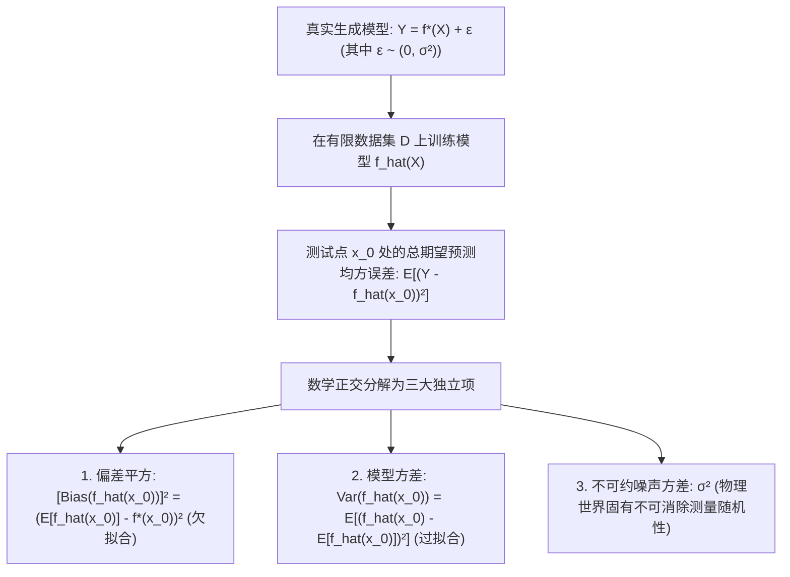

# Lec 3 统计学习基础：经验风险最小化与偏差-方差权衡 (Fundamentals of Machine Learning)

> MIT 15.097 统计与机器学习前沿研讨 (Prediction: Machine Learning and Statistics) · 授课教师：Prof. Roy Welsch

## TL;DR

- 统计学习理论将预测建模抽象为未知数据联合分布下的真实风险（Risk）泛函极小化。
- 偏差-方差分解（Bias-Variance Decomposition）揭示了欠拟合与过拟合之间不可避免的权衡铁律。
- K-折交叉验证（K-Fold Cross-Validation）提供了无偏估计泛化误差的标准黄金准则。

## 预测的本质：从已知样本推断未知总体

机器学习的终极追求是**泛化能力（Generalization Ability）**：模型不仅要在我们手头已经观测到的有限历史数据上表现良好，更要在未来未曾见过的未知测试数据上依然保持极高的预测精度。

在初等数据分析中，人们容易陷入“盲目追求训练误差为 0”的狂热陷阱：通过不断增加模型参数（如构建 50 阶多项式或无限深度决策树），使拟合曲线穿过训练集的每一个数据点。然而，这种模型在面对新数据时会瞬间崩溃。

麻省理工学院 15.097 第三讲深入统计学习理论的核心腹地，推导支配一切监督学习算法的永恒公理——**偏差-方差权衡（Bias-Variance Tradeoff）**。

## 真实风险 vs 经验风险最小化 (ERM)

设输入特征向量 $X \in \mathcal{X} \subset \mathbb{R}^d$，输出响应变量 $Y \in \mathcal{Y}$，其底层联合概率分布为未知的 $\mathbb{P}(X, Y)$。
设损失函数为 $L(y, f(x))$（例如平方误差损失 $L(y, \hat{y}) = (y - \hat{y})^2$）。
我们真正追求的终极目标是**真实期望风险（Expected Risk / Generalization Error）全局最小**：
$$
R(f) = \mathbb{E}_{(X, Y) \sim \mathbb{P}}[L(Y, f(X))] = \int_{\mathcal{X} \times \mathcal{Y}} L(y, f(x)) d\mathbb{P}(x, y)
$$
然而，由于联合分布 $\mathbb{P}$ 是大自然的终极机密，我们根本无法直接计算这个全积分！

我们手中唯一拥有的是由分布 $\mathbb{P}$ 独立同分布抽样生成的有限样本训练集 $\mathcal{D}_n = \{(x_i, y_i)\}_{i=1}^n$。
瓦普尼克提出了以样本算术均值代替总体期望的**经验风险最小化原则（Empirical Risk Minimization, ERM）**：
$$
\hat{R}_n(f) = \frac{1}{n}\sum_{i=1}^n L(y_i, f(x_i))
$$

## 偏差-方差分解定理 (The Bias-Variance Decomposition)

假设真实的物理数据生成过程为：
$$
Y = f^*(X) + \epsilon
$$
其中真实的未知回归函数为 $f^*(x) = \mathbb{E}[Y \mid X = x]$，随机噪声满足 $\mathbb{E}[\epsilon] = 0, \text{Var}(\epsilon) = \sigma^2$，且 $\epsilon$ 独立于 $X$。

设算法基于随机训练集 $\mathcal{D}$ 拟合出的预测模型为 $\hat{f}(x; \mathcal{D})$。
考察对于任意固定的测试点 $x_0$，预测值 $\hat{f}(x_0)$ 与真实标签 $Y$ 之间的**期望预测均方误差（Expected Mean Squared Error）**：

::: theorem [偏差-方差分解恒等式]
在所有可能的随机训练集 $\mathcal{D}$ 上对模型取数学期望，测试误差严格正交分解为三大项：
$$
\mathbb{E}_{\mathcal{D}, \epsilon}\left[(Y - \hat{f}(x_0))^2\right] = \left[\text{Bias}(\hat{f}(x_0))\right]^2 + \text{Var}_{\mathcal{D}}(\hat{f}(x_0)) + \sigma^2
$$
其中：
1. **偏差平方（Squared Bias）**：
$$
\text{Bias}(\hat{f}(x_0)) = \mathbb{E}_{\mathcal{D}}[\hat{f}(x_0)] - f^*(x_0)
$$
衡量了算法在大量不同数据集上训练出的平均预测，距离真实物理真相 $f^*(x_0)$ 的系统性偏离距离（反映了模型的表达假设能力）；
2. **方差（Variance）**：
$$
\text{Var}_{\mathcal{D}}(\hat{f}(x_0)) = \mathbb{E}_{\mathcal{D}}\left[\left(\hat{f}(x_0) - \mathbb{E}_{\mathcal{D}}[\hat{f}(x_0)]\right)^2\right]
$$
衡量了由于训练集的微小随机扰动，导致拟合模型产生剧烈上下震荡的波动幅度（反映了模型对特定样本的敏感度）；
3. **不可约噪声（Irreducible Noise, $\sigma^2$）**：由物理世界测量仪器与环境随机性决定的固有下限，任何完美算法均无法超越。
:::

### 宇宙间的模型复杂度天平
- **低复杂度模型（如简单一元线性回归）**：参数极少，在不同数据集上训练出的直线几乎一动不动（方差极低），但根本无法捕捉曲线真相（偏差极高，**欠拟合 Underfitting**）；
- **高复杂度模型（如高阶神经网络或超深决策树）**：模型极其灵活可以拟合任意曲面（偏差极低），但在不同训练集之间发生疯狂跳跃翻滚（方差极高，**过拟合 Overfitting**）。

最佳的泛化能力，永远落在偏差平方曲线与方差曲线相交的“U 型谷底”！

## K-折交叉验证 (K-Fold Cross-Validation)

如何客观评估模型在“U 型谷底”中的精确位置？
**K-折交叉验证**提供了工业界的标准量化铁律：
1. 将全量样本集随机均匀打散，切分为 $K$ 个大小相等的互斥子集（Folds $D_1, \dots, D_K$，通常取 $K = 5$ 或 $10$）；
2. 执行 $K$ 轮模型训练：在第 $k$ 轮中，保留第 $k$ 折子集 $D_k$ 作为纯净的验证集，使用其余 $K-1$ 个子集拟合模型；
3. 计算跨 $K$ 次验证的平均泛化误差：
$$
\text{CV}_{(K)} = \frac{1}{K}\sum_{k=1}^K \text{MSE}_k
$$
通过在正则化超参数网格上寻找使 $\text{CV}_{(K)}$ 最小的点，算法能够客观锁定最佳模型复杂度。

::: pitfall 将测试集参与交叉验证参数选择
如果为了追求漂亮的学术汇报，在独立的测试集（Test Set）上不断微调超参数以挑选最好成绩，测试集实际上已经沦为第二训练集！这会导致所谓的“元过拟合（Meta-Overfitting）”。必须严格保持训练集、验证集与盲测集（Blind Test Set）的三重物理隔离。
:::

::: insight 偏差与方差是认知科学在数学中的终极投影
在人类认识世界的过程中，固执偏执的人抱守成见（高偏差、低方差），对外界的新证据视而不见；神经质的人对每一个微小细节过度反应（低偏差、高方差），陷入无尽的疑神疑鬼。
**优秀的学习算法与智慧的人格惊人同构：它既具备足够的模型容量容纳世界的复杂细节，又通过奥卡姆剃刀与正则化保持内在的稳定定力**。这正是统计学习的最高美感。
:::
