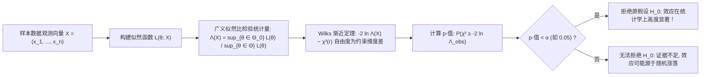

# Lec 4 统计推断、似然比检验与多重假设校正 (Statistical Inference and Hypothesis Testing)

> MIT 15.097 统计与机器学习前沿研讨 (Prediction: Machine Learning and Statistics) · 授课教师：Prof. Roy Welsch

## TL;DR

- 经典统计推断通过置信区间与抽样分布量化总体真实参数的认知不确定性。
- Neyman-Pearson 引理与似然比检验（LRT）确立了在控制一类错误下功效（Power）最大的最优检验准则。
- 多重检验假阳性爆炸催生了 Bonferroni 强控制与 Benjamini-Hochberg 错误发现率（FDR）。

## 从点预测走向公理化推断

在很多纯计算机工程应用中，人们往往只关心输出一个预测数值 $\hat{y}$；
然而，在药物临床试验、金融因果归因、宏观经济政策评估与科学假说验证中，**孤立的预测数值毫无意义，我们必须回答严谨的统计推断问题（Statistical Inference）**：
- 新研发的抗癌药物在统计学上是否显著优于安慰剂？
- 营销团队在电商页面更换的红色购买按钮，带来的转化率提升究竟是真实的业务突破，还是纯粹的随机数据抽样噪声？
- 当基因测序同时检测人类 20,000 个基因表达水平时，如何防止纯随机波动带来的成百上千个虚假假阳性（False Positives）？

麻省理工学院 15.097 第四讲深入数理统计学的公理体系，系统梳理从**似然比检验（LRT）**到**多重检验校正（FDR）**的严密数学大厦。

## 假设检验的两大类型错误与检出力

设总体分布依赖于未知参数 $\theta \in \Theta$。我们提出一对互斥的统计假说：
- 原假设（Null Hypothesis）：$H_0: \theta \in \Theta_0$（通常代表无效应、无差异、基准状态）；
- 备择假设（Alternative Hypothesis）：$H_1: \theta \in \Theta_1 = \Theta \setminus \Theta_0$（代表发现新效应、有显著差异）。

任何基于有限样本的决策规则，在面对真实未知世界时都会面临两类不可避免的犯错风险：

| 决策结论 \ 真实客观世界 | 原假设 $H_0$ 为真 (真实无效应) | 原假设 $H_0$ 为假 (真实有效应) |
| :---: | :---: | :---: |
| **拒绝 $H_0$ (宣称显著)** | **第一类错误 (Type I Error / 假阳性)** 概率 $\alpha = \mathbb{P}(\text{Reject } H_0 \mid H_0)$ (显著性水平) | **正确决策 (True Positive)** 概率 $1 - \beta$ (**检出力 / Power**) |
| **接受 $H_0$ (未能宣称)** | **正确决策 (True Negative)** 概率 $1 - \alpha$ (置信水平) | **第二类错误 (Type II Error / 假阴性)** 概率 $\beta = \mathbb{P}(\text{Accept } H_0 \mid H_1)$ |

统计推断的公理原则（Neyman-Pearson 范式）：**优先死守第一类错误率不超过严格预设的极低门槛（如 $\alpha = 0.05$ 或 $0.01$），在此前提下竭尽全力最大化检验的功效（Power $1 - \beta$）！**

## Neyman-Pearson 引理与广义似然比检验 (LRT)

对于简单假设对简单假设（$H_0: \theta = \theta_0$ vs $H_1: \theta = \theta_1$），耶日·内曼（Jerzy Neyman）与埃贡·皮尔逊（Egon Pearson）在 1933 年证明了数理统计学最重要的基础引理：

::: theorem [Neyman-Pearson 基础引理]
在给定的显著性水平 $\alpha$ 下，使得功效 $1 - \beta$ 达到绝对最大的**一致最优势检验（Most Powerful Test）**，必须且仅能以**似然比（Likelihood Ratio）**作为检验统计量：
$$
\Lambda(x) = \frac{L(\theta_1; x)}{L(\theta_0; x)} > k_\alpha
$$
阈值 $k_\alpha$ 由 $\mathbb{P}_{\theta_0}(\Lambda(X) > k_\alpha) = \alpha$ 唯一确定。
:::

对于更一般的复合假设，**广义似然比检验（Generalized Likelihood Ratio Test, GLRT）**定义为受约束最大似然与无约束全局最大似然的比值：
$$
\lambda_{\text{LR}} = \frac{\sup_{\theta \in \Theta_0} L(\theta; X)}{\sup_{\theta \in \Theta} L(\theta; X)} \in [0, 1]
$$
塞缪尔·威尔克斯（Samuel S. Wilks）在 1938 年建立了著名的渐近定理：

::: theorem [Wilks 渐近大样本卡方定理]
在原假设 $H_0$ 为真的条件下，当样本容量 $n \to \infty$ 时，对数似然比统计量的两倍严格收敛于**卡方分布**：
$$
-2 \ln \lambda_{\text{LR}} \xrightarrow{d} \chi^2(r)
$$
其中自由度 $r = \dim(\Theta) - \dim(\Theta_0)$ 精确等于原假设所施加的独立独立参数约束数量！
:::

## 多重检验灾难与 FDR 错误发现率控制

在大数据、全基因组关联分析（GWAS）与量化金融多因子挖掘中，我们往往同时并行进行 $m = 10,000$ 次独立的假设检验。
若对每一次检验均采用传统的 $\alpha = 0.05$ 门槛：
即使所有假设全部都是毫无效果的纯噪声，全系统发生至少一次假阳性误报的概率高达：
$$
\mathbb{P}(\text{至少一次假阳性}) = 1 - (1 - 0.05)^{10000} = 1 - (0.95)^{10000} \approx 1 - 10^{-223} \approx 100\%！
$$
预期会凭空诞生 $10000 \times 0.05 = 500$ 个虚假的“重大科学发现”！这就是著名的**多重比较假阳性灾难（Multiple Testing Crisis）**。

### 1. Bonferroni 强控制族错误率 (FWER)
为了使全族发生哪怕一次假阳性的总概率受控在 $\alpha$，最保守的经典方案是 **Bonferroni 校正**：
将每个单独检验的显著性阈值严苛缩小为：
$$
\alpha_{\text{Bonferroni}} = \frac{\alpha}{m}
$$
若 $m = 10000$，单次门槛降至 $0.000005$！
Bonferroni 具有绝对的理论安全性，但其**过度保守**，会导致检验功效暴跌，误杀大量真实的微弱科学信号。

### 2. Benjamini-Hochberg 错误发现率 (FDR)
1995 年，Yoav Benjamini 与 Yosef Hochberg 提出了颠覆全球生物信息学与现代数据科学的**错误发现率（False Discovery Rate, FDR）**准则：
FDR 不再追求“绝对不犯一次错”，而是控制**在所有被宣称为显著发现的结果中，假阳性所占的期望比例不超过预设阈值 $q$（如 5%）**：
$$
\text{FDR} = \mathbb{E}\left[\frac{\text{错误拒绝数 } V}{\text{总拒绝数 } R} \mid R > 0\right] \cdot \mathbb{P}(R > 0) \le q
$$

::: theorem [BH 阶梯上升校正过程 (Benjamini-Hochberg Procedure)]
1. 将所有 $m$ 个检验计算出的原始 $p$-值按升序严格排序：$p_{(1)} \le p_{(2)} \le \dots \le p_{(m)}$；
2. 寻找满足以下不等式的**最大排序索引** $k^*$：
$$
k^* = \max \left\{k : p_{(k)} \le \frac{k}{m} q\right\}
$$
3. 拒绝所有前 $k^*$ 个假设对应的原假设：即判定 $H_{(1)}, H_{(2)}, \dots, H_{(k^*)}$ 为真正的显著发现！
:::
Benjamini-Hochberg 定理严格证明了：在独立性与正相依条件下，该算法严格保证 $\text{FDR} \le q$！它在严格控制假阳性的同时，释放了极其强大的真实信号检出能力。

::: pitfall 随意窥探数据后修改假说（HARKing）
在学术研究与商业分析中，严禁在看完数据后才去逆向编造假设（Hypothesizing After Results are Known, HARKing）或反复挑选指标直到出现 $p < 0.05$（$p$-hacking）。这种行为彻底摧毁了先验概率的地基，导致发表的结论在现实生产中毫无复现性。
:::

::: insight 统计推断是科学探索在面对偶然性时的理性盾牌
自然界充满了随机扰动的烟雾弹。
统计推断与假设检验的伟大之处，在于它在科学家的热情好奇心与冰冷的客观现实之间，设立了一道严密的法庭公理：**任何主张在被数据法庭采纳之前，都必须在原假设的严格拷问下，证明其超越随机巧合的数学可信度**。这种对证据链的极致追求，是现代实证科学最宝贵的品格。
:::
