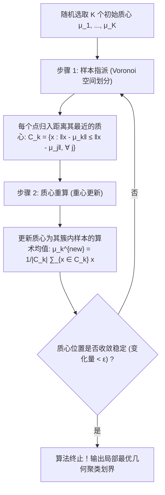

# Lec 5 无监督学习：K-Means 聚类、谱聚类与层次聚类 (Unsupervised Clustering)

> MIT 15.097 统计与机器学习前沿研讨 (Prediction: Machine Learning and Statistics) · 授课教师：Prof. Roy Welsch

## TL;DR

- 无监督聚类在缺乏外部标签引导下发掘高维空间样本点内生的几何团簇流形。
- K-Means Lloyd 算法通过交替分配与质心更新实现组内平方误差（WCSS）局部极小化。
- 谱聚类（Spectral Clustering）利用图拉普拉斯矩阵谱嵌入攻克非凸环形几何流形划分。

## 没有教师的学习：发现数据的内在几何结构

在监督学习中，每一个样本都配有一位全知全能的“教师”，明确告诉算法该样本属于哪一类标签 $y$。
然而在现实世界中，**超过 95% 的工业与自然数据是完全没有标签的原始数据**：
- 社交网络用户群体的兴趣圈层自发聚类；
- 金融反洗钱系统中罕见可疑交易团伙的无监督识别；
- 基因芯片上成千上万个基因在不同癌细胞组织中的共表达模块挖掘。

**聚类分析（Clustering Analysis）**是无监督学习的第一支柱：它的核心使命是在没有外部监督信号的前提下，**将特征空间中的样本点划分为若干个互斥子集（Clusters），使得同一子集内部的样本相似度极高（高内聚），而不同子集之间的样本差异度极大（高分离）**。

## K-Means 聚类与组内平方误差极小化

设样本集为 $\mathcal{D} = \{x_1, x_2, \dots, x_n\} \subset \mathbb{R}^d$。目标是将这 $n$ 个点划分为预先指定的 $K$ 个聚类集合 $\mathcal{C} = \{C_1, C_2, \dots, C_K\}$。
记聚类 $k$ 的几何质心（Centroid）为均值向量 $\mu_k = \frac{1}{|C_k|}\sum_{x \in C_k} x$。

经典的 K-Means 优化目标为极小化**组内平方和（Within-Cluster Sum of Squares, WCSS）**：
$$
\min_{\mathcal{C}} \quad J(\mathcal{C}, \mu) = \sum_{k=1}^K \sum_{x \in C_k} \|x - \mu_k\|_2^2 = \sum_{i=1}^n \sum_{k=1}^K r_{ik} \|x_i - \mu_k\|_2^2
$$
其中 $r_{ik} \in \{0, 1\}$ 为 0-1 指示变量（若样本 $i$ 被指派给聚类 $k$ 则为 1，且满足 $\sum_k r_{ik} = 1$）。

::: theorem [Lloyd 坐标轮换交替极小化定理 (Lloyd's Algorithm)]
Stuart Lloyd 在 1957 年提出的经典 K-Means 算法，本质上是在离散指派矩阵 $R$ 与连续质心空间 $\mu$ 之间进行的**块坐标下降法（Block Coordinate Descent）**：
1. **固定质心 $\mu$ 优化 $R$**：目标函数关于每个样本完全解耦，最优解显然是将点分配给欧氏距离最近的质心；
2. **固定指派 $R$ 优化 $\mu$**：关于 $\mu_k$ 求导置零 $\sum_{x \in C_k} 2(\mu_k - x) = 0$，极值解唯一且严格等于簇内样本的算术重心！
每次迭代使得连续有界的非负目标函数 $J$ 严格单调递减，**算法必然在有限步内收敛至局部极小值！**
:::

## 初始质心敏感性与 K-Means++ 概率播种

经典 K-Means 最受诟病的阿喀琉斯之踵在于**对随机初始质心的极度敏感性**：如果随机选取的两个初始点落在同一个真实簇内，算法会深陷低质局部最优，甚至产生极差的切片划分。

2007 年 David Arthur 与 Sergei Vassilvitskii 提出了震动业界的 **K-Means++ 播种算法**：
1. 在样本集中完全均匀随机选取第 1 个质心 $\mu_1$；
2. 对于任意样本点 $x$，计算其到**已有全部质心集合的最短距离平方**：$D(x)^2 = \min_{j} \|x - \mu_j\|^2$；
3. 以正比于距离平方的概率分布选择下一个新质心：
$$
\mathbb{P}(x \text{ 被选为新质心}) = \frac{D(x)^2}{\sum_{z \in \mathcal{D}} D(z)^2}
$$
4. 重复直到选满 $K$ 个质心。

::: theorem [K-Means++ 近似比保证定理]
通过使新质心尽可能彼此远离的高概率播种机制，K-Means++ 期望上达到的组内平方和满足严格的理论常数界：
$$
\mathbb{E}[J_{\text{K-Means++}}] \le 8(\ln K + 2) J_{\text{Optimal}}
$$
在实践中，K-Means++ 不仅收敛速度提升数倍，更使得最终聚类误差大幅削减 20%-40%！
:::

## 层次聚类树状图 (Hierarchical Clustering & Dendrograms)

与必须预先假定聚类数 $K$ 的 K-Means 不同，**层次聚类（Hierarchical Clustering）**构建的是一个包含全部尺度的多层次树状结构（Dendrogram）：
- **聚合层次法（Agglomerative / Bottom-Up）**：初始时将每个样本视为独立的单一簇；在每一步迭代中，计算所有簇对之间的距离，将距离最近的两个簇合并为一个新簇，直至最终融合成一个全局大簇。

簇间距离定义（Linkage Criteria）决定了聚类的几何形状偏好：
1. **单连接（Single Linkage）**：$d(A, B) = \min_{x \in A, y \in B} \|x - y\|$。倾向于寻找长链条状流形，容易发生“链条粘连（Chaining Effect）”；
2. **全连接（Complete Linkage）**：$d(A, B) = \max_{x \in A, y \in B} \|x - y\|$。倾向于寻找紧凑、等直径的紧密球形簇；
3. **平均连接（Average Linkage）**：$d(A, B) = \frac{1}{|A||B|}\sum_{x \in A} \sum_{y \in B} \|x - y\|$。稳健折中；
4. **Ward 方差极小化法（Ward's Linkage）**：每次合并使得全系统组内离差平方和增量最小，在噪声存在下表现极佳。

## 谱聚类突破凸几何极限 (Spectral Clustering)

当数据呈现复杂的非凸流形（例如内外嵌套的双环形分布、两弯相互缠绕的同心月牙流形）时，基于欧氏中心距离的 K-Means 与高斯混合模型（GMM）会彻底失效，因为它们本质上只能切出超平面的凸多胞形（Voronoi Cells）。

**谱聚类（Spectral Clustering）**利用图论拉普拉斯矩阵的代数谱，打破了这一几何枷锁：
1. 构建样本点之间的**亲和度邻接图（Affinity Graph）**，权重矩阵 $W_{ij} = \exp(-\|x_i - x_j\|^2 / 2\sigma^2)$；
2. 计算度矩阵 $D = \text{diag}(d_i)$ 与**归一化图拉普拉斯矩阵（Normalized Graph Laplacian）**：
$$
L_{\text{sym}} = I - D^{-1/2} W D^{-1/2}
$$
3. 提取矩阵 $L_{\text{sym}}$ 的前 $K$ 个最小非零特征值对应的特征向量，将其作为坐标在低维流形空间中重新投影；
4. 在这个经过拓扑拉伸解缠绕的新坐标空间中，原本高度扭曲非凸的环形流形被神奇地拉开为彼此正交分离的点阵，此时只需调用一次简单的标准 K-Means，即可完美切出任意复杂形状的非凸簇！

::: pitfall 忽视特征变量量纲尺度不一致对欧氏距离的污染
若特征 1 是年收入（取值在 $10^4$ 到 $10^6$），特征 2 是年龄（取值在 20 到 80）。未经标准化的欧氏距离将被年收入项彻底绝对支配，年龄特征完全丧失任何距离辨识力。运行聚类前必须对所有连续特征执行 Z-score 规范化（`scale()`）。
:::

::: insight 聚类是人类对自然界离散归纳本能的数学重构
在认知哲学中，人类认识世界的开端就是“物以类聚”。
从林奈双名法对地球生物分类，到门捷列夫元素周期表；
**聚类算法展现了数学在缺乏裁判时的深刻自组织力量：它依靠样本点在微观欧氏空间中的万有引力与图拓扑的共振谐调，自然凝聚出宏观世界的秩序与形态**。这是探索高维未知世界最敏锐的眼睛。
:::
