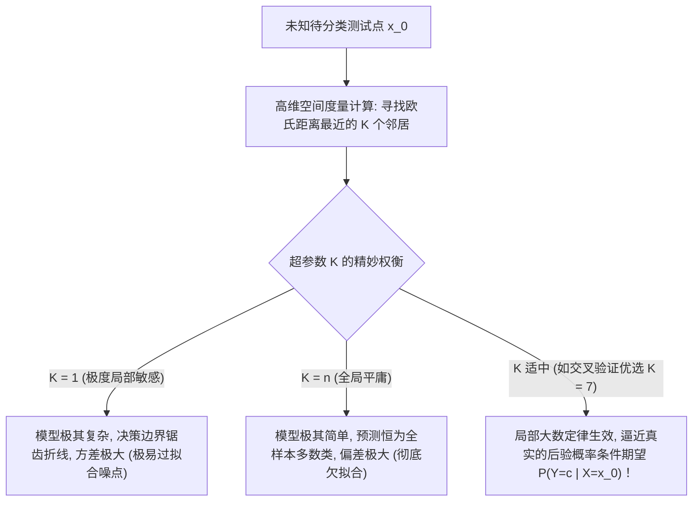

# Lec 6 非参数估计：K 近邻分类器与核密度估计 (Non-Parametric Methods: KNN and Density Estimation)

> MIT 15.097 统计与机器学习前沿研讨 (Prediction: Machine Learning and Statistics) · 授课教师：Prof. Roy Welsch

## TL;DR

- 非参数估计打破了经典统计学对总体服从刚性先验参数族（如高斯分布）的狭隘假设。
- K 近邻算法（KNN）通过局部大数投票逼近贝叶斯最优决策边界、渐近误差严格不超最优解两倍。
- 维度灾难（Curse of Dimensionality）揭示了高维超球空间极端稀疏化对局部邻域估计的致命瓦解。

## 抛弃分布假设的自由度革命

在参数统计学（Parametric Statistics）中，我们习惯于首先做出一个宏大的先验假设：“假设总体数据服从某个带有未知参数 $\theta$ 的特定分布族（例如单峰对称的一维正态分布 $\mathcal{N}(\mu, \sigma^2)$）”，随后将所有的精力投入到对参数 $\theta$ 的矩估计或极大似然估计上。

然而，大自然往往并不遵循人类教科书上写下的简单公式：
- 在风电功率预测、金融资产回报率与图像像素分布中，真实的概率密度往往呈现严重的多峰、厚尾、偏斜与奇异流形结构；
- 如果先验模型假设本身就是错误的（Model Misspecification），参数拟合无论多么精密，求出的结论从起点开始就是彻头彻尾的谬论。

**非参数学习方法（Non-Parametric Methods）**秉承彻底的数据驱动哲学：**“让数据自己为自己代言”**。我们不预先限定任何固定的函数形状，模型的复杂度与参数量随着收集到的数据规模动态生长。

## K 近邻分类器 (K-Nearest Neighbors, KNN)

KNN 是整个机器学习领域最朴素、最符合人类常理直觉，却又拥有极深数理根基的分类算法。

设给定训练样本集 $\mathcal{D} = \{(x_i, y_i)\}_{i=1}^n$。
对于任意一个未知的待预测测试点 $x_0$：
1. 计算点 $x_0$ 到训练集中所有样本点 $x_i$ 的度量距离（如欧氏距离 $d(x_0, x_i) = \|x_0 - x_i\|_2$ 或曼哈顿距离）；
2. 筛选出距离 $x_0$ 最近的 $K$ 个邻居点集合，记为 $\mathcal{N}_K(x_0)$；
3. 根据邻域内的绝大多数投票（Majority Vote）决定类别标签：
$$
\hat{y}(x_0) = \arg\max_{c} \sum_{i \in \mathcal{N}_K(x_0)} \mathbf{1}_{\{y_i = c\}}
$$

::: theorem [Cover-Hart 渐近误差极限理论 (Cover & Hart, 1967)]
托马斯·科弗（Thomas Cover）与彼得·哈特证明了统计模式识别历史上最震撼的理论之一：
设贝叶斯最优分类器（Bayes Optimal Classifier，即掌握了完全真实后验概率分布的理想神谕）的理论极限最低错误率为 $R^* = \mathbb{P}(Y \ne f_{\text{Bayes}}(X))$。
则当样本容量趋向无穷大（$n \to \infty$）时，**最简单的 1-近邻算法（1-NN）的渐近泛化错误率 $R_{1\text{-NN}}$ 满足严格理论上限**：
$$
R^* \le R_{1\text{-NN}} \le 2 R^* (1 - R^*) \le 2 R^*
$$
这一定理宣告：**即使没有任何复杂的训练和优化，单凭一个最简单的 1-NN 查表法，在大样本极限下，其犯错概率绝不会超过全宇宙全知全能的上帝最优错误率的两倍！**
:::

## 连续概率密度估计：从直方图到核密度估计 (KDE)

除了离散分类，非参数统计的另一大核心任务是估算连续概率密度函数 $f(x) = \frac{d\mathbb{P}}{dx}$。

最原始的方法是划分等间距的直方图（Histograms），但直方图具有两大致命硬伤：阶梯跳跃处处不连续、且形状极度依赖于箱子边界原点的随意摆放。
埃马纽埃尔·帕森（Emanuel Parzen）与默里·罗森布拉特（Murray Rosenblatt）提出了现代**核密度估计（Kernel Density Estimation, KDE / Parzen Windows）**。

::: definition [核密度估计标准公式]
设样本 $x_1, \dots, x_n$ 独立同分布于未知连续密度 $f(x)$。
定义其核密度估计量为：
$$
\hat{f}_h(x) = \frac{1}{n h^d} \sum_{i=1}^n K\left(\frac{x - x_i}{h}\right)
$$
其中：
- $K(\cdot)$ 为满足对称、非负且单位积分为 1 的**核函数**（如标准高斯核 $K(u) = \frac{1}{\sqrt{2\pi}} e^{-u^2 / 2}$）；
- $h > 0$ 为至关重要的平滑参数——**带宽（Bandwidth）**。
:::

### 带宽 $h$ 的最优渐近积分均方误差 (AMISE)
带宽 $h$ 的选择是一场典型的偏差-方差博弈：
- $h$ 过小：拟合曲面呈现无数个尖锐毛刺（Under-smoothing）；
- $h$ 过大：密度峰值被严重削平抹平（Over-smoothing）。
优化渐近积分均方误差（Asymptotic Mean Integrated Squared Error, AMISE），推导出著名的 **Silverman 最优经验带宽法则**：
$$
h^* = 1.06 \cdot \hat{\sigma} \cdot n^{-1/5}
$$

## 致命绝壁：维度灾难 (The Curse of Dimensionality)

虽然非参数方法在低维（1-3 维）空间表现堪称完美，但在高维数据（如 $d \ge 50$）中，它们会遭遇残酷的物理毁灭——理查德·贝尔曼（Richard Bellman）命名的**维度灾难**。

考察高维欧氏超立方体 $[0, 1]^d$：
假设我们希望在测试点周围划定一个小超立方体局部邻域，使其仅仅包含全空间 **10%（0.1）的邻近样本点**。
那么这个小立方体的每一条边长 $l$ 必须达到多少？
$$
l^d = 0.1 \implies l = (0.1)^{1/d}
$$
- 当 $d = 1$ 时：$l = 0.1$（真正的局部微小邻域）；
- 当 $d = 10$ 时：$l = 0.1^{0.1} \approx 0.794$！
- 当 $d = 100$ 时：$l = 0.1^{0.01} \approx 0.977$！

::: pitfall 高维空间中“最近邻”不再是局部的物理幻觉
注意看这个数字：在 100 维空间中，为了捕获区区 10% 的最近邻居，你必须在每一个特征维度上跨越全空间 **97.7% 的整个宽度范围**！
这意味着：**在高维空间中，所谓的“最近邻”根本不是局部点，它们在距离上与全空间任意点几乎一样遥远！高维欧氏空间的体积几乎 100% 集中在外层薄薄的超球壳表面，中心腹地彻底空洞化**。
这导致基于局部距离度量的 KNN 与 KDE 在高维空间彻底丧失统计辨识力，必须在降维（PCA/t-SNE）或特征选择后才能运行。
:::

::: insight 非参数方法是数据密度丰饶时代的特权
非参数估计的灵魂在于“用局部密度置换全局假设”。
在数据密集的低维空间，它免去了人类一切自作聪明的先验猜测，以最朴素的近邻投票直击真相；
**而维度灾难冷酷地警告我们：高维世界是一片空旷冰冷的宇宙，没有哪种算法能在缺乏结构假设的前提下仅凭有限样本征服高维虚空**。这种对维度边界的敬畏，驱动着后续正则化与高维降维理论的发展。
:::
