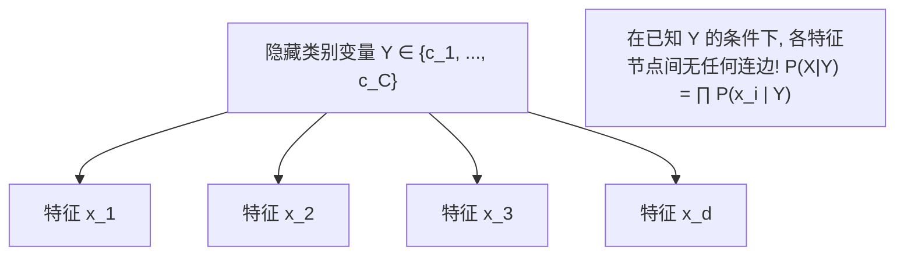

# Lec 7 概率生成模型：朴素贝叶斯与有向无环图 (Naive Bayes and Bayesian Networks)

> MIT 15.097 统计与机器学习前沿研讨 (Prediction: Machine Learning and Statistics) · 授课教师：Prof. Roy Welsch

## TL;DR

- 判别式模型与生成式模型构成了监督机器学习对联合分布与条件分布建模的两大哲学流派。
- 朴素贝叶斯（Naive Bayes）通过特征条件独立性假设消解了高维多项分布参数爆炸。
- 有向无环图（DAG）与贝叶斯信念网络通过 d-分离（d-Separation）形式化刻画因果条件独立结构。

## 判别式 vs 生成式：建模世界的两大世界观

在监督机器学习中，面对特征 $X$ 与类别标签 $Y$，全球算法学者分化为两大截然不同的思想学派：
1. **判别式模型（Discriminative Models，如 SVM、逻辑回归）**：
主张“实用主义”：我不关心输入特征 $X$ 自己是如何生成的，我也不关心不同特征之间的微观物理关联，我**仅仅专注于直接学习条件概率分布 $\mathbb{P}(Y \mid X)$**，寻找最佳的分类切分超平面；
2. **生成式模型（Generative Models，如朴素贝叶斯、高斯混合模型 GMM、隐马尔可夫模型 HMM）**：
主张“全知全能”：试图为每一类实体建立完整的物理生成画像，即学习**特征与标签的联合概率分布 $\mathbb{P}(X, Y) = \mathbb{P}(X \mid Y)\mathbb{P}(Y)$**，在分类时通过贝叶斯定理反向推导后验分布。

麻省理工学院 15.097 第七讲深入**概率图模型（Probabilistic Graphical Models, PGM）**与生成式分类的核心语法。

## 贝叶斯后验决策公理与参数灾难

根据贝叶斯定理（Bayes' Theorem），给定输入特征向量 $X = (x_1, x_2, \dots, x_d)$，其属于类别 $c \in \{1, \dots, C\}$ 的后验概率为：
$$
\mathbb{P}(Y = c \mid X) = \frac{\mathbb{P}(X \mid Y = c) \mathbb{P}(Y = c)}{\mathbb{P}(X)} = \frac{\mathbb{P}(X \mid Y = c) \mathbb{P}(Y = c)}{\sum_{k=1}^C \mathbb{P}(X \mid Y = k) \mathbb{P}(Y = k)}
$$
分类决策遵循**最大后验概率准则（Maximum A Posteriori, MAP）**：
$$
\hat{y}(X) = \arg\max_{c} \mathbb{P}(X \mid Y = c) \mathbb{P}(Y = c)
$$
其中先验概率 $\mathbb{P}(Y = c)$ 可以直接通过样本中各类别的出现频率无偏估计。

然而，致命的瓶颈在于**类条件概率密度 $\mathbb{P}(X \mid Y = c) = \mathbb{P}(x_1, x_2, \dots, x_d \mid Y = c)$**：
如果每个特征仅取 2 个离散值（0 或 1），要在没有独立性假设的前提下完整描绘这 $d$ 个特征的联合条件分布，每个类别需要估计的自由参数数量高达 $2^d - 1$ 个！
若 $d = 50$，$2^{50} \approx 10^{15}$，即使穷尽全人类全部服务器，也绝不可能有足够的样本去估计如此庞大的参数联合分布表。

## 朴素贝叶斯分类器 (Naive Bayes Classifier)

面对这一高维参数绝壁，1950 年代统计学家引入了一条看似极度激进、近乎天真的强假设——**特征条件独立性假设（Conditional Independence Assumption）**：
> **“在给定目标类别 $Y = c$ 的前提下，所有输入特征 $x_1, x_2, \dots, x_d$ 之间相互条件独立！”**

在条件独立性假设下，庞大的高维联合概率分布被瞬间因式分解为一维边际条件概率的纯粹相乘：
$$
\mathbb{P}(x_1, x_2, \dots, x_d \mid Y = c) = \prod_{j=1}^d \mathbb{P}(x_j \mid Y = c)
$$
需要估计的参数数量瞬间从 $\mathcal{O}(2^d)$ 暴跌至极度平庸的 $\mathcal{O}(d)$ 线性量级！

分类决策方程两边取对数，化除为乘、化乘为加：
$$
\hat{y}(X) = \arg\max_{c} \left\{\ln \mathbb{P}(Y = c) + \sum_{j=1}^d \ln \mathbb{P}(x_j \mid Y = c)\right\}
$$

### 拉普拉斯平滑 (Laplace Smoothing)
若在测试样本中，某个词语在某类训练集中的出现频次恰好为 0，连乘项中会出现 $\mathbb{P}(x_j \mid Y = c) = 0$。这会导致整个联合后验概率被单一的零测度“一票否决”乘积归零！
为了消除零概率灾难，必须引入**拉普拉斯平滑（加一平滑）**：
$$
\hat{\mathbb{P}}(x_j = v \mid Y = c) = \frac{N_{jc, v} + \alpha}{N_c + \alpha \cdot K_j}
$$
其中 $K_j$ 为特征 $j$ 的可能取值类别数，$\alpha = 1$ 为标准平滑伪计数。

## 贝叶斯网络与有向无环图 (Bayesian Belief Networks & DAGs)

朴素贝叶斯假设所有特征完全独立，这在物理现实中往往过于极端（例如“发烧”与“咳嗽”显然存在内在关联）。
**贝叶斯网络（Bayesian Networks）**通过引入**有向无环图（Directed Acyclic Graph, DAG）**，允许我们在任意特征之间灵活表达部分依赖与因果拓扑结构：
- 图中的节点 $V$ 代表随机变量；
- 有向边 $E$ 代表直接因果依赖关系；
- 每个节点仅条件依赖于其**直接父节点集合（Parents $\pi(X_i)$）**：
$$
\mathbb{P}(X_1, X_2, \dots, X_d) = \prod_{i=1}^d \mathbb{P}\left(X_i \mid \pi(X_i)\right)
$$

### d-分离准则 (d-Separation)
在贝叶斯网络中，三类核心三节点子结构定义了信息的流动通闭：
1. **因果链（Chain: $A \to B \to C$）**：若中间节点 $B$ 未知，信息从 $A$ 流通至 $C$；若已知 $B$，信息被阻塞阻断（$A \perp C \mid B$）；
2. **共因分叉（Fork / Common Cause: $A \leftarrow B \to C$）**：若共同父节点 $B$ 已知，$A$ 与 $C$ 条件独立；
3. **碰撞汇聚（Collider / V-Structure: $A \to B \leftarrow C$）**：若碰撞节点 $B$ 及其后代节点**完全未知**，输入源 $A$ 与 $C$ 处于天然独立阻塞状态；但**一旦观测到 $B$ 的具体取值，原本独立的 $A$ 与 $C$ 将瞬间变得相互相关（反向解释效应 Explaining Away）！**

::: pitfall 误以为概率估计有偏差会导致分类决策错误
许多学者批评朴素贝叶斯给出的后验概率数值极度极端（往往偏向 0 或 1），认为其不可靠。Pedro Domingos 严格证明了：**即使条件独立性假设严重违背物理事实，只要条件独立概率乘积的最大值排序顺序与真实联合分布的排序一致，朴素贝叶斯的分类决策边界依然是 100% 严格贝叶斯最优的！** 这正是为什么它在垃圾邮件过滤与文本分类中称霸数十年的深层原因。
:::

::: insight 激进的假设往往带来极致的系统鲁棒性
朴素贝叶斯展现了一种令人深思的工程哲学反转：
复杂的模型试图捕捉全要素的一切交互，结果被高维方差与过拟合吞噬；
而朴素贝叶斯勇敢地做出了一个“几乎注定是错的”极其天真的独立性假设，**以略微偏向的系统性偏差，换取了全局方差几乎归零的极度稳健性**。这种在不完美假设下依然能稳健出活的生命力，是现代工程实战中最可宝贵的品质。
:::
