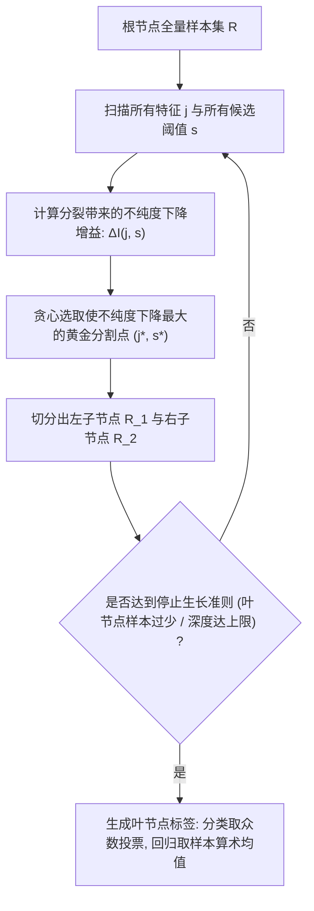

# Lec 8 决策树与分类回归树：递归二分划分与剪枝 (Decision Trees and CART)

> MIT 15.097 统计与机器学习前沿研讨 (Prediction: Machine Learning and Statistics) · 授课教师：Prof. Roy Welsch

## TL;DR

- 分类与回归树（CART）通过对特征空间进行轴平行的贪心正交递归二分划分（Recursive Partitioning）。
- 基尼不纯度（Gini Impurity）与信息增益比为特征最优分裂点提供了一致的凸不纯度度量。
- 代价复杂度剪枝（Cost-Complexity Pruning）通过正则化罚项消除了过度生长的深层虚假叶片。

## 贴近人类心智的可解释性之王

在现代深度神经网络与高维核方法中，模型往往是一个深不可测的“黑箱”：由数亿个难以解释的浮点权重张量构成，人类根本无法理解模型究竟为何做出这一预测决策。

而在医疗诊断、法院量刑保释与高风险金融信贷审批中，**模型的可解释性（Interpretability）与审计透明度具有压倒一切的法律与伦理地位**。
1984 年，利奥·布雷曼（Leo Breiman）、杰罗姆·弗里德曼（Jerome Friedman）等四位大师合著出版了里程碑著作《Classification and Regression Trees》，正式确立了 **CART 决策树算法**。

决策树以极其直观的“如果-那么（If-Then）”规则树状结构呈现，完美复刻了人类专家在复杂情境下的层级化逻辑推理路径。

## 递归二分划分与轴平行几何空间 (Recursive Partitioning)

CART 的核心思想是**分治法（Divide-and-Conquer）与贪心递归二分**：
在每一步，算法在当前的特征空间超立方体中，挑选一个**最优的特征维度 $j$** 以及该维度上的**最优切割阈值 $s$**，用一条与坐标轴平行的超平面将空间一刀劈为两个互斥的子区域：
$$
R_1(j, s) = \{X \mid X_j \le s\} \quad \text{与} \quad R_2(j, s) = \{X \mid X_j > s\}
$$

## 不纯度度量准则 (Impurity Measures)

如何从数学上量化“哪一个切分点最好”？
设当前节点 $m$ 包含的样本子集中，属于类别 $k$ 的相对频率为 $p_{mk} = \frac{1}{N_m}\sum_{x_i \in R_m} \mathbf{1}_{\{y_i = k\}}$。

### 1. 基尼不纯度（Gini Impurity，CART 分类标准）
$$
I_G(m) = \sum_{k=1}^K p_{mk}(1 - p_{mk}) = 1 - \sum_{k=1}^K p_{mk}^2
$$
物理意义：从该节点随机抽取两个样本，其类别不一致的概率。
- 若该节点内部所有样本完全属于同一类别（纯净如水），则 $I_G = 0$；
- 若各类样本均匀分布（极其混乱），$I_G$ 达到最大值 $1 - 1/K$。

### 2. 交叉熵 / 互信息（Cross-Entropy / Information Gain，ID3 / C4.5 标准）
$$
I_E(m) = -\sum_{k=1}^K p_{mk} \log_2(p_{mk})
$$

### 3. 回归树平方误差准则（Squared Error for Regression）
对于回归问题，最优预测值为叶节点内部的样本均值 $\bar{y}_m = \frac{1}{N_m}\sum_{x_i \in R_m} y_i$。
局部不纯度直接采用均方误差：
$$
I_R(m) = \frac{1}{N_m}\sum_{x_i \in R_m} (y_i - \bar{y}_m)^2
$$

切分的目标是在所有可能的候选对 $(j, s)$ 中，最大化切分后左右子节点的**加权不纯度下降量（Impurity Reduction）**：
$$
\Delta I(j, s) = I(m) - \left[\frac{N_{L}}{N_m} I(R_1) + \frac{N_{R}}{N_m} I(R_2)\right]
$$

## 代价复杂度剪枝 (Cost-Complexity Pruning)

如果允许决策树无限制地向下野蛮生长，直到每一个叶节点只包含 1 个样本（$I_G = 0$），训练误差会达到绝对完美的 0。
但这棵巨大的复杂树对噪声极度敏感，方差极高，在测试集上会遭遇灾难性的过拟合。

Breiman 提出了极其优雅的**代价复杂度后剪枝算法（Minimal Cost-Complexity Pruning）**：
定义带正则化惩罚的综合损失函数：
$$
C_\alpha(T) = \sum_{m \in \text{Leaves}(T)} N_m I(m) + \alpha |T|
$$
其中 $|T|$ 为决策树的**叶节点总数（模型复杂度）**，参数 $\alpha \ge 0$ 为惩罚系数。

::: theorem [嵌套剪枝子树序列定理]
当正则化参数 $\alpha$ 从 $0$ 单调递增到 $+\infty$ 时，使得 $C_\alpha(T)$ 达到全局最小的最优子树，构成一个**严格单调嵌套的有限子树序列**：
$$
T_{\max} = T_0 \supset T_1 \supset T_2 \supset \dots \supset T_k = \text{Root}
$$
在每一步剪枝时，只需找到使“弱连接收缩比率”最小的内部节点折叠为其子树：
$$
g(t) = \frac{R(t) - R(T_t)}{|T_t| - 1}
$$
最后，利用独立的 10-折交叉验证，直接在这串极小规模的子树序列上挑选泛化误差最小的黄金树！
:::

::: pitfall 忽视轴平行正交切片对旋转特征（Correlated Features）的极度无能
由于决策树的每一刀都强制与单一坐标轴平行（$X_j \le s$），如果真实物理边界是一条对角斜线 $X_1 + X_2 = 1$：
决策树将被迫进行无数次密密麻麻的细碎“阶梯状（Staircase）”锯齿切分，消耗海量深度才能逼近一条简单的斜线。在处理强相关特征时，树模型前置必须结合 PCA 旋转或线性组合树。
:::

::: insight 决策树是集成学习军团的最强原子士兵
单个决策树虽然存在高方差、易受扰动不稳定的缺点；
但正是这种“低偏差、高方差、结构轻量、运算极速”的独特物理特性，使其成为了现代机器学习中最不可动摇的超级基石：
**当我们在后续的课程中把数百棵微弱的决策树通过随机森林（Random Forest）进行方差平均，或者通过梯度提升树（GBDT/XGBoost）进行残差迭代时，这个曾经脆弱的单兵，将进化为统治全球工业级结构化表格数据预测的绝对霸主**。
:::
