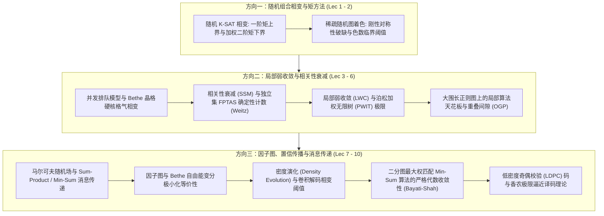

# 15.098 应用概率与随机过程前沿研讨 (Special Seminar in Applied Probability and Stochastic Processes)

> MIT Course 15 · Operations Research & Statistics · 课号 15.098

## TL;DR

- 深度交叉理论计算机科学、统计物理学与信息论，解析随机组合结构上的微观相变。
- 建立一阶/二阶矩方法、局部弱收敛（PWIT）与强空间相关性衰减（SSM）分析范式。
- 剖析因子图、置信传播（BP）、密度演化与 LDPC 码在分布式优化与信道译码中的严格收敛机理。

## 课程全景与前沿交叉体系

本研讨课由麻省理工学院斯隆管理学院与运筹学中心（ORC）教授联合讲授，是面向博士研究生的顶级应用概率专题。
课程聚焦于21世纪初概率论、统计物理与理论计算机科学交汇处爆发的一场深刻学术革命：**如何利用统计物理学中的空穴法、配分函数相变与局部树状逼近，严谨破解随机图上的极端组合优化难题与分布式网络算法性能界限**。

在整体知识演进脉络上，研讨系统划分为三大前沿核心支柱：
第一支柱聚焦随机约束满足问题（Random CSP）与图着色相变，利用精细的加权二阶矩方法推导临界阈值；第二支柱发展空间局部弱收敛与自避行走展开，将原本不可计算的 #P-完全计数难题在强空间混合条件下转化为确定性多项式时间近似（FPTAS）；第三支柱全面探索消息传递动力学，阐明置信传播与密度演化如何在通信纠错（LDPC 码）和离散组合优化（二分加权匹配）中实现无偏全局收敛。

这一跨学科体系展示了离散概率论的终极统一：无论是物理学中自旋玻璃的能量亚稳态、通信系统中逼近香农容量极限的稀疏图译码器，还是分布式网络路由中的并发加权匹配，底层全部受控于空间相关性的衰减速率以及高维非凸解空间的几何聚类拓扑。

::: insight [应用概率与统计物理的交叉同一性]
在很长一段时间内，理论计算机科学家将图上的局部启发式（如置信传播与模拟退火）视为“无法严格证明的玄学”，而理论物理学家则使用非严格的副本方法（Replica Method）得出了大量惊人精确但缺乏数学基础的预测。
本课程展示了现代应用概率如何扮演“伟大的公理化桥梁”：通过局部弱收敛定义测度极限，通过二阶矩方差控制锚定副本对称破缺，最终不仅将物理学的直觉升华为柯尔莫哥洛夫测度体系下的严谨定理，更为运筹网络设计和分布式最优化开辟了全新的算法工程世界。
:::

## 讲义全集与研讨大纲

| 讲次 | 中文研讨主题 | 核心数学与概率机制 | 状态 | 笔记链接 |
| :--- | :--- | :--- | :--- | :--- |
| **Lec 01** | 随机 K-SAT 相变与二阶矩方法 | 满足性相变阈值、一阶矩马尔可夫上界、加权二阶矩方差控制 | `complete` | [随机 K-SAT 相变与二阶矩方法](lec1.md) |
| **Lec 02** | 稀疏随机图着色与色数相变阈值 | 稀疏图 $G(n, d/n)$、$q$-着色数相变、非对称重叠矩阵鞍点分析 | `complete` | [稀疏随机图着色与色数相变阈值](lec2.md) |
| **Lec 03** | 排队访问相变与 Bethe 晶格硬核模型 | 数据库排斥约束排队、巨正则吉布斯测度、Bethe 晶格腔方程分支 | `complete` | [排队访问相变与 Bethe 晶格硬核模型](lec3.md) |
| **Lec 04** | 相关性衰减与独立集近似计数算法 | #P-完全计数难题、自避行走树展开（SAW）、强空间相关性衰减（SSM） | `complete` | [相关性衰减与独立集近似计数](lec4.md) |
| **Lec 05** | 局部弱收敛方法与随机组合优化 | Benjamini-Schramm 弱收敛、泊松加权无限树（PWIT）、Aldous $\zeta(2)$ 猜想 | `complete` | [局部弱收敛与随机组合优化](lec5.md) |
| **Lec 06** | 大围长正则图上的独立集与匹配 | 大围长局部树同构、局部分布式算法天花板、重叠间隙性质（OGP） | `complete` | [大围长正则图上的独立集与匹配](lec6.md) |
| **Lec 07** | 马尔可夫随机场与置信传播算法基础 | 树状 MRF 边际推断、Sum-Product 和积消息更新、Min-Sum 代数对偶 | `complete` | [马尔可夫随机场与置信传播](lec7.md) |
| **Lec 08** | 因子图、密度演化与置信传播收敛性 | 二分因子图、Bethe 自由能极值变分对应、密度演化卷积动力学 | `complete` | [因子图与密度演化收敛性](lec8.md) |
| **Lec 09** | 二分图最大权匹配与 Min-Sum 置信传播 | 分布式交换机匹配调度、计算树交错路径展开、单纯形拍卖算法同构 | `complete` | [二分图最大权匹配与 Min-Sum BP](lec9.md) |
| **Lec 10** | 低密度奇偶校验码与消息传递译码理论 | Tanner 图稀疏校验矩阵、香农容量逼近、软判决和积译码、陷阱集消除 | `complete` | [低密度奇偶校验码与消息传递](lec10.md) |

::: definition [自旋玻璃模型与副本对称破缺]
在无序磁性系统中，自旋变量 $S_i \\in \\{-1, +1\\}$ 之间的耦合强度 $J_{ij}$ 是随机实数，导致系统处于强挫折态（Frustration）。
当温度降低时，系统的能量曲面演化为极其复杂且包含天文数字般局部极小值的高维崎岖地形。
此时纯态不再唯一，两个独立系统副本（Replicas）之间的重叠度分布呈现非平凡离散多峰结构，即**副本对称破缺（Replica Symmetry Breaking, RSB）**。这一现象直接对应于组合优化中解空间的孤立团簇化。
:::

::: pitfall [长程空间关联破坏局部平均场假设]
在应用概率网络建模中，研究者常常直觉性地套用平均场近似（Mean-Field Approximation），假设节点之间的交互可以被平均环境标量所代替。
然而，当系统逼近相变临界点（如排队访问强度接近 $\\lambda_c$ 或图密度接近着色临界阈值）时，**微观涨落的相关长度（Correlation Length）发散至全网尺度**。
任何局部平均场假设都会在此处彻底失真，导致容量预测出现不可逆的严重系统性偏差。必须通过严格的空间重整化群或腔方法捕捉多尺度长程相关性。
:::

---

本资料根据 [MIT OpenCourseWare (15.098)](https://ocw.mit.edu/courses/15-098-special-seminar-in-applied-probability-and-stochastic-processes-spring-2006/) 深度重构，遵循 CC BY-NC-SA 4.0 协议。
