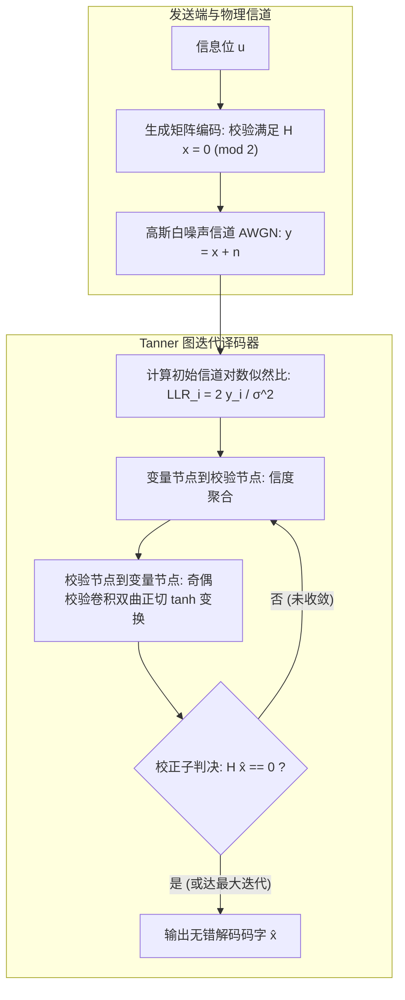

# Lec 10 低密度奇偶校验码与消息传递译码理论 (Low-Density Parity-Check (LDPC) Codes and Message Passing Decoding)

> MIT 15.098 应用概率与随机过程前沿研讨 · 讲义 10

## TL;DR

- 低密度奇偶校验（LDPC）码在稀疏二分校验矩阵定义下逼近香农信道容量极限。
- 详细拆解硬判决 Gallager 算法与软判决和积（Sum-Product / BP）信道译码动力学。
- 计算树局部正交性与消环设计（PEG）确保有限码长下的极低误码平层（Error Floor）。
## 香农容量与稀疏校验码革命

1948 年克劳德·香农（Claude Shannon）发表了划时代的《通信的数学理论》，证明了在任何含噪信道（如加性高斯白噪声信道 AWGN 或二元对称信道 BSC）中，均存在一个理论极限传输速率——**信道容量（Channel Capacity $C$）**。
只要编码速率 $R < C$，在理论上即可通过充分长的信道编码使传输误码率逼近任意小。
然而香农的证明是纯粹随机非构造性的，寻找能够在实用多项式复杂度内逼近香农极限的真实编码方案，困扰了全球通信与应用概率学界整整半个世纪。

1962 年 Robert Gallager 在其麻省理工学院（MIT）博士论文中提出了**低密度奇偶校验码（Low-Density Parity-Check, LDPC Codes）**。
受限于当时的计算硬件，这一工作被尘封了三十年。直到 20 世纪 90 年代末，MacKay、Neal 以及 Richardson、Urbanke 重新发现了 LDPC 码，并证实其结合置信传播迭代译码，性能距离香农极限仅差 $0.0045 \text{ dB}$，成为人类历史上最接近香农物理极限的信息编码成就，广泛应用于 5G NR、Wi-Fi (802.11ax) 与深空卫星通信中。

## Tanner 图与奇偶校验方程

一个线性分组码 $(n, k)$ 由其大小为 $(n - k) \times n$ 的稀疏奇偶校验矩阵 $H \in \{0, 1\}^{m \times n}$ 完全定义。
合法码字集合为校验空间的零空间：
$$
\mathcal{C} = \{x \in \{0, 1\}^n : H x = 0 \pmod 2\}
$$
在图形结构上，校验矩阵被映射为著名的**坦纳图（Tanner Graph）**——一个包含 $n$ 个变量节点（Variable Nodes $v_1, \dots, v_n$）与 $m$ 个校验节点（Check Nodes $c_1, \dots, c_m$）的稀疏二分图。
若 $H_{j, i} = 1$，则在变量节点 $v_i$ 与校验节点 $c_j$ 之间连接一条无向边。
- 若每个变量节点的度数均为固定的 $d_v$，每个校验节点的度数均为固定的 $d_c$，则称为**正则 LDPC 码（Regular LDPC）**，其设计码率为 $R = 1 - d_v / d_c$；
- 矩阵的“低密度”（Low-Density）核心要求是：行重与列重均为极小的常数（如 $d_v = 3, d_c = 6$），矩阵中绝大多数元素均为 0。

## 软判决 BP 译码算法（和积算法）

在二元相移键控（BPSK）调制下，比特 $x_i \in \{0, 1\}$ 映射为传输信号 $s_i = (-1)^{x_i} \in \{+1, -1\}$。
接收端观测到 $y_i = s_i + w_i$，其中 $w_i \sim \mathcal{N}(0, \sigma^2)$。
节点 $v_i$ 的初始先验**对数似然比（Log-Likelihood Ratio, LLR）**定义为：
$$
L_i^{(0)} = \ln \frac{\mathbb{P}(x_i = 0 \mid y_i)}{\mathbb{P}(x_i = 1 \mid y_i)} = \frac{2 y_i}{\sigma^2}
$$

::: definition [LDPC 对数和积消息传递方程]
设 $L_{v \to c}$ 为变量节点发给校验节点的消息，$L_{c \to v}$ 为校验节点发给变量节点的消息。
在每轮迭代中执行如下双向更新：
1. **变量节点更新（加法法则）**：
$$
L_{v_i \to c_j} = L_i^{(0)} + \sum_{c_k \in \mathcal{N}(v_i) \setminus \{c_j\}} L_{c_k \to v_i}
$$
2. **校验节点更新（双曲正切乘法法则）**：
校验节点必须确保相连的所有变量在模 2 意义下奇偶和为 0，经傅里叶变换展开可得：
$$
\tanh\left( \frac{L_{c_j \to v_i}}{2} \right) = \prod_{v_k \in \mathcal{N}(c_j) \setminus \{v_i\}} \tanh\left( \frac{L_{v_k \to c_j}}{2} \right)
$$
:::

迭代终止条件：在每轮计算全后验 LLR：
$$
L_i = L_i^{(0)} + \sum_{c_j \in \mathcal{N}(v_i)} L_{c_j \to v_i}
$$
对符号进行硬判决 $\hat{x}_i = 0$ 若 $L_i \ge 0$，否则 $\hat{x}_i = 1$。
若 $H \hat{x} = 0 \pmod 2$，则说明已成功纠正所有信道错误，立即提前终止并输出码字！

## 误码平层与陷阱集分析

虽然稀疏随机 Tanner 图在 $n \to \infty$ 时局部几乎是纯无环树，但在有限码长下，图中必然不可避免地存在有限环路。

::: pitfall [陷阱集 (Trapping Sets) 引发的误码平层]
在信噪比极高的区域，LDPC 码的误码率曲线往往不会以指数级持续陡峭下落，而是会突然变缓，出现**误码平层（Error Floor）**。
其物理根源不是随机热噪声过大，而是图中存在被称为**陷阱集 $(a, b)$（Trapping Sets）**的特定子图诱导结构——即一个包含 $a$ 个变量节点的子集，其在全图诱导的导出子图中，仅包含 $b$ 个奇度校验节点。
当这组变量节点发生错误时，它们在内部形成封闭的伪自旋稳定态，传递给外界的错误校验综合征极弱，导致 BP 迭代陷入局部假不动点而无法纠正。
:::

::: insight [非正则化（Irregular）与局部围长工程]
现代信息论的重大突破之一在于证明了：**非正则 LDPC 码的性能在本质上优于完美的正则对称码**。
通过精细优化度分布多项式 $\lambda(x) = \sum \lambda_i x^{i-1}$ 与 $\rho(x) = \sum \rho_i x^{i-1}$，使少数“核心变量节点”拥有极高的连接度（充当全局信度播报中心），而其余节点保持稀疏低度；
同时利用**渐进边增长算法（Progressive Edge Growth, PEG）**在构图时人为消除短环并最大化陷阱集的阻抗度，从而在逼近香农极限的同时彻底压制了误码平层。
:::
