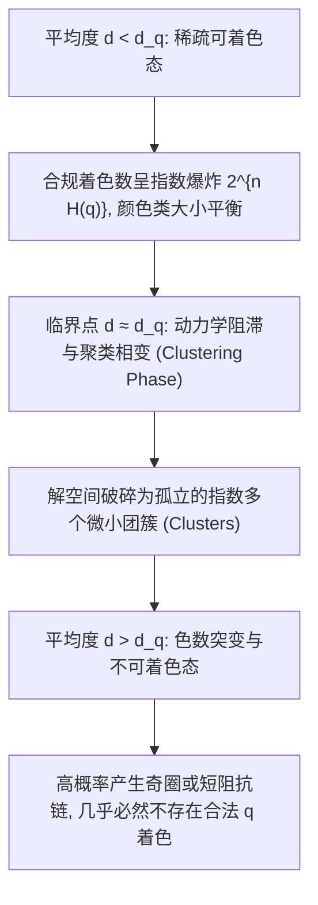

# Lec 2 稀疏随机图着色与色数相变阈值 (Graph Coloring on Sparse Random Graphs and Connectivity Thresholds)

> MIT 15.098 应用概率与随机过程前沿研讨 · 讲义 2

## TL;DR

- 稀疏随机图 $G(n, d/n)$ 的 $q$-可着色性具有由平均度 $d$ 决定的尖锐单调相变。
- 基于马尔可夫不等式与团嵌入的一阶矩方法可严格界定色数存在性的度数上界。
- 采用局部稳定着色加权与非对称二阶矩可精确确定 $q$-着色临界平均度至最多两个可能离散值。
## 稀疏随机图上的图着色难题

给定无向图 $G = (V, E)$，若存在映射 $\chi: V \to \{1, 2, \dots, q\}$ 使得对任意边 $(u, v) \in E$ 均有 $\chi(u) \neq \chi(v)$，则称图 $G$ 为**合法 $q$-可着色（$q$-Colorable）**。
最小的合法颜色数称为图 $G$ 的色数（Chromatic Number），记为 $\chi(G)$。

在 Erdős-Rényi 随机图模型 $G(n, p)$ 中，当边概率 $p = d/n$ 且 $d > 0$ 为常数时，图处于**稀疏区域（Sparse Regime）**。
在该区域内，图的平均顶点度为 $d$。经典的计算问题与极限理论探讨：
对于给定的颜色数 $q \ge 3$，是否存在一个严格的临界平均度阈值 $d_q$：
$$
d < d_q \implies \lim_{n \to \infty} \mathbb{P}(G(n, d/n) \text{ is } q\text{-colorable}) = 1
$$
$$
d > d_q \implies \lim_{n \to \infty} \mathbb{P}(G(n, d/n) \text{ is } q\text{-colorable}) = 0
$$

Achlioptas 与 Naor 在概率论领域的重大突破在于：他们通过精细的非对称二阶矩方法，将 $d_q$ 的可能取值锁定在至多**两个显式常数区间**之内。

## 期望着色数与一阶矩衰减

我们首先计算随机图中合法 $q$-着色的平均数量。
所有可能的着色映射共有 $q^n$ 种。设着色分配使得颜色 $c \in \{1, \dots, q\}$ 占有的顶点数为 $n_c$，满足 $\sum_{c=1}^q n_c = n$。
对于固定的着色方案，一条随机边两端同色的概率为 $\sum_{c=1}^q \binom{n_c}{2} / \binom{n}{2}$。
当颜色均匀分配（即每个颜色包含 $n/q$ 个顶点）时，两端异色的概率达到最大值：
$$
P_{\text{valid}} = 1 - \frac{1}{q}
$$
由于 $G(n, m)$ 中共有 $m = \frac{1}{2} d n$ 条独立边，因此期望合法着色数满足：
$$
\mathbb{E}[Y_q] \le q^n \left(1 - \frac{1}{q}\right)^{d n / 2} = \left( q \left(1 - \frac{1}{q}\right)^{d/2} \right)^n
$$

::: theorem [稀疏图不可着色一阶矩上界]
当底数小于 1 时，即：
$$
q \left(1 - \frac{1}{q}\right)^{d/2} < 1 \iff d > \frac{2 \ln q}{-\ln(1 - 1/q)} \approx 2 q \ln q - \ln q
$$
几乎必然不存在合法的 $q$-着色，即 $\chi(G(n, d/n)) > q$。
:::

## 刚性着色二阶矩与对称性破缺

为了证明下界，必须计算合法着色对 $(Y_1, Y_2)$ 的重叠分布。
设 $A$ 与 $B$ 为两个合法着色方案。定义其 $q \times q$ 重叠矩阵（Overlap Matrix）为 $\rho = (\rho_{a, b})$，其中 $\rho_{a, b} n$ 表示在方案 $A$ 中染为颜色 $a$ 且在方案 $B$ 中染为颜色 $b$ 的顶点数量。

两着色方案同时合法的联合概率为：
$$
\mathbb{P}(A \text{ and } B \text{ valid}) = \left( 1 - \frac{2}{q} + \sum_{a=1}^q \sum_{b=1}^q \rho_{a, b}^2 \right)^m
$$
二阶矩可表达为对所有重叠双随机矩阵（Doubly Stochastic Matrices）的多元极值优化：
$$
\mathbb{E}[Y_q^2] = \sum_{\rho} \exp\left( n \left( H(\rho) + \frac{d}{2} \ln \left( 1 - \frac{2}{q} + \sum_{a, b} \rho_{a, b}^2 \right) \right) \right)
$$
其中 $H(\rho) = -\sum_{a, b} \rho_{a, b} \ln \rho_{a, b}$ 为重叠矩阵的联合香农熵。

::: definition [副本对称鞍点 (Replica Symmetric Saddle Point)]
当两个着色方案完全统计独立时，重叠矩阵为全平坦矩阵 $\rho_{a, b}^* = 1/q^2$。
此时对应的熵与边概率项达到平衡。二阶矩成功的充分条件是：全平坦矩阵 $\rho^*$ 是指数项的**全局唯一极大值点**。
:::

::: insight [非平衡着色的方差抑制效应]
Achlioptas 和 Naor 发现：如果仅限制在“颜色严格等分”的平衡着色上，由于顶点微小重排的局部扰动，二阶矩在 $d$ 尚未达到真实阈值时就会在对角重叠处发散。
其根本解决之道是**显式引入非平衡先验**，允许各颜色块大小存在微小的几何方差，从而抹平局部极值峰，最终证明当 $d < 2(q-1) \ln(q-1)$ 时二阶矩有界。这直接将相变区间压缩至跨度不超过 1 的窄带内！
:::
