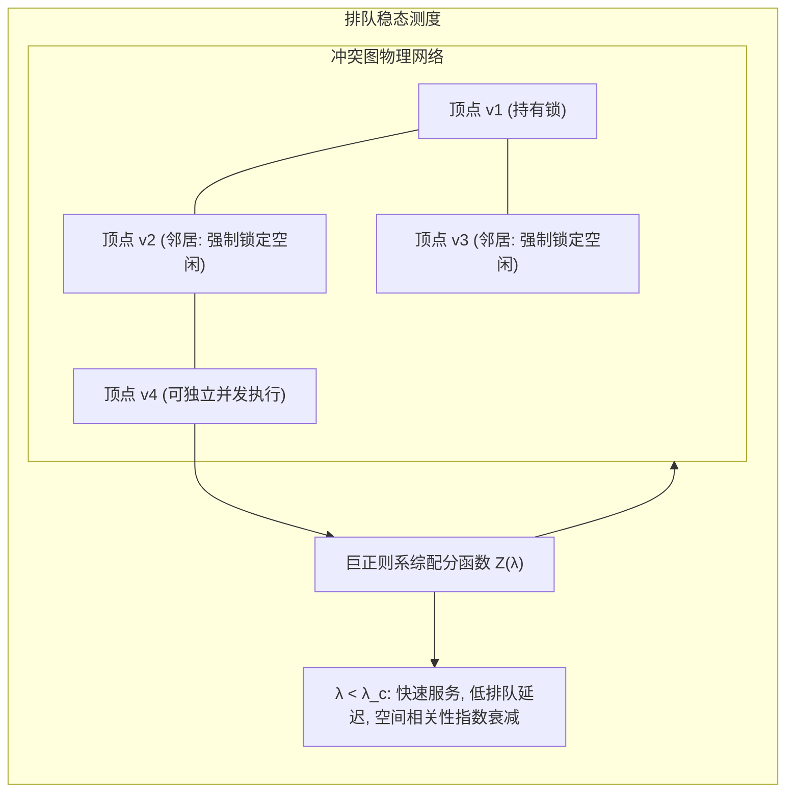

# Lec 3 排队访问相变与 Bethe 晶格硬核模型 (Queueing Phase Transitions and the Hard-Core Model on Bethe Lattices)

> MIT 15.098 应用概率与随机过程前沿研讨 · 讲义 3

## TL;DR

- 共享数据库访问排队模型可形式化映射为图上的硬核气体模型（Hard-Core Gas Model）。
- 空间排队网络的稳态分布表现为以逸度 $\lambda$ 为自变量的吉布斯测度（Gibbs Measure）。
- Bethe 晶格（正则树）上的空穴排队极限展现出亚临界唯一性与超临界多稳态相变。
## 并发排队与图排斥约束

在大规模分布式数据库与高性能多处理器系统中，并发事务（Transactions）对数据项的读写访问存在严格的互斥约束（Mutual Exclusion Locks）。
设系统包含 $n$ 个数据资源，资源之间的互斥冲突构成冲突图（Conflict Graph）$G = (V, E)$。
当资源 $u$ 与资源 $v$ 之间存在边 $(u, v) \in E$ 时，表示这两个资源不能被并发事务同时占用。

事务以泊松过程（Poisson Process）到达，请求锁定某个子集的数据项。在经典简化模型中，每个事务请求单一顶点 $v \in V$ 的互斥访问。
如果请求到达时顶点 $v$ 的邻域 $\mathcal{N}(v)$ 中没有任何顶点处于被占用状态，则该事务被立即接受并持有锁；否则事务进入等待队列或被阻塞丢弃。
系统在任意时刻被锁定的顶点集合必须是图 $G$ 的一个**独立集（Independent Set）**。

该排队系统在稳态下的无条件概率分布与统计物理学中著名的**硬核格气模型（Hard-Core Lattice Gas Model）**严格等价。

## 硬核模型与吉布斯测度

设 $\mathcal{I}(G)$ 为图 $G$ 的所有独立集集合。对于每个独立集 $I \in \mathcal{I}(G)$，其稳态概率由巨正则系综给出：
$$
\mu(I) = \frac{\lambda^{|I|}}{Z(\lambda)}, \quad Z(\lambda) = \sum_{I \in \mathcal{I}(G)} \lambda^{|I|}
$$
其中 $\lambda > 0$ 称为**逸度（Fugacity）**或活度，直接对应于排队系统中的事务到达率与服务率之比 $\lambda = \gamma / \mu_{\text{service}}$；$Z(\lambda)$ 为配分函数（Partition Function），在数学上即为图 $G$ 的独立集多项式。

::: definition [硬核模型局部边际占有率]
顶点 $v$ 处于繁忙占用状态的边际概率为：
$$
p_v(\lambda) = \mathbb{P}_\mu(v \in I) = \sum_{I \in \mathcal{I}(G): v \in I} \mu(I) = \frac{\lambda}{Z(\lambda)} \frac{\partial Z(\lambda)}{\partial \lambda_v}
$$
其条件概率满足马尔可夫随机场（MRF）性质：给定邻域 $\mathcal{N}(v)$ 的配置，若 $\mathcal{N}(v) \cap I \neq \emptyset$，则 $v$ 必然为空闲；若 $\mathcal{N}(v) \cap I = \emptyset$，则 $v$ 被占用的比率为 $\frac{\lambda}{1 + \lambda}$。
:::

## Bethe 晶格上的递归腔方程与相变

为了分析热力学极限（$n \to \infty$）下的相变行为，统计物理学通常将高维稀疏图局部近似为无环的**Bethe 晶格（无限正则树 $\mathbb{T}_d$）**。
设树的每个节点分支度为 $d$（即度数为 $d+1$）。我们定义子树根节点的“腔分布”（Cavity Distribution）：
设 $R_t$ 为深度为 $t$ 的子树根节点在其父节点不占有时被占有的几率比值：
$$
R_t = \frac{\mathbb{P}(v_{\text{root}} \in I)}{\mathbb{P}(v_{\text{root}} \notin I)}
$$
根据独立集的互斥条件，根节点 $v$ 只有在其所有 $d$ 个子节点均未被占用时才能被激活：
$$
R_{t+1} = \lambda \prod_{j=1}^d \frac{1}{1 + R_t^{(j)}}
$$
在对称不动点假设下，$R_t = R$，上述动态系统简化为一维非线性迭代映射：
$$
R = f(R) = \lambda (1 + R)^{-d}
$$

::: theorem [Bethe 晶格硬核模型唯一性与相变临界阈值]
映射 $f(R)$ 出现导数绝对值 $|f'(R)| = 1$ 的分支点对应于空间马尔可夫测度的唯一性破缺（Uniqueness Phase Transition）。
临界逸度阈值为：
$$
\lambda_c(d) = \frac{(d-1)^{d-1}}{(d-2)^d}
$$
- 当 $\lambda < \lambda_c(d)$ 时，不动点唯一且全局指数吸引，系统具有强空间相关性衰减（Spatial Decay of Correlations），排队网络吞吐稳定；
- 当 $\lambda > \lambda_c(d)$ 时，系统出现多重吉布斯测度（偶数层密集与奇数层密集的自发对称性破缺），排队系统陷入局部死锁与相变滞后。
:::

::: insight [排队拥堵的统计物理微观解释]
传统排队论通常假设队列之间完全解耦或服从 Jackson 乘积解网络。
但硬核互斥约束打破了局域解耦假设：当到达率跨越 $\lambda_c$ 时，排队网络发生的是**空间维度的宏观凝聚相变**。锁的持有状态在长距离上传播，微观个体的微小排队扰动会导致全网吞吐量的阶跃崩塌。理解此阈值为现代分布式数据库锁管理（如 2PL 协议优化）提供了坚实的数学理论上限。
:::
