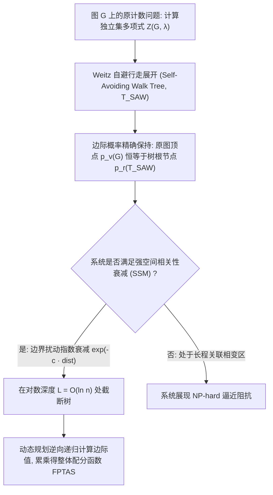

# Lec 4 相关性衰减与独立集近似计数算法 (Correlation Decay and Approximate Counting of Independent Sets)

> MIT 15.098 应用概率与随机过程前沿研讨 · 讲义 4

## TL;DR

- 计算一般图上的独立集配分函数属于典型的 #P-完全难题。
- 威茨（Weitz）利用强空间相关性衰减（SSM）开创了确定性完全多项式时间近似方案（FPTAS）。
- 结合自避行走树（SAW Tree）展开与腔分布压缩，在度数至多为 5 的图上实现了精准近似计数。
## 计数复杂性与配分函数挑战

在算法复杂性理论中，**计数问题（Counting Problems）**通常比判定问题困难得多。
求解图 $G$ 上的所有合法独立集总数（即逸度 $\lambda = 1$ 时的配分函数 $Z(G)$），根据 Valiant 定理是 **#P-完全（#P-Complete）** 的，即便对于最大度仅为 3 的图亦是如此。

在过去几十年中，解决高维状态空间计数的唯一主流范式是马尔可夫链蒙特卡洛法（MCMC），利用 Glauber 动力学构建多项式时间随机近似方案（FPRAS）。
然而，2006 年 Dror Weitz 取得了革命性突破：他证明了只要物理系统处于**强空间相关性衰减（Strong Spatial Mixing, SSM）**区域，便可以构造纯粹的**确定性完全多项式时间近似方案（FPTAS）**，彻底打破了必须依赖随机采样的传统格局！

## 自避行走树展开定理

Weitz 算法的核心数学支柱是：将任意具有环路结构的图 $G$，通过自避行走（Self-Avoiding Walks）精确转化为一棵可能包含叶子固定边界条件的**有限正则展开树 $T_{\text{SAW}}(v)$**。

::: theorem [Weitz 边际等价性定理]
对于任意图 $G$ 及其顶点 $v$，存在一棵以 $v$ 为根的自避行走树 $T_{\text{SAW}}(v)$，并在其某些叶子节点上施加“强制占用”或“强制空闲”的固定边界约束，使得：
$$
p_v(G) = p_{\text{root}}(T_{\text{SAW}}(v))
$$
即：图 $G$ 中顶点 $v$ 的硬核模型边际占有率，与该展开树根节点的边际占有率**在数值上严格相等**。
:::

展开树的构造规则如下：从 $v$ 出发的每条自避路径构成树的一个节点。如果一条路径试图访问已经在此前路径中出现过的顶点（形成闭环），则根据硬核互斥逻辑，将该分支以一个固定的确定性边界（置为 0 或 1）剪枝终止。

## 强空间相关性衰减与对数截断

虽然展开树 $T_{\text{SAW}}$ 是有限的，但其顶点数通常随图的规模呈指数增长。为了获得多项式时间算法，必须实现局部截断。

::: definition [强空间相关性衰减 (Strong Spatial Mixing)]
系统被称为在图族上满足强空间相关性衰减（SSM），若对展开树上任意两组不同的外围边界条件 $\tau_1$ 与 $\tau_2$（位于距离根节点距离为 $L$ 的球面上），根节点的边际占有率差异满足指数级衰减：
$$
|p_{\text{root}}^{\tau_1} - p_{\text{root}}^{\tau_2}| \le C e^{-\gamma L}
$$
其中 $C, \gamma > 0$ 为与图规模无关的绝对常数。
:::

根据 SSM 性质，只要截断深度选取为：
$$
L = \frac{1}{\gamma} \ln\left( \frac{C n}{\epsilon} \right) = O(\ln n)
$$
在距离根节点超过 $L$ 的所有子树均可直接赋任意假想边界并截断。
在最大度为 $\Delta$ 的图上，深度为 $O(\ln n)$ 的树所包含的顶点总数仅为：
$$
(\Delta - 1)^{O(\ln n)} = n^{O(\ln \Delta)} = \text{Poly}(n)
$$
因此，利用树上的腔递归方程（Cavity Recurrence）：
$$
R_u = \lambda \prod_{w \in \text{Children}(u)} \frac{1}{1 + R_w}
$$
自底向上在多项式时间内即可计算出根节点的边际概率 $\hat{p}_v$。

## 从边际概率到整体计数积

一旦掌握了高精度的单点边际概率计算器，即可利用经典的望远镜连乘积（Telescoping Product）将全局配分函数分解为一系列序列条件概率：
$$
Z(G) = \prod_{i=1}^n \frac{Z(G \setminus \{v_1, \dots, v_i\})}{Z(G \setminus \{v_1, \dots, v_{i-1}\})} = \prod_{i=1}^n \frac{1}{1 - p_{v_i}(G_{i-1})}
$$
其中 $G_{i-1} = G \setminus \{v_1, \dots, v_{i-1}\}$ 为逐次移除已被固定的顶点后的子图。

::: insight [相变边界即算法可计算性边界]
Weitz 证明了：对于度数至多为 $\Delta = d + 1$ 的任意图，当逸度 $\lambda < \lambda_c(d) = \frac{(d-1)^{d-1}}{(d-2)^d}$ 时，SSM 恒成立！
特别地，当 $\lambda = 1$（纯独立集计数）时，代入可知当 $\Delta \le 5$ 时，$\lambda = 1 < \lambda_c(\Delta - 1)$，因而最大度不超过 5 的所有图均存在确定性 FPTAS。
随后 Sly 证明了反向定理：当 $\lambda > \lambda_c$ 时，除非 NP = RP，否则不存在多项式时间近似方案！统计物理的相变点在此与理论计算机科学的计算复杂度边界完成了绝妙合体。
:::
