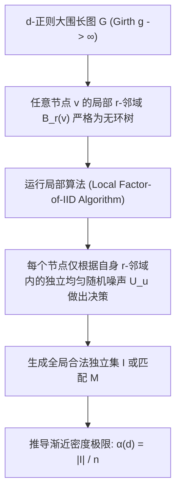

# Lec 6 大围长正则图上的独立集与匹配 (Independent Sets and Matchings on Regular Graphs of High Girth)

> MIT 15.098 应用概率与随机过程前沿研讨 · 讲义 6

## TL;DR

- 大围长（High Girth）正则图局部结构在任意有限深度内与纯正则树完全同构。
- 利用局部弱收敛与因子图上的马尔可夫截断可推导最大独立集密度严格界。
- 局部分布式算法（Local Algorithms）确立了无需全局通信的组合优化多项式近似下界。
## 大围长图的几何特征

在极值图论中，图 $G$ 的**围长（Girth）**定义为图中包含的最短环（Cycle）的长度。
设 $G$ 为 $d$-正则图（每个顶点的度数严格等于 $d$）。若图的围长 $g(G) \ge 2r + 1$，则意味着对于图中任意顶点 $v$，以 $v$ 为中心、半径为 $r$ 的邻域球 $B_r(v, G)$ **不存在任何环路**，其拓扑结构与无限 $d$-正则树 $\mathbb{T}_d$ 的对应邻域完全等价。

大围长正则图（High Girth Regular Graphs）是理解图论极限与分布式算法复杂性的核心试金石：
- 它们在宏观上是极度连通的良好扩展图（Expander Graphs）；
- 但在微观上，任意节点放眼望去只看得到纯粹的分支树结构。

核心科学问题是：在大围长 $d$-正则图上，最大独立集占全图顶点的比例（独立数密度 $\alpha(d)$）以及最大匹配比例的理论极限是多少？

## 局部算法与 i.i.d. 因子模型

为了在无环树状结构上构造独立集，Gamarnik 等人系统发展了**局部算法（Local Algorithms / Factor-of-i.i.d. Processes）**。
设每个顶点 $v \in V$ 被独立赋予一个来自 $[0, 1]$ 的均匀分布随机标签 $U_v \sim \text{Uniform}(0, 1)$。
一个半径为 $r$ 的局部算法定义为一个确定性博弈规则：
$$
X_v = f\left( (G, v, \{U_u\}_{u \in B_r(v)}) \right) \in \{0, 1\}
$$
即顶点 $v$ 是否加入独立集，完全且仅取决于以自身为中心半径为 $r$ 内的邻居拓扑和随机标签。

::: example [局部贪心消除算法 (Random Priority Local Elimination)]
最经典的局部独立集算法是随机优先权算法：
1. 每个顶点独立生成随机时间戳 $U_v$；
2. 顶点 $v$ 进入独立集 $I$，当且仅当其时间戳比其所有未被淘汰的邻居都要小。
在无限正则树上，该算法等价于一个确定性马尔可夫衰减过程。
每个节点被选中的边际概率可解析求解：
$$
p(d) = \int_0^1 (1 - t)^{d} \, dt = \frac{1}{d + 1}
$$
通过多轮迭代修正，该局部边际密度可显著提升至 $\Omega\left( \frac{\ln d}{d} \right)$。
:::

## 独立集密度的理论上下界

对于一般 $d$-正则大围长图的最大独立集密度 $\alpha(d) = \frac{\alpha(G)}{n}$：
通过代数图论中的霍夫曼界（Hoffman Bound）结合拉普拉斯谱特征，可得谱上界：
$$
\alpha(d) \le \frac{-\lambda_{\min}}{d - \lambda_{\min}}
$$
由于 Ramanujan 图的最小特征值满足 $\lambda_{\min} \ge -2\sqrt{d-1}$，代入可得渐近上界：
$$
\alpha(d) \le \frac{2\sqrt{d-1}}{d + 2\sqrt{d-1}} \approx \frac{2}{\sqrt{d}}
$$
然而，物理学副本对称破缺理论与概率图论预测，大围长正则图的真实最大独立集渐近极限应为：
$$
\alpha^*(d) \approx \frac{2 \ln d}{d}
$$

::: theorem [Gamarnik-Sudan 局部算法极限重合定理]
局部算法所能达到的最大独立集密度存在一个固定的天花板：
对任意固定半径 $r$，局部算法生成的独立集平均密度不能超过 $\frac{\ln d}{d}$；
若要达到理论极值 $\frac{2 \ln d}{d}$，算法的信息传播半径 $r$ 必须突破常数限制，与图的围长或网络直径同阶增长。
:::

::: insight [局部算法与重叠间隙性质 (OGP)]
为什么常数步的局部分布式算法无法跨越从 $\frac{\ln d}{d}$ 到 $\frac{2 \ln d}{d}$ 的间隙？
Gamarnik 等人证明了根本原因在于解空间几何形态的突变——**重叠间隙性质（Overlap Gap Property, OGP）**。
当密度超过 $\frac{\ln d}{d}$ 时，所有近似极大独立集不再均匀分散，而是分裂为两两距离极其遥远、中间存在绝对“真空阻抗带”的互斥簇。任何局部连续或低复杂度算法都无法跨越这种由非凸地形造成的全局拓扑鸿沟，揭示了组合优化计算硬度的拓扑起源。
:::
