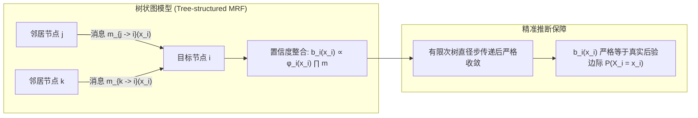

# Lec 7 马尔可夫随机场与置信传播算法基础 (Belief Propagation Foundations on Markov Random Fields)

> MIT 15.098 应用概率与随机过程前沿研讨 · 讲义 7

## TL;DR

- 置信传播（Belief Propagation, BP）是将高维图模型边际化推断解耦的分布式消息传递算法。
- 在无环树图（Trees）上，BP 算法保证在有限直径步内精确收敛至真实后验边际分布。
- 阐明 Sum-Product（和积）与 Min-Sum（最小和）在概率边缘化与 MAP 最优解码中的代数对偶。
## 概率图模型与高维边际推断困境

在高维统计推断、计算机视觉、自然语言处理与信道编码中，系统由海量相互耦合的随机变量 $X = (X_1, X_2, \dots, X_n)$ 组成。
**马尔可夫随机场（Markov Random Fields, MRF）**利用无向图 $G = (V, E)$ 编码变量之间的条件独立性。
全局联合概率分布根据 Hammersley-Clifford 定理分解为定义在极大团（或超边）上的势函数乘积：
$$
P(X = x) = \frac{1}{Z} \prod_{i \in V} \phi_i(x_i) \prod_{(i, j) \in E} \psi_{ij}(x_i, x_j)
$$
其中 $\phi_i(x_i)$ 为单节点先验/观测势函数，$\psi_{ij}(x_i, x_j)$ 为边相容势函数（Edge Compatibility），$Z$ 为确保概率归一化的配分函数。

高维推断的核心任务包含两类：
1. **边际推断（Marginalization）**：计算任意单个变量的后验边际概率 $P(X_i = x_i) = \sum_{x \setminus x_i} P(x)$；
2. **最大后验估计（Maximum A Posteriori, MAP）**：寻找全局最优状态 $x^* = \arg\max_{x} P(x)$。
由于变量状态总数随 $n$ 呈指数爆炸，直接暴力求和在计算上是不可行的。

## Sum-Product 和积消息传递算法

在树状无环图上，Pearl 提出了划时代的**置信传播算法（Belief Propagation, BP）**。
算法的核心哲学在于：每个节点 $j$ 向其相邻节点 $i$ 发送一个**消息向量（Message）** $m_{j \to i}(x_i)$。
该消息在语义上代表：**在排除节点 $i$ 的影响下，以节点 $j$ 为根的子树传递给节点 $i$ 取值为 $x_i$ 的相对似然信度**。

::: definition [Sum-Product 消息更新方程]
节点 $j$ 发送给节点 $i$ 的消息更新规则为：
$$
m_{j \to i}(x_i) \propto \sum_{x_j} \phi_j(x_j) \psi_{ij}(x_i, x_j) \prod_{k \in \mathcal{N}(j) \setminus \{i\}} m_{k \to j}(x_j)
$$
在此规则下，每个变量在更新向 $i$ 的输出时，将其自身的所有其他邻居传入的“证据”进行点乘，再与边相容矩阵卷积求和。
:::

经过多轮迭代，当所有消息收敛后，节点 $i$ 的**局部置信度（Belief）**为自身势函数与所有输入消息的乘积：
$$
b_i(x_i) = \frac{1}{Z_i} \phi_i(x_i) \prod_{j \in \mathcal{N}(i)} m_{j \to i}(x_i)
$$
类似地，相邻节点边 $(i, j)$ 的联合置信度为：
$$
b_{ij}(x_i, x_j) = \frac{1}{Z_{ij}} \phi_i(x_i) \phi_j(x_j) \psi_{ij}(x_i, x_j) \left( \prod_{k \in \mathcal{N}(i) \setminus \{j\}} m_{k \to i}(x_i) \right) \left( \prod_{l \in \mathcal{N}(j) \setminus \{i\}} m_{l \to j}(x_j) \right)
$$

::: theorem [无环树精确收敛定理]
若图 $G$ 是一棵无环树（或多叉树森林），以树的直径（Diameter）为上界的迭代轮数后，消息传递严格达到唯一不动点，且局部置信度严格等于真实无偏边际概率：
$$
b_i(x_i) = P(X_i = x_i), \quad \forall i \in V, \forall x_i
$$
:::

## Min-Sum 算法与代数半环对偶

当推断目标由“边际概率”转换为“求解 MAP 全局极值配置”时，只需将上述概率半环 $(+, \times)$ 替换为**极大积或热力学零温极限下的 $(\max, +)$ 半环**。
定义代数代价函数 $J_i(x_i) = -\ln \phi_i(x_i)$ 以及 $J_{ij}(x_i, x_j) = -\ln \psi_{ij}(x_i, x_j)$，将概率相乘转化为代价求和，算法即演化为经典的 **Min-Sum 算法（动态规划广义形式）**：

::: definition [Min-Sum 消息更新方程]
定义代价消息 $\gamma_{j \to i}(x_i)$：
$$
\gamma_{j \to i}(x_i) = \min_{x_j} \left\{ J_j(x_j) + J_{ij}(x_i, x_j) + \sum_{k \in \mathcal{N}(j) \setminus \{i\}} \gamma_{k \to j}(x_j) \right\} - C_{j \to i}
$$
其中常数 $C_{j \to i}$ 为归一化标量偏移，防止代数值单调发散溢出。
最终最优配置通过局部独立 argmin 提取：
$$
x_i^* = \arg\min_{x_i} \left\{ J_i(x_i) + \sum_{j \in \mathcal{N}(i)} \gamma_{j \to i}(x_i) \right\}
$$
:::

::: pitfall [环路图上的循环振荡与伪假收敛]
当将该算法直接应用于包含大量环路的通用图时（称为 Loopy Belief Propagation, LBP），消息会在环路中不断自我放大、陷入正反馈“自证回音壁”（Self-Confirming Feedback Loop）。
LBP 不再保证全局收敛，可能陷入极限环振荡；即使收敛，其不动点也不保证是真实边际分布。理解 LBP 的有效性必须引入变分推断与 Bethe 自由能极小化。
:::

::: insight [动态规划的高维图论拓扑泛化]
从运筹学视角审视，隐马尔可夫模型（HMM）中的前向-后向算法（Forward-Backward Algorithm）以及求最优路径的维特比算法（Viterbi Algorithm），本质上就是链状树图上极为特殊的 Sum-Product 与 Min-Sum 实例！
置信传播算法的伟大之处在于它彻底打破了“时间必须是单向一维”的传统线性因果假设，将动态规划无缝拓展至任意多维空间图网络。
:::
