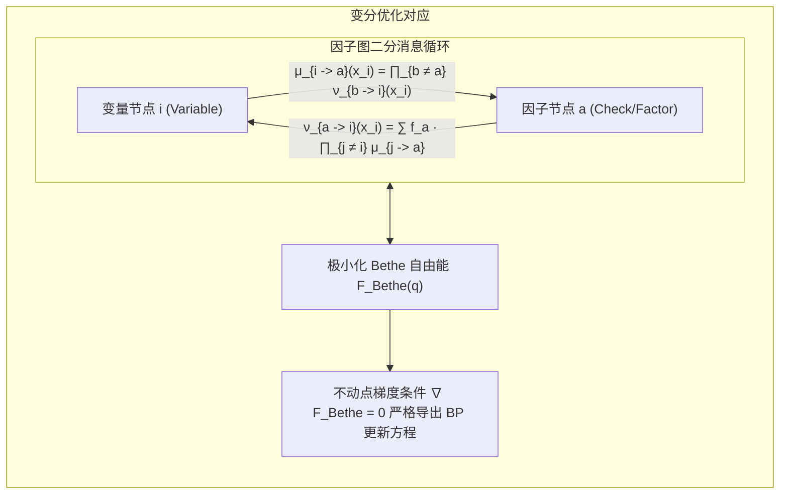

# Lec 8 因子图、密度演化与置信传播收敛性 (Belief Propagation Convergence, Density Evolution and Factor Graphs)

> MIT 15.098 应用概率与随机过程前沿研讨 · 讲义 8

## TL;DR

- 因子图（Factor Graphs）显式分离变量节点与校验约束节点，统一表征复杂概率关系。
- 贝特自由能（Bethe Free Energy）极值点与环状置信传播（LBP）的不动点严格等价。
- 密度演化（Density Evolution）利用无限码长极限下的测度卷积迭代精确追踪相变阈值。
## 因子图的二分图表示

在很多复杂的概率建模（尤其是信道编码与组合优化约束满足）中，势函数往往牵涉多个变量的高阶耦合。
**因子图（Factor Graph）**通过引入二分图（Bipartite Graph）结构对此进行了最普适的抽象。
因子图包含两类节点：
1. **变量节点（Variable Nodes $i \in V$）**：对应随机变量 $X_i$；
2. **因子节点（Factor/Check Nodes $a \in F$）**：对应局部相容势函数 $f_a(X_{\partial a})$。

全局联合概率测度表征为：
$$
P(X = x) = \frac{1}{Z} \prod_{a \in F} f_a(x_{\partial a})
$$
其中 $\partial a$ 表示与因子节点 $a$ 相连的所有变量集合。

在因子图上，消息在两类节点之间交替往返传递：
- 变量到因子消息：$\mu_{i \to a}(x_i) = \prod_{b \in \partial i \setminus \{a\}} \nu_{b \to i}(x_i)$；
- 因子到变量消息：$\nu_{a \to i}(x_i) = \sum_{x_{\partial a \setminus \{i\}}} f_a(x_{\partial a}) \prod_{j \in \partial a \setminus \{i\}} \mu_{j \to a}(x_j)$。

## 变分原理与 Bethe 自由能

为什么在包含环路的复杂图上，Loopy BP 往往能以惊人的精度收敛并逼近真实边际？
Yedidia、Freeman 与 Weiss 在 2001 年揭示了深藏其后的热力学本质：**LBP 并不是某种盲目的经验启发式算法，而是在非凸约束下极小化 Bethe 自由能（Bethe Free Energy）的变分一阶不动点迭代！**

对于任意试验伪边际分布族 $\{q_i(x_i)\}_{i \in V}$ 与 $\{q_a(x_{\partial a})\}_{a \in F}$，满足局部一致性约束：
$$
\sum_{x_{\partial a \setminus \{i\}}} q_a(x_{\partial a}) = q_i(x_i), \quad \sum_{x_i} q_i(x_i) = 1
$$
定义系统在伪边际下的 Bethe 自由能泛函为期望能量减去 Bethe 近似熵：
$$
\mathcal{F}_{\text{Bethe}}(q) = \mathcal{U}(q) - \mathcal{S}_{\text{Bethe}}(q)
$$
其中能量与熵展开为：
$$
\mathcal{U}(q) = - \sum_{a \in F} \sum_{x_{\partial a}} q_a(x_{\partial a}) \ln f_a(x_{\partial a})
$$
$$
\mathcal{S}_{\text{Bethe}}(q) = - \sum_{a \in F} \sum_{x_{\partial a}} q_a(x_{\partial a}) \ln q_a(x_{\partial a}) + \sum_{i \in V} (d_i - 1) \sum_{x_i} q_i(x_i) \ln q_i(x_i)
$$

::: theorem [Yedidia-Freeman-Weiss 变分等价性定理]
在满足边际相容性单纯形约束的流形上，拉格朗日乘子条件：
$$
\nabla_q \left( \mathcal{F}_{\text{Bethe}}(q) + \sum \lambda \dots \right) = 0
$$
所导出的稳态极值一阶充要条件，与因子图上的置信传播更新方程**在代数上完全恒等**。
BP 算法传递的消息 $m_{i \to a}$ 正是该变分优化问题中的拉格朗日对偶乘子的指数重参数化！
:::

## 密度演化与相变阈值追踪

在分析大规模随机图模型与信道纠错码（如 LDPC 码）的渐近性能时，单个消息是随机变量。
为了追踪整个图上所有消息的统计行为演进，Richardson 与 Urbanke 创立了**密度演化（Density Evolution, DE）**技术。

设 $P_t(m)$ 为第 $t$ 次迭代时全网传递消息的对数似然比（LLR）的经验概率密度函数。
在随机稀疏图中，当码长 $n \to \infty$ 时，局部的无环性质使得流入每个节点的各条输入消息相互独立。
因此：
1. 在变量节点处，消息更新是线性累加操作，对应的输出概率密度是输入密度的**经典卷积（Convolution）**：
$$
P_{\text{out}}^{(v)} = P_{\text{in}}^{(1)} * P_{\text{in}}^{(2)} * \dots * P_{\text{in}}^{(d_v - 1)}
$$
2. 在校验节点处，利用双曲正切变换 $\tanh(u/2)$，乘积操作可映射到对偶傅里叶域并转化为对偶卷积。

::: definition [密度演化动力系统与解码阈值]
整个算法的宏观收敛性被抽象为一个无限维无穷小概率密度的非线性迭代动力学：
$$
P_{t+1} = \Phi(P_t; \sigma^2)
$$
其中 $\sigma^2$ 为信道噪声功率。
存在一个临界噪声阈值 $\sigma_{\text{BP}}^*$（即解码相变阈值）：
- 若 $\sigma < \sigma_{\text{BP}}^*$，概率测度 $P_t$ 随 $t \to \infty$ 弱收敛于狄拉克测度 $\delta_{+\infty}$，错误率以双指数级迅速收敛至绝对 0；
- 若 $\sigma > \sigma_{\text{BP}}^*$，密度演化在有限非零错误测度处陷入不动点，译码彻底失败。
:::

::: insight [统计力学空穴法与密度演化的统合]
信息论中的密度演化（Density Evolution）与理论统计物理中用于解析自旋玻璃态的“一阶副本对称破缺空穴法（1RSB Cavity Method）”在数学上是同一种思想在不同学科的独立绽放！
这一数学工具不仅能够预测分布式算法在无限图上的宏观成功率，更为后续香农极限容量逼近码的设计提供了唯一精确的理论指针。
:::
