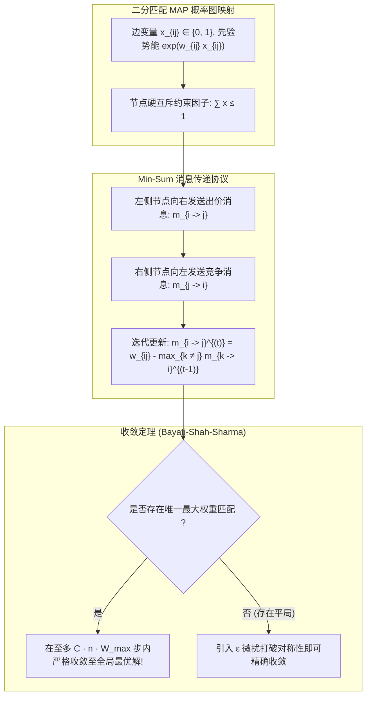

# Lec 9 二分图最大权匹配与 Min-Sum 置信传播 (Max-Weight Bipartite Matching via Min-Sum Belief Propagation)

> MIT 15.098 应用概率与随机过程前沿研讨 · 讲义 9

## TL;DR

- 经典组合最优化问题（二分图加权匹配）可完全映射为离散图模型上的 MAP 推断。
- 贝托纳（Bayati）、沙阿（Shah）与夏玛（Sharma）证明了在唯一解条件下 Min-Sum BP 保证精确收敛。
- 揭示了消息传递动态更新与匈牙利算法/原始-对偶单纯形拍卖机制的内在拓扑等价性。
## 组合优化与分布式消息传递

在网络交换机调度（Input-Queued Crossbar Switches）、资源动态分配与运筹学中，**最大权重二分图匹配（Max-Weight Bipartite Matching）**是最核心的基础算法原语。
设二分图 $G = (U \cup V, E)$，其中 $|U| = |V| = n$，边 $(i, j) \in E$ 带有非负实数权重 $w_{ij} > 0$。
目标是寻找一个边子集 $M \subseteq E$，满足每个顶点至多与一条边关联，并最大化总权重：
$$
\max_{x \in \{0, 1\}^{|E|}} \sum_{(i, j) \in E} w_{ij} x_{ij} \quad \text{s.t.} \quad \sum_{j \in \mathcal{N}(i)} x_{ij} \le 1, \; \forall i \in U; \quad \sum_{i \in \mathcal{N}(j)} x_{ij} \le 1, \; \forall j \in V
$$

虽然该问题在中心化计算下存在著名的多项式时间匈牙利算法（Hungarian Algorithm, $O(n^3)$）或网络流解法，但在大规模分布式数据中心网络中，各个交换节点需要以完全局部、去中心化且轻量级的方式达成全局最优匹配。

Mohsen Bayati、Devavrat Shah 与 Mayank Sharma 在 2005-2008 年发表了一系列里程碑论文，证明了：**看似只具有局部启发性的 Min-Sum 置信传播算法，在二分匹配问题上不仅收敛，而且必然精确收敛至全局真实最优解！**

## 匹配图模型与消息传递更新

我们将二分匹配问题构建为一个因子图。每个候选边 $(i, j)$ 对应一个二值变量 $x_{ij} \in \{0, 1\}$。
单点势能为 $\phi(x_{ij}) = e^{w_{ij} x_{ij}}$。每个顶点 $i \in U$ 和 $j \in V$ 对应一个硬约束因子：
$$
f_i(x) = \begin{cases} 1, & \sum_{j} x_{ij} \le 1 \\ 0, & \text{otherwise} \end{cases}
$$
由于所有非零势能均为非负，这是一个纯粹的离散组合优化问题。
在 Min-Sum 算法（取对数后的极大积）下，设 $m_{i \to j}^{(t)}$ 为节点 $i \in U$ 在第 $t$ 轮向节点 $j \in V$ 发送的实数标量消息。

::: theorem [匹配 Min-Sum 消息传递方程]
经过因子节点的极值约简，从左侧节点 $i$ 到右侧节点 $j$ 的标量消息满足如下极为优雅的闭式递归：
$$
m_{i \to j}^{(t)} = w_{ij} - \max_{k \in \mathcal{N}(i) \setminus \{j\}} \left( m_{k \to i}^{(t-1)} \right)^+
$$
其中 $(x)^+ = \max(x, 0)$。
在第 $t$ 轮结束时，每条边 $(i, j)$ 的决策由边际置信度符号直接判定：
$$
x_{ij}^{(t)} = \begin{cases} 1, & w_{ij} > \max_{k \neq j} (m_{k \to i})^+ + \max_{l \neq i} (m_{l \to j})^+ \\ 0, & \text{otherwise} \end{cases}
$$
:::

在物理直觉上，$m_{i \to j}$ 的含义是：**“节点 $i$ 愿意为了与节点 $j$ 匹配而给出的净剩余出价（Surplus Offer）”**。如果节点 $i$ 有其他非常高权重的替代伙伴 $k$，它传递给 $j$ 的消息就会被削弱。

## 严格收敛性证明：计算树与增广交错路

既然包含环路的图上 BP 通常面临不收敛风险，为什么在二分图匹配中却能保证严格收敛？
Bayati 等人的核心证明工具是**有限时间计算树展开（Computation Tree）**与**网络流增广交错路（Alternating Paths）**的结构结合。

::: definition [无环展开计算树中的交错树]
在二分图 $G$ 上运行 $t$ 步的 BP，在数学上等效于在以边 $(i, j)$ 为根、深度为 $t$ 的局部展开树 $T_t(i, j)$ 上运行精准树状推断。
由于展开树上的任意路径对应原图中的一条**交错路径（Alternating Walk）**，计算树中的最优配置与原图最优配置的差值构成一组交错环或交错路。
:::

设 $M^*$ 为原图的唯一全局最优匹配，而 $M'$ 为任意其他备选匹配。
由于 $M^*$ 最优，任意交错环或交错路的加权权重和必然严格小于最优匹配对应段的权重和（即不存在正权重增广交错回路）。
因此：
1. 随着迭代深度 $t$ 的增长，计算树外围边界的影响力被严格的交错权重劣势所压制；
2. 边界的虚假扰动无法长程回溯传递至根节点；
3. 当迭代次数达到 $t^* > C n W_{\text{ratio}}$ 时，所有非最优候选边的信度指数衰减并彻底转为负值。

::: insight [消息传递与单纯形拍卖算法的惊人同构]
深入考察 Min-Sum BP 的更新式，可以发现它在代数结构上与 Bertsekas 著名的**拍卖算法（Auction Algorithm）**以及线性规划对偶单纯形松弛存在一一映射！
消息向量 $m_{j \to i}$ 本质上就是线性规划松弛对偶问题中的拉格朗日乘子（即节点的影子价格 / Dual Prices）。
置信传播在这里完成了从概率推断到经典运筹线性规划对偶求解的绝妙蜕变，证明了分布式消息传递不仅能作为启发式统计推断，更能胜任确定性组合优化的最高精度求解！
:::
