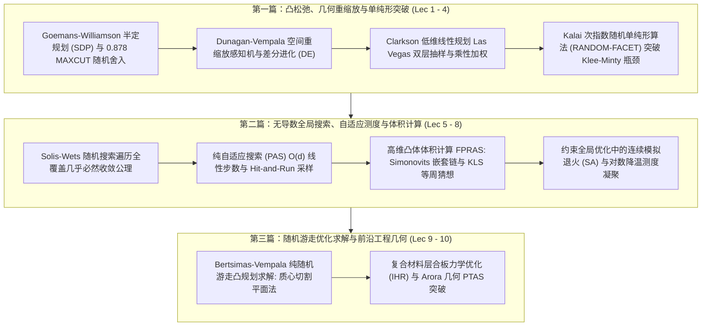

# 15.099 确定性优化中的随机方法前沿研讨 (Readings in Optimization: Randomized Methods for Deterministic Optimization)

> MIT Course 15 · Operations Research & Statistics · 课号 15.099

## TL;DR

- 深度精读优化理论近现代经典文献，聚焦“以随机化方法求解确定性最优化”的数学前沿。
- 剖析半定规划（SDP）超平面舍入、多面体重缩放感知机与次指数单纯形法（RANDOM-FACET）。
- 系统阐释纯自适应搜索（PAS）、Hit-and-Run 高维马尔可夫链、凸体体积 FPRAS 与 Arora 几何 PTAS。

## 课程全景与前沿交叉体系

本研讨课由麻省理工学院斯隆管理学院与运筹学中心（ORC）罗伯特·弗罗因德（Robert Freund）教授主持，是面向运筹学与理论计算博士生的旗舰经典研讨。
课程聚焦于 20 世纪 90 年代至 21 世纪初最优化理论的一场深刻认识论范式转移：**传统优化依赖确定性的梯度导引与刚性代数变换，而引入受控的随机过程、马尔可夫链蒙特卡洛（MCMC）与高维几何测度集中，能够以颠覆性的复杂度突破经典确定性算法的最坏情况瓶颈**。

在研讨脉络与知识结构上，课程分为三大递进篇章：
第一篇章聚焦凸松弛与经典线性规划随机化，涵盖 Goemans-Williamson 半定规划 MAXCUT 突破、Dunagan-Vempala 几何重缩放以及 Kalai 次指数单纯形算法；第二篇章转向连续全局优化与测度采样理论，从 Solis-Wets 几乎必然收敛公理、纯自适应搜索（PAS）线性复杂度，到 Simonovits 高维凸体体积多项式时间 FPRAS 逼近；第三篇章直击工程落地与几何前沿，剖析 Bertsimas-Vempala 纯随机游走凸规划求解、波音复合材料机翼加筋壁板优化与 Arora 几何 PTAS 近似。

这一前沿体系揭示了现代最优化的最高境界：通过在连续几何空间中赋予粒子布朗运动与随机方向游走的自由度，不仅无需显式求解繁复的 Hessian 矩阵或逆转对抗性多面体，反而能以极高概率直穿高维几何核心，实现了计算精度与算法鲁棒性的双重升华。

::: insight [随机性在确定性优化中的“不讲道理的有效性”]
对于确定性问题（如求一个确定矩阵的线性规划，或求一个确定多面体的体积），初学者往往难以理解为什么要引入“抛硬币”这种看似不确定的机制。
现代优化理论给出了无可辩驳的证明：**确定性对抗输入可以通过精心设计的微小几何假象，将任何确定性算法诱入超指数级的泥潭（如 Klee-Minty 超立方体或体积计算的指数不可逼近性）；而随机化本质上是在算法与输入之间建立了一道信息不对称屏障，彻底摧毁了最坏情况输入的对抗结构**。随机性并非妥协，而是最锐利的降维解耦武器。
:::

## 讲义全集与研讨大纲

| 讲次 | 中文研讨主题 | 核心数学与运筹机制 | 状态 | 笔记链接 |
| :--- | :--- | :--- | :--- | :--- |
| **Lec 01** | Goemans-Williamson 半定规划与 MAXCUT 近似算法 | 向量松弛为球面 SDP、高斯随机超平面舍入、Grothendieck 0.878 近似常数 | `complete` | [Goemans-Williamson 半定规划与 MAXCUT](lec1.md) |
| **Lec 02** | 线性规划多项式重缩放与差分进化算法 | 感知机停滞几何拉伸、DV 空间各向同性放大、差分进化（DE）自适应变异 | `complete` | [线性规划多项式重缩放与差分进化](lec2.md) |
| **Lec 03** | 低维线性规划的 Las Vegas 随机算法 | 约束随机子抽样、逆向分析引理、违背集乘性权重倍增法、强多项式复杂度 | `complete` | [低维线性规划的 Las Vegas 随机算法](lec3.md) |
| **Lec 04** | 单纯形法次指数随机枢轴与多面体几何 | 简单多面体刻面结构、RANDOM-FACET 随机递归、次指数期望步数上界 | `complete` | [单纯形法次指数随机枢轴与多面体几何](lec4.md) |
| **Lec 05** | 随机搜索极小化与随机游走采样 | Solis-Wets 空间遍历几乎必然收敛公理、自适应均值偏置与方差记忆动力学 | `complete` | [随机搜索极小化与随机游走采样](lec5.md) |
| **Lec 06** | 纯自适应搜索与 Hit-and-Run 全局优化 | 理想改善水平集均匀抽样、期望线性迭代步数定理、Hit-and-Run 快速混合 | `complete` | [纯自适应搜索与 Hit-and-Run 全局优化](lec6.md) |
| **Lec 07** | 高维凸体体积计算与多项式时间 MCMC | #P-hard 几何不可能性、望远镜几何嵌套序列分解、KLS 等周导流率界 | `complete` | [高维凸体体积计算与多项式 MCMC](lec7.md) |
| **Lec 08** | 约束全局优化中的模拟退火算法 | 吉布斯测度热力学凝聚定理、连续约束边界碰撞、对数降温全局收敛性 | `complete` | [约束全局优化中的模拟退火算法](lec8.md) |
| **Lec 09** | 基于随机游走的凸规划求解与采样加速 | Grünbaum 质心黄金切割定理、Hit-and-Run 经验样本均值近似、无导数多项式求解 | `complete` | [基于随机游走的凸规划求解](lec9.md) |
| **Lec 10** | 复合材料结构优化与几何 PTAS 近似方案 | 碳纤维层合板离散铺层 IHR 优化、波音机翼减重、Arora 随机四叉树 PTAS | `complete` | [复合材料结构优化与几何 PTAS](lec10.md) |

::: definition [全多项式时间随机近似方案 (FPRAS)]
对于某个计数或体积优化问题，若存在随机算法 $\\mathcal{A}$，对于任意输入实例 $x$ 与精度参数 $\\epsilon, \\delta \\in (0, 1)$：
$$
\\mathbb{P}\\left( (1 - \\epsilon) V(x) \\le \\mathcal{A}(x) \\le (1 + \\epsilon) V(x) \\right) \\ge 1 - \\delta
$$
且算法运行时间关于输入规模 $|x|$、$1/\\epsilon$ 与 $\\ln(1/\\delta)$ 均为多项式多项式函数，则称该算法为全多项式时间随机近似方案（FPRAS）。
:::

::: pitfall [伪随机数生成器的维度缺陷与周期陷阱]
在实际运行高维随机化算法（如 $d > 100$ 维度的 Hit-and-Run 或体积计算）时，严禁使用经典的线性同余发生器（LCG）。
Marsaglia 证明了线性同余生成的高维向量会不可避免地退化并全数落入极少数平行的超平面格子（Hyperplane Planes）上！
这种伪随机缺陷会在高维几何采样中造成极严重的假象与死角，必须采用密码学安全随机源或梅森旋转算法（Mersenne Twister, MT19937）配合高质量各向同性高斯球坐标映射。
:::

---

本资料根据 [MIT OpenCourseWare (15.099)](https://ocw.mit.edu/courses/15-099-readings-in-optimization-fall-2003/) 深度重构，遵循 CC BY-NC-SA 4.0 协议。
