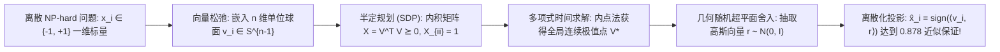

# Lec 1 Goemans-Williamson 半定规划与 MAXCUT 近似算法 (Goemans-Williamson MAXCUT SDP and Random Hyperplane Rounding)

> MIT 15.099 优化理论文献前沿研讨 · 讲义 1

## TL;DR

- 最大割（MAXCUT）是经典的 NP-hard 组合最优化问题，传统图贪心只能达到 0.5 近似比。
- Goemans 与 Williamson 将离散二次规划松弛为单位球面上的半定规划（SDP）。
- 随机超平面舍入（Random Hyperplane Rounding）证明了突破性的 0.87856 近似比常数。
## 最大割问题与离散二次规划

给定无向图 $G = (V, E)$，边 $(i, j) \in E$ 具有非负权重 $w_{ij} \ge 0$。
**最大割问题（Maximum Cut, MAXCUT）**的目标是将顶点集合 $V$ 划分为两个互斥子集 $S$ 与 $V \setminus S$，使得跨越割集的边权重之和最大化：
$$
\text{MAXCUT}(G) = \max_{S \subseteq V} \sum_{i \in S, j \notin S} w_{ij}
$$
通过引入二值自旋变量 $x_i \in \{-1, +1\}$（$x_i = +1$ 表示 $i \in S$，$x_i = -1$ 表示 $i \notin S$），跨越割集的边 $(i, j)$ 满足 $x_i x_j = -1$，此时 $\frac{1 - x_i x_j}{2} = 1$；若两端在同侧则该式为 0。
因此 MAXCUT 可严格等价表述为如下非凸二次整数规划：
$$
\max_{x \in \{-1, +1\}^n} \frac{1}{2} \sum_{1 \le i < j \le n} w_{ij} (1 - x_i x_j)
$$
Karps 证明了 MAXCUT 是 NP-hard 的。简单的随机抛硬币划分或贪心局部搜索算法只能达到平凡的 $0.5$ 近似比（即保证割权至少为总边权的一半）。

1995 年 Michel Goemans 与 David Williamson 提出了划时代的半定规划随机舍入算法，开创了凸松弛在现代组合近似算法中的新纪元。

## 几何向量松弛与半定规划

Goemans-Williamson 的核心构思是：将一维的离散标量 $x_i \in \{-1, +1\}$ 放宽为 $n$ 维欧氏空间中的**单位向量** $v_i \in \mathbb{R}^n$，满足 $\|v_i\|_2 = 1$。
离散乘积 $x_i x_j$ 被自然的几何内积 $\langle v_i, v_j \rangle$ 所替代：
$$
\max_{v_1, \dots, v_n \in \mathbb{R}^n} \frac{1}{2} \sum_{i < j} w_{ij} (1 - \langle v_i, v_j \rangle) \quad \text{s.t.} \quad \|v_i\|_2^2 = 1, \; \forall i \in V
$$
定义半正定格拉姆矩阵（Gram Matrix）$X = (X_{ij})_{n \times n}$，其中 $X_{ij} = \langle v_i, v_j \rangle$。
上述向量优化问题完全等价于标准**半定规划（Semidefinite Program, SDP）**：
$$
\max_{X \in \mathcal{S}^n} \frac{1}{2} \sum_{i < j} w_{ij} (1 - X_{ij}) \quad \text{s.t.} \quad X_{ii} = 1, \; \forall i; \quad X \succeq 0
$$
由于对称半正定锥 $\mathcal{S}_+^n$ 是凸锥，目标函数与等式约束均为线性，该 SDP 可以在任意预设精度 $\epsilon$ 下通过内点法在多项式时间内精确求解，得到最优矩阵 $X^*$ 及其 Cholesky 分解向量族 $\{v_i^*\}_{i=1}^n$。

## 随机超平面舍入与 0.878 近似比推导

如何将连续单位球面上的向量解 $\{v_i^*\}$ 映射回离散自旋 $\{-1, +1\}$？
GW 算法引入了**随机超平面舍入（Random Hyperplane Rounding）**：
从标准多元高斯分布中独立抽取一个随机方向向量 $r \sim \mathcal{N}(0, I_n)$，由法向量 $r$ 定义过原点的随机超平面 $r^\top x = 0$。
各顶点的离散赋值由其位于超平面的哪一侧唯一决定：
$$
x_i = \text{sign}(\langle v_i^*, r \rangle) = \begin{cases} +1, & \langle v_i^*, r \rangle \ge 0 \\ -1, & \langle v_i^*, r \rangle < 0 \end{cases}
$$

::: theorem [Grothendieck 几何交角引理]
对于任意两个单位向量 $v_i^*, v_j^*$，由旋转对称性，其被随机超平面分割（即内积符号相反，使得顶点 $i$ 与 $j$ 被划分至割集两侧）的概率，严格正比于它们在二维子空间中的夹角 $\theta_{ij} = \arccos(\langle v_i^*, v_j \rangle)$：
$$
\mathbb{P}(x_i \neq x_j) = \frac{\theta_{ij}}{\pi} = \frac{1}{\pi} \arccos(\langle v_i^*, v_j^* \rangle)
$$
:::

利用期望的线性性质，随机割的总期望权重为：
$$
\mathbb{E}[W_{\text{cut}}] = \sum_{i < j} w_{ij} \mathbb{P}(x_i \neq x_j) = \sum_{i < j} w_{ij} \frac{\arccos(X_{ij}^*)}{\pi}
$$
对比 SDP 松弛目标函数中对应边的贡献项 $\frac{1}{2}(1 - X_{ij}^*) = \frac{1}{2}(1 - \cos \theta_{ij})$，我们研究逐边比值：
$$
\alpha(\theta) = \frac{\frac{\theta}{\pi}}{\frac{1 - \cos \theta}{2}} = \frac{2}{\pi} \frac{\theta}{1 - \cos \theta}
$$
求导寻找该比值在 $\theta \in [0, \pi]$ 上的全局极小值点：在 $\theta^* \approx 2.331178 \text{ rad} \approx 133.56^\circ$ 处取得极小值：
$$
\alpha_{\text{GW}} = \min_{\theta \in [0, \pi]} \frac{2}{\pi} \frac{\theta}{1 - \cos \theta} \approx 0.878567
$$

::: insight [唯一博弈猜想与近似极限]
0.87856 是人类算法史上的一个奇迹常数。
Subhash Khot 等人在 2007 年证明：如果**唯一博弈猜想（Unique Games Conjecture, UGC）**成立，那么在多项式时间内实现比 $\alpha_{\text{GW}} \approx 0.87856$ 更好的近似比在数学上是 NP-hard 的！
也就是说，Goemans-Williamson 算法不仅是一个精妙的启发式方案，更是该经典组合难题在现代计算复杂性极限下的“完美终局解”。
:::
