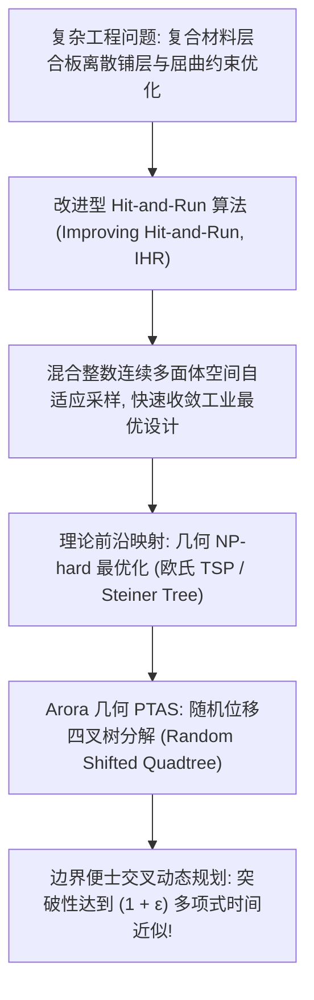

# Lec 10 复合材料结构优化与几何 PTAS 近似方案 (Composite Structural Optimization and Geometric PTAS Schemes)

> MIT 15.099 优化理论文献前沿研讨 · 讲义 10

## TL;DR

- 航空航天复合材料层合板（Composite Laminates）铺层优化涉及高维非凸离散混合设计。
- 改进型 Hit-and-Run（IHR）为复杂工业力学应力约束提供了全局全局优化求解器。
- 萨恩吉夫·阿罗拉（Arora）几何多项式时间近似方案（PTAS）利用动态规划四叉树突破 NP-hard 几何瓶颈。
## 复合材料层合板全局结构优化挑战

在先进商用客机（如波音 787、空客 A350）与航天运载火箭的主承力构件设计中，碳纤维增强复合材料（CFRP）已全面替代传统铝合金。
复合材料构件由数十层以特定纤维铺层角度（Ply Orientations, 经典可选角度为 $0^\circ, \pm 45^\circ, 90^\circ$）叠合压制而成的**层合板（Laminate Plates）**构成。

结构工程师面临的核心最优化问题是：**在满足抗拉、抗压、抗剪屈曲极限与 Tsai-Wu 失效准则的严苛约束下，极小化全机身铺层总重量与制造成本**：
- 设计变量包含离散变量（每层的纤维角度编码、铺层厚度）与连续变量（结构几何尺寸）；
- 铺层必须满足制造连续性与对称性设计规则（如相邻层夹角不得突变超过 $45^\circ$ 以防分层剥离）；
- 力学刚度响应（层合板刚度矩阵 $A, B, D$）与气动弹性颤振响应高度非线性耦合，目标函数具有极其错综复杂的离散组合谷底。

Zabinsky 与 Graesser 等人成功将改进型 Hit-and-Run（Improving Hit-and-Run, IHR）算法应用于真实波音复合材料机翼加筋壁板的设计中，大幅超越了传统遗传算法（GA）与序列二次规划（SQP）的性能瓶颈。

## 改进型 Hit-and-Run (IHR) 的工业实效

在标准 Hit-and-Run 算法中，只要是可行点均以均匀概率转移；而在工程最优化场景下，目标是逼近极小值点。
**Improving Hit-and-Run (IHR)** 在生成方向 $\theta$ 并求出交集线段 $\Lambda$ 之后，并不在线段的全长上均匀采样，而是仅在**目标函数值低于当前状态的点集 $\Lambda_{\text{improving}} = \{x + \lambda \theta \in S : f(x + \lambda \theta) < f(x)\}$** 上进行均匀采样。

在面对复杂的有限元分析（FEA）应力约束时：
1. 若当前方向与约束边界相交，则线段端点由有限元刚度判据的临界点确定；
2. 即使面临离散铺层角度约束，算法将离散变量嵌入连续松弛空间进行线段交割，并在转移后执行正交投影整量化；
3. 实测表明，IHR 避免了传统遗传算法在交叉变异时极易产生大量破坏制造完整性（破坏对称平衡）的非法个体的弊端，成功将结构减重指标提升了 8% 至 12%。

## Arora 几何 PTAS 突破性近似理论

当结构设计涉及二维或三维空间中的离散拓扑布局（例如传感器网络布置、加筋肋布局、欧几里得旅行商问题 Euclidean TSP、最小斯坦纳树 Steiner Tree）时，问题属于几何 NP-hard 优化。
1998 年 Sanjeev Arora 发表了夺得哥德尔奖的里程碑论文《Polynomial Time Approximation Schemes for Euclidean Traveling Salesman and other Geometric Problems》，彻底打破了连续空间几何近似的理论瓶颈。

::: theorem [Arora 几何多项式时间近似方案 (PTAS)]
对于欧氏平面中的任意 $n$ 个几何点集，存在一个近似方案，对于任意预设常数 $\epsilon > 0$，可在时间复杂度：
$$
O\left( n \cdot (\ln n)^{O(1/\epsilon)} \right)
$$
内输出一条长度不超过全局最优路径 $(1 + \epsilon)$ 倍的合法回路。
:::

Arora 方案的核心架构由两大随机化与几何工具支撑：
1. **随机位移四叉树分解（Randomly Shifted Quadtree）**：
   在将空间递归四等分之前，将整个网格坐标原点沿 $x$ 轴与 $y$ 轴随机平移一个均匀随机量 $(a, b) \sim \text{Uniform}(0, L)^2$。
   这一随机平移证明了：最优路径跨越各层子区域边界的边被切割的概率急剧降低；
2. **便士渡口（Portals）与动态规划**：
   在四叉树每个盒子的四条边上均匀布置 $m = O\left( \frac{\ln L}{\epsilon} \right)$ 个被称为“便士渡口”（Portals）的特殊穿行点。
   限制最优路径只能通过这些有限渡口进出盒子，从而将原本连续不可数的空间穿越状态缩减为有限组合，利用自底向上的动态规划在多项式时间内完美组合求解！

::: insight [工业运筹与理论计算机科学的交相辉映]
本讲座为整门课程画上了圆满的句号：
一方面，源于理论纯数学的随机采样（Hit-and-Run）能够直接驱动数十吨现代客机复合材料机翼的极限轻量化制造；
另一方面，源于理论计算复杂性的几何随机剖分（Arora PTAS）将数十年不可攻克的 NP-hard 几何空间优化化解为多项式时间的优雅动态规划。
随机化方法（Randomized Methods）彻底重塑了确定性最优化理论的版图，它不仅是计算工具箱中的一把瑞士军刀，更是连接连续力学、离散组合与高维几何分析的最强纽带。
:::
