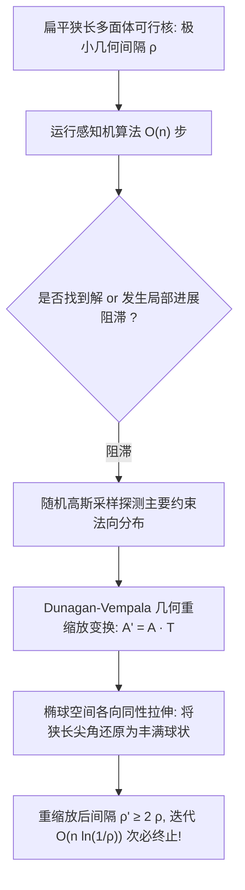

# Lec 2 线性规划多项式重缩放与差分进化算法 (Dunagan-Vempala Rescaling and Differential Evolution)

> MIT 15.099 优化理论文献前沿研讨 · 讲义 2

## TL;DR

- 杜纳甘-文帕拉（Dunagan-Vempala）算法通过随机投影与几何重缩放改造感知机。
- 将求解线性规划（LP）可行性转化为多项式步数的高概率椭球体放大收敛。
- 差分进化（DE）利用群体向量差分扰动实现连续非凸空间的无导数全局搜索。
## 线性规划几何条件数与感知机困境

求解线性规划（Linear Programming, LP）或寻找线性不等式系统的可行解：
$$
A x > 0
$$
是多项式时间算法（如椭球法、内点法）与组合单纯形法的核心焦点。
经典的罗森布拉特感知机算法（Perceptron Algorithm）是一种极简的迭代投影方法：
从 $x_0 = 0$ 出发，在第 $t$ 步若存在某个约束 $a_i^\top x_t \le 0$，则执行次梯度更新：
$$
x_{t+1} = x_t + \frac{a_i}{\|a_i\|}
$$
若可行核包含一个半径为 $\rho$ 的单位球（即几何间隔/条件数为 $\rho$），感知机保证在至多 $1/\rho^2$ 步内终止。
然而，当多面体非常狭长扁平（Condition Number 极差，$\rho \ll 2^{-L}$）时，$1/\rho^2$ 会呈现指数级爆炸，因此感知机不是弱多项式算法，更非强多项式算法。

2004 年 John Dunagan 与 Santosh Vempala 提出了震撼的**简单多项式时间重缩放算法（DV Rescaling Algorithm）**，利用纯粹的随机化几何重缩放赋予了感知机严格的多项式时间复杂度！

## Dunagan-Vempala 随机几何重缩放

DV 算法的核心思想是：当感知机在若干步内未能找到可行解时，当前累加的方向向量必然高度集中在导致多面体狭窄的主特征方向上。
算法通过维持一个线性坐标变换矩阵 $T$（初始为单位矩阵 $I$），在每轮“停滞”时，利用随机游走样本的二阶矩或误分类约束的外积，对空间进行拉伸变换：
$$
T_{k+1} = T_k \left( I + \alpha \frac{v v^\top}{\|v\|^2} \right)
$$
其中 $v$ 是从误分类超平面中通过随机加权抽取的方向。

::: theorem [DV 几何重缩放多项式收敛定理]
在每次空间重缩放之后，可行锥的内切球体积期望以乘性因子扩张：
$$
\text{Vol}(T_{k+1} \mathcal{K}) \ge \left(1 + \frac{1}{n}\right) \text{Vol}(T_k \mathcal{K})
$$
由于可行锥的初始归一化体积至少为 $\rho^n$，且变形后的体积不能超过单位球体积 $O(1)$，因此几何重缩放的总发生次数被严格上界限制为：
$$
K = O\left( n^2 \ln\left(\frac{1}{\rho}\right) \right)
$$
结合每轮感知机运行的 $O(n)$ 次迭代，整体算法构成了具有极高实用性的随机化多项式时间 LP 求解器。
:::

## 差分进化算法（Differential Evolution）

在连续非凸、非光滑、黑箱不可微的全局优化场景中：
$$
\min_{x \in \mathbb{R}^d} f(x)
$$
Storn 与 Price（1997）提出了著名的随机自适应全局启发式算法——**差分进化（Differential Evolution, DE）**。

DE 的核心创新在于**向量差分变异（Vector Differential Mutation）**。
维持一个大小为 $N_p$ 的种群 $P = \{x_1, x_2, \dots, x_{N_p}\}$。对于每个目标个体 $x_i$：
1. **差分变异**：随机选取三个互不相同的个体 $x_{r_1}, x_{r_2}, x_{r_3}$（均不等于 $i$），生成变异向量：
$$
v_i = x_{r_1} + F \cdot (x_{r_2} - x_{r_3})
$$
其中 $F \in (0, 2]$ 为变异缩放常数；
2. **二项交叉**：以交叉概率 $C_r$ 将目标向量 $x_i$ 与变异向量 $v_i$ 逐维度重组生成试验向量 $u_i$；
3. **贪婪选择**：若 $f(u_i) \le f(x_i)$ 则用 $u_i$ 替代 $x_i$，否则保留原个体。

::: insight [无尺度自适应的微观动力学]
差分进化的惊人效率来源于其内在的“无尺度自适应性”（Scale-Invariance）：
在优化初期，种群分布极其分散，差分向量 $(x_{r_2} - x_{r_3})$ 模长巨大，驱动算法在全空间进行宽幅广域探索（Exploration）；
随着种群逐渐向极小值谷底聚集，个体间距自然缩小，差分步长自动自发衰减为高精度的微观爬山微调（Exploitation），完全无需人为设计复杂的冷却调度表！
:::
