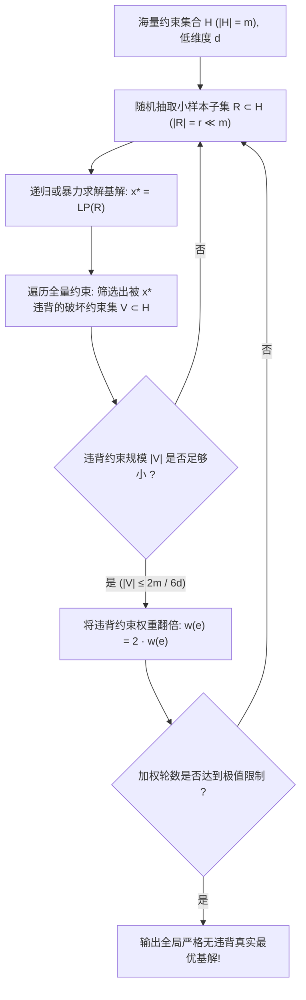

# Lec 3 低维线性规划的 Las Vegas 随机算法 (Clarkson Las Vegas Algorithms for Low-Dimensional Linear Programming)

> MIT 15.099 优化理论文献前沿研讨 · 讲义 3

## TL;DR

- 在计算几何与低维 LP 中，约束数量 $m$ 极大而维度 $d$ 很小（$d \ll m$）。
- 克拉克森（Clarkson）算法基于两层随机采样与约束加权倍增机制。
- 实现了期望运行时间与约束总数 $m$ 严格呈线性的强多项式复杂度 $O(d^2 m)$。
## 低维线性规划与几何对偶挑战

在计算机图形学、计算几何（如凸包构建、半空间求交、最小包围球）以及鲁棒回归中，经常遇到一类极具特征的线性规划问题：
$$
\min c^\top x \quad \text{s.t.} \quad A x \le b, \quad x \in \mathbb{R}^d
$$
其中约束数量 $m$ 极其庞大（数以百万计），但决策变量的维度 $d$ 是很小的固定常数（如 $d = 2, 3, 4$）。

若直接运行通用内点法或单纯形法，复杂度往往依赖于矩阵求逆或庞大的基矩阵操作，耗时 $O(m^{1.5} d \dots)$。
Megiddo（1984）首次证明了对于固定 $d$，LP 可以在 $O(C_d \cdot m)$ 时间内求解（线性依赖于 $m$），但常数 $C_d = 2^{2^d}$ 是双重指数级。
Kenneth Clarkson 在 1995 年提出了两套革命性的**Las Vegas 随机算法**，将常数项急剧压缩，并建立了随机子集采样的通用几何范式。

## Clarkson 第一算法：随机子采样与违背集

算法首先为每个超平面约束分配权重，初始时所有约束权重均为 1。
设 $R \subset H$ 为根据当前权重分布独立抽取的随机子集，规模为 $r = O(d^2)$。
令 $x_R = \arg\min \{c^\top x : x \in \bigcap_{h \in R} h^+\}$ 为受限子问题的最优解。
定义**违背约束集（Violated Constraints）**：
$$
V_R = \{h \in H : x_R \notin h^+\}
$$

::: theorem [Clarkson 采样引理 (Sampling Lemma)]
若随机样本规模选取为 $r = 4 d^2$，则最优解 $x_R$ 所违背的约束权重的数学期望满足：
$$
\mathbb{E}[w(V_R)] \le \frac{d}{r + 1} w(H) \le \frac{1}{4d} w(H)
$$
特别地，由马尔可夫不等式，以至少 $1/2$ 的概率，违背集的总权重不超过 $\frac{1}{2d} w(H)$。
:::

证明基于经典逆向分析（Backward Analysis）：从包含样本 $R$ 的凸解基反推被删除约束的概率。

## Clarkson 第二算法：乘性权重倍增法（Multiplicative Weights）

如果抽取的样本解 $x_R$ 违背的约束集规模满足 $|V_R| \le \frac{1}{2d} w(H)$，算法并不丢弃这些违背约束，而是执行**加权倍增（Weight Doubling）**：
$$
w_{t+1}(h) = \begin{cases} 2 \cdot w_t(h), & h \in V_R \\ w_t(h), & h \notin V_R \end{cases}
$$

::: theorem [权重倍增迭代步数上界]
设全局真实最优基对应的 $d$ 个关键紧约束为 $B^* \subset H$。
每次加权倍增发生时：
1. 违背集合 $V_R$ 必然至少包含 $B^*$ 中的一个约束，因此最优基的权重乘积单调递增：
$$
\prod_{h \in B^*} w(h) \ge 2^k
$$
2. 另一方面，全网总权重的增长由于违背集权重受控，满足 $W_{t+1} \le W_t (1 + 1/2d)$。
由不等式放缩可知，加权倍增的总次数至多为：
$$
k \le 3 d \ln m
$$
:::

结合两层嵌套采样，Clarkson 算法在 $O(d^2 m + d^4 \ln m)$ 的期望时间内严格终止并返回无误解，展现了 Las Vegas 算法（绝对正确、期望极速）的无穷魅力。

::: insight [支持向量机中的有效支持集发现]
Clarkson 算法的几何本质是：**利用随机化试探快速剔除 99.9% 冗余的松弛约束，将计算资源极致聚焦在极少数决定多面体顶点的紧支撑面上**。
这一思想直接启发了现代大规模线性 SVM 中的“工作集（Working Set）”与核空间活跃约束挖掘算法。
:::
