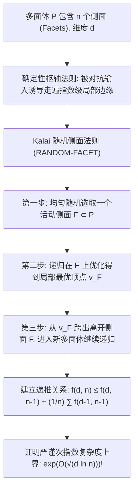

# Lec 4 单纯形法次指数随机枢轴与多面体几何 (Kalai Subexponential Randomized Simplex Algorithm and Simple Polytopes)

> MIT 15.099 优化理论文献前沿研讨 · 讲义 4

## TL;DR

- 确定性单纯形主元选取法则（如 Dantzig、Bland）在 Klee-Minty 变形超立方体上呈现指数级最坏情况步数。
- 吉尔·卡莱（Gil Kalai）提出了颠覆性的次指数随机单纯形算法（RANDOM-FACET）。
- 严格证明了多面体单纯形遍历期望步数上界 $2^{O(\sqrt{d \ln n})}$，打破多面体直径猜想瓶颈。
## Hirsch 猜想与确定性单纯形法的滑铁卢

单纯形算法（Simplex Algorithm）是乔治·丹齐格（George Dantzig）在 1947 年提出的运筹学奠基石。
单纯形法在多面体外围的顶点-边图（1-Skeleton Graph）上沿着改善目标函数值的边缘进行枢轴旋转（Pivot Steps）。
虽然在工业实践中单纯形法表现极快（平均步数约为 $O(m)$），但在理论计算机科学中，其最坏情况复杂度长达半个世纪未决：
- Klee 与 Minty（1972）构造了著名的扭曲超立方体（Klee-Minty Cube），证明了丹齐格最大梯度改进法则需要遍历全部 $2^d$ 个顶点；
- 随后针对最小下标法则（Bland Rule）、最大增益法则等确定性主元规则，学者们均构造出了导致指数步数的对抗多面体。

更为深刻的几何核心是著名的 **Hirsch 猜想（Hirsch Conjecture）**：一个由 $n$ 个不等式定义的 $d$ 维多面体，其直径（任意两顶点间最短路径）是否必然不超过 $n - d$？（该猜想后在 2010 年被 Santos 构造反例证伪）。

1992 年 Gil Kalai（以及 Jiřı́ Matoušek, Micha Sharir, Emo Welzl）提出了划时代的**随机化次指数单纯形法（RANDOM-FACET）**，首次将单纯形法的最坏情况期望复杂度推进至次指数区间！

## RANDOM-FACET 算法的递归架构

设 $P \subset \mathbb{R}^d$ 为由 $n$ 个刻面（Facets）围成的非退化简单多面体（Simple Polytope），目标是最大化线性泛函 $c^\top x$。
设当前处于顶点 $v$。包含在 $v$ 处的紧不等式集合构成了若干个候选侧面。
Kalai 的 RANDOM-FACET 算法设计极其精妙：
1. 找出当前顶点 $v$ 处所有可进一步改善目标的候选紧侧面集合 $\mathcal{F}(v)$；
2. **均匀随机**从中抽取一个侧面 $F \in \mathcal{F}(v)$；
3. 将问题递归限制在 $d-1$ 维侧面 $F$ 上，从 $v$ 出发寻找该侧面内的局部最优顶点 $v_F^*$；
4. 检查 $v_F^*$ 是否已是全多面体 $P$ 的全局最优解：
   - 若是，则终止返回；
   - 若不是，沿着 $v_F^*$ 处唯一一条离开侧面 $F$ 且使目标函数继续严格增加的边进行一步枢轴旋转，到达新顶点 $v'$，并在全多面体上重新递归调用 RANDOM-FACET。

## 次指数复杂度递推证明

设 $f(d, n)$ 为该算法在至多 $n$ 个刻面的 $d$ 维多面体上所需执行的期望枢轴步数。
关键的概率观察在于分析在步骤 4 中重新发起递归调用的概率与惩罚：

::: theorem [Kalai 随机侧面期望递推式]
算法满足如下核心差分方程：
$$
f(d, n) \le f(d, n - 1) + f(d - 1, n - 1) + \frac{1}{n} \sum_{i=1}^n f(d, n - i)
$$
通过对 $d$ 与 $n$ 采用精细的生成函数与鞍点放缩，可解得其全局渐近极值界：
$$
f(d, n) \le \exp\left( C \sqrt{d \ln n} \right) = n^{O(\sqrt{d / \ln n})}
$$
其中 $C > 0$ 为绝对常数。
:::

当维度 $d$ 与刻面数 $n$ 同阶增长时（如 $d \sim n/2$），该复杂度为 $2^{O(\sqrt{n})}$，严格小于任何底数大于 1 的纯指数函数 $2^{\Omega(n)}$！

::: insight [随机化摧毁对抗几何的本质]
为什么随机化能粉碎 Klee-Minty 维度的诅咒？
确定性法则的致命弱点在于：恶意构造的多面体可以在每一个决策岔路口布置微小的假象，诱导确定性算法步入一条极度迂回但局部贪婪的“长蛇链”。
而 RANDOM-FACET 的随机抽样使得算法以极大概率在早期直接“洞穿”高维多面体深处的一个主干侧面，从而以 $1/n$ 的期望概率在几何上直接跨越指数级数量的冗余顶点，彻底瓦解了对抗几何的刚性拓扑陷阱！
:::
