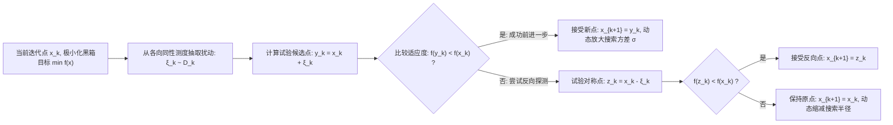

# Lec 5 随机搜索极小化与随机游走采样 (Minimization by Random Search Techniques and Random Walk Sampling)

> MIT 15.099 优化理论文献前沿研讨 · 讲义 5

## TL;DR

- 经典索利斯-韦茨（Solis-Wets）框架奠定了随机搜索算法的全局几乎必然收敛准则。
- 在无先验可微性假定下，利用空间各向同性高斯随机微扰打破局部极小滞留。
- 随机游走采样（Random Walk Sampling）利用遍历测度克服维度灾难下的体积退化。
## 无导数优化与随机搜索的兴起

在航空航天外形气动设计、复杂工业化学反应器控制以及超参数优化中，目标函数 $f: \mathbb{R}^d \to \mathbb{R}$ 通常由重型数值仿真软件（如有限元分析 CFD/FEM）黑箱输出：
- 目标函数不存在可解析的代数显式表达式；
- 无法通过自动微分或伴随方程获得高精度的梯度信息 $\nabla f(x)$；
- 目标曲面往往充斥着严重的数值噪声、高频锯齿以及密集的非凸局部极值深坑。

在这种严苛场景下，基于梯度的下降法（如梯度下降、拟牛顿法 BFGS）会立即在局部极值或导数断裂处永久卡死。
F. J. Solis 与 R. J-B. Wets 在 1981 年发表了里程碑式的奠基论文《Minimization by Random Search Techniques》，首次系统建立了**随机搜索全局优化算法（Random Search Techniques）**的现代公理化测度收敛理论。

## Solis-Wets 全局收敛性公理化定理

设紧致可行域为 $K \subset \mathbb{R}^d$。设全局极小值集合为：
$$
M = \left\{ x \in K : f(x) < \inf_{z \in K} f(z) + \epsilon \right\}
$$
由于 $f$ 在连续假设下在其下确界附近具有正测度，即勒贝格测度 $\nu(M) > 0$。

算法在第 $k$ 步生成扰动向量 $\xi_k$，其抽样概率分布记为度量空间上的概率测度 $\mathcal{D}_k$。
定义生成候选点在集合 $M$ 内的条件概率为：
$$
P_k = \mathcal{D}_k(M - x_k) = \mathbb{P}(x_k + \xi_k \in M)
$$

::: theorem [Solis-Wets 全局几乎必然收敛公理]
若随机搜索算法选取的抽样测度序列 $\{\mathcal{D}_k\}$ 满足**空间遍历全覆盖条件（Space Exhaustion Condition）**：
对于可行域 $K$ 内的任意博雷尔子集 $A$ 且 $\nu(A) > 0$，存在常数 $\rho > 0$ 使得：
$$
\sum_{k=1}^\infty \mathcal{D}_k(A - x) = \infty, \quad \forall x \in K
$$
则无论初始点 $x_0 \in K$ 如何选择，算法所产生的状态序列 $\{x_k\}$ 几乎必然收敛至全局最优解集 $M$：
$$
\lim_{k \to \infty} \mathbb{P}\left( x_k \in M \right) = 1
$$
:::

证明基于 Borel-Cantelli 引理与独立随机事件在无穷序列下的必然命中原理。

## 随机游走采样与自适应方差动力学

单纯的均匀随机采样虽然满足上述理论收敛条件，但其效率极低（在 $d$ 维空间中盲目命中的时间随 $d$ 呈几何级数 $O((1/\epsilon)^d)$ 爆发）。
Solis 与 Wets 在算法实践中引入了**偏差向量与方差自适应记忆机制（Adaptive Variance and Bias）**：
设当前生成均值为 $b_k$，协方差为 $\sigma_k^2 I$ 的高斯扰动 $\xi_k \sim \mathcal{N}(b_k, \sigma_k^2 I)$：
- 若正向点 $y_k = x_k + \xi_k$ 带来收益，则强化该方向：$b_{k+1} = 0.4 \xi_k + 0.2 b_k$，同时扩大步长 $\sigma_{k+1} = 1.2 \sigma_k$；
- 若正反向探索均连续失败若干步，则重置偏置 $b_{k+1} = 0$，并以几何级数收缩方差 $\sigma_{k+1} = 0.5 \sigma_k$ 以收敛至局部精细结构。

::: insight [无序探索与确定性收敛的辩证法]
Solis-Wets 框架向优化界传达了一个深刻的数学哲学：**收敛的必然性可以建立在微观过程的绝对不可预测性之上**。
通过维持一个对全空间开放微小测度的各向同性支持集，随机游走算法既保持了在有限步内迅速顺应局部几何单调下降的高效性，又保留了在无限时间尺度下逃逸任意深度势阱的确定性理论证明。
:::
