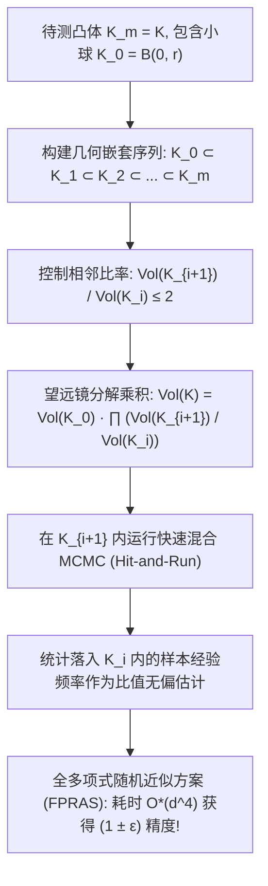

# Lec 7 高维凸体体积计算与多项式时间 MCMC (High-Dimensional Volume Computation and Polynomial-Time MCMC)

> MIT 15.099 优化理论文献前沿研讨 · 讲义 7

## TL;DR

- 精确计算 $d$ 维多面体的体积属于典型的 #P-hard 难题。
- Dyer-Frieze-Kannan 与 Simonovits 确立了利用凸体序列嵌套伸缩的多项式随机算法（FPRAS）。
- 结合等周不等式（Isoperimetric Inequality）与球漫步/Hit-and-Run 突破混合时间下界。
## 凸体体积计算的计算复杂度深渊

给定由 $m$ 个半空间不等式定义的高维有界凸体 $K = \{x \in \mathbb{R}^d : A x \le b\}$。
计算其在 $\mathbb{R}^d$ 欧几里得空间中的勒贝格测度（体积）：
$$
\text{Vol}(K) = \int_{x \in K} 1 \, dx
$$
在最优化理论、贝叶斯先验归一化、配分函数求解以及几何概率中处于基础核心地位。

然而，在计算复杂性理论中：
- Dyer 与 Frieze（1988）证明了即便是计算凸多面体的精确体积也是 **#P-hard** 的；
- Bárány 与 Füredi（1987）进一步证明了更残酷的确定性下界：**任何确定性算法，如果仅能通过多项式数量的点对多面体进行几何查询（Oracle Queries），其算出的体积近似比误差必然随维度呈指数级爆炸 $(c \cdot d / \ln d)^d$**！
这意味着确定性数值积分在高维空间下被理论彻底宣判死刑。

1989 年 Martin Dyer、Alan Frieze 与 Ravi Kannan（DFK 算法）创造了理论计算机科学的奇迹：他们提出了首个用于高维凸体体积计算的**全多项式时间随机近似方案（FPRAS）**，随后由 Miklós Simonovits 与 László Lovász 进行了极致优化。

## 几何伸缩序列与多阶段蒙特卡洛

DFK 与 Simonovits 算法的根本框架是将全空间的宏观体积测量，分解为一系列相互重叠的微观嵌套凸体链条：
设 $K_0 = B(0, r) \subset K$ 为一个已知解析体积的内切球，其半径满足 $R/r \le d \sqrt{d}$。
构造一系列缩放凸体：
$$
K_i = K \cap \left( 2^{i/d} K_0 \right), \quad i = 0, 1, 2, \dots, m = \lceil d \ln(R/r) \rceil
$$
使得 $K_m = K$，并且相邻两个集合的体积比满足常数上界：
$$
1 \le \frac{\text{Vol}(K_{i+1})}{\text{Vol}(K_i)} \le 2
$$
利用望远镜恒等式，待求体积严格分解为连乘积：
$$
\text{Vol}(K) = \text{Vol}(K_0) \prod_{i=0}^{m-1} \frac{\text{Vol}(K_{i+1})}{\text{Vol}(K_i)}
$$

对于序列中的每一项比值 $r_i = \frac{\text{Vol}(K_{i+1})}{\text{Vol}(K_i)}$：
我们在较大的集合 $K_{i+1}$ 中**均匀抽取** $N$ 个独立样本点 $X_1, \dots, X_N \sim \text{Uniform}(K_{i+1})$。
定义示性变量计数落入内部较小集合 $K_i$ 的样本比例：
$$
\hat{p}_i = \frac{1}{N} \sum_{j=1}^N \mathbb{I}_{\{X_j \in K_i\}} \implies \mathbb{E}[\hat{p}_i] = \frac{\text{Vol}(K_i)}{\text{Vol}(K_{i+1})} = \frac{1}{r_i}
$$
由于 $r_i \le 2$，该几何概率落在良好区间 $[0.5, 1]$ 内，完全不会发生方差爆炸，只需多项式数量的样本即可获得极低变异系数。

## 等周不等式与马尔可夫链导流率

整个算法在多项式时间内成立的决定性瓶颈，落在了**如何在凸体 $K_{i+1}$ 内生成高质量的均匀伪随机样本**。
Simonovits 系统分析了高维网格漫步（Grid Walk）、球漫步（Ball Walk）与 Hit-and-Run 的**导流率（Conductance $\Phi$）**：
$$
\Phi = \inf_{S \subset K: 0 < \pi(S) \le 1/2} \frac{\int_{x \in S, y \notin S} P(x, dy) \, d\pi(x)}{\pi(S)}
$$
根据 Jerrum-Sinclair 定理，马尔可夫链的谱隙（Spectral Gap）满足 $\lambda_2 \ge \Phi^2 / 2$，其达到稳态的混合时间满足 $\tau_{\text{mix}} = O(\Phi^{-2} \ln(1/\epsilon))$。

::: theorem [Kannan-Lovász-Simonovits (KLS) 等周猜想]
为了证明马尔可夫链在高维凸体内不会被“狭窄隘口”瓶颈锁死，Simonovits 等人证明了任意在各向同性位置（Isotropic Position）的凸测度均满足强等周不等式：
$$
\nu(\partial A) \ge C \cdot \min(\nu(A), 1 - \nu(A))
$$
该等周下界确保了 Hit-and-Run 采样器能够以 $O^*(d^4)$ 的低阶多项式步数彻底遍历任意高维凸体。
:::

::: insight [随机性突破确定性不可能性定理]
体积计算是计算复杂性理论中最震撼人心的篇章之一：
对于同一个数学问题，**确定性算法被严格证明需要超指数时间**，在物理上永远不可能计算；
而仅仅引入了一个带硬币翻转的马尔可夫链，计算复杂度瞬间跌落至 $O^*(d^4)$ 的平滑多项式！这确立了现代概率方法不仅是加速计算的技巧，更是超越确定性计算图灵机理论天花板的唯一钥匙。
:::
