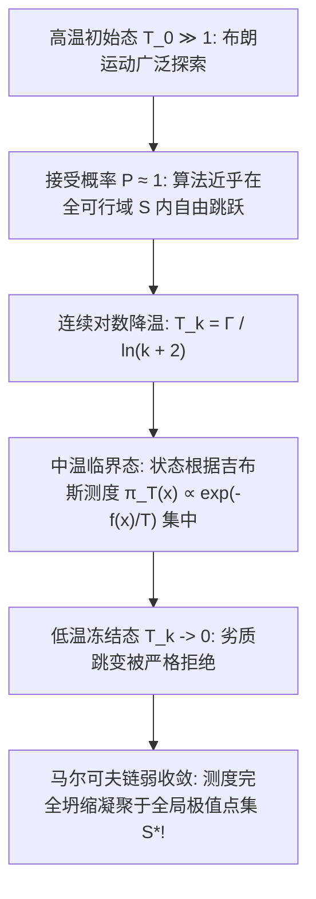

# Lec 8 约束全局优化中的模拟退火算法 (Simulated Annealing for Constrained Global Optimization)

> MIT 15.099 优化理论文献前沿研讨 · 讲义 8

## TL;DR

- 模拟退火（Simulated Annealing, SA）将连续非凸约束优化映射为物理退火降温动力学。
- 罗梅因（Romeijn）与史密斯（Smith）建立了连续状态空间约束下的遍历生成测度。
- 严格解析对数降温调度（Logarithmic Cooling Schedule）下的全局弱平稳收敛性。
## 统计力学与连续模拟退火

1953 年 Metropolis 等人提出了模拟高温分子系综平衡分布的蒙特卡洛算法。
1983 年 Kirkpatrick、Gelatt 与 Vecchi 发现：将温度参数 $T$ 随着迭代进行缓慢调低，可用于求解包含大量局部极小值的复杂组合最优化难题（如旅行商问题 TSP 与超大规模集成电路 VLSI 布局），这一范式被称为**模拟退火（Simulated Annealing, SA）**。

在连续非凸约束全局优化问题中：
$$
\min_{x \in S} f(x)
$$
其中 $S \subset \mathbb{R}^d$ 为有界连通可行域。
算法维持一个随时间单调递减的温度参数序列 $T_k > 0$（满足 $\lim_{k \to \infty} T_k = 0$）。
在状态 $x_k$ 处，通过转移核生成候选点 $y \sim Q(x_k, \cdot)$，并以 Metropolis 准则接受该跳变：
$$
P_{\text{accept}}(x_k \to y) = \min\left( 1, \exp\left( -\frac{(f(y) - f(x_k))^+}{T_k} \right) \right)
$$

若新点函数值改善（$f(y) \le f(x)$），则以概率 1 无条件接受；
若新点函数值劣化（$f(y) > f(x)$），算法**仍保留非零的概率接受该劣质解**，这使得系统具备从极深的局部极小陷阱中自发逃逸的强悍能力！

## 吉布斯测度的连续收敛极限

在任意固定正温度 $T > 0$ 下，假设连续马尔可夫链的生成核满足可逆性与遍历性，其平稳分布严格服从玻尔兹曼-吉布斯概率密度（Boltzmann-Gibbs Measure）：
$$
\pi_T(x) = \frac{\exp\left( -\frac{f(x)}{T} \right)}{\int_S \exp\left( -\frac{f(u)}{T} \right) du}
$$
令 $f^* = \inf_{x \in S} f(x)$ 为全局最优值。定义包含全部全局最优解的流形集合：
$$
S^* = \{x \in S : f(x) = f^*\}
$$

::: theorem [热力学零温测度凝聚定理]
当温度趋于绝对零度时，吉布斯测度序列 $\pi_T$ 在弱收敛意义下完全凝聚于全局最优集 $S^*$ 上：
对任意包含 $S^*$ 的开邻域 $U \supset S^*$，均有：
$$
\lim_{T \to 0^+} \pi_T(U) = \lim_{T \to 0^+} \frac{\int_U e^{-f(x)/T} dx}{\int_S e^{-f(x)/T} dx} = 1
$$
:::

证明基于拉普拉斯渐近积分法（Laplace's Method）：当 $T \to 0$ 时，指数衰减因子将抑制所有函数值高于 $f^*$ 的区域，其相对测度在分母的归一化主项中被指数级彻底抹杀。

## Romeijn-Smith 约束遍历采样与降温调度

在连续约束域 $S$ 上，生成候选点 $y$ 若直接脱离可行域边界，会导致算法效率大幅衰减。
H. E. Romeijn 与 R. L. Smith 提出了结合**Hit-and-Run 生成机制的连续约束模拟退火体系**。
在每一步，通过过当前点引出的随机直线与约束集合 $S$ 求交，直接在交集线段内抽取候选点，从而天然规避了边界越界的非法计算。

同时，为了保证在温度连续下降（非齐次马尔可夫链）的情形下算法不被早期伪平衡点所“冰冻锁定”，温度衰减必须服从严格的**对数冷却调度（Logarithmic Cooling Schedule）**：
$$
T_k = \frac{\Gamma}{\ln(k + k_0)}
$$

::: theorem [连续模拟退火几乎必然收敛充要条件]
若降温常数 $\Gamma$ 严格大于可行域中所有局部极小值逃逸势垒的最大深度（Critical Depth $D^*$）：
$$
\Gamma > D^* = \sup_{x, y \in S} \left( \inf_{\gamma: x \rightsquigarrow y} \max_{z \in \gamma} f(z) - f(x) \right)
$$
则无论初始位置如何，马尔可夫链状态序列 $X_k$ 几乎必然收敛至全局最优集：
$$
\lim_{k \to \infty} \mathbb{P}(X_k \in S^*) = 1
$$
反之，若降温过快（例如工业界常用的几何降温 $T_k = \alpha^k$），系统以正概率永久冻结在次优极值凹坑中。
:::

::: insight [探索与利用的时间尺度权衡]
模拟退火的对数降温条件揭示了运筹优化中永恒的哲学矛盾：**要想获得全局最优的绝对确定性，就必须忍受对数降温所要求的极漫长耗时**。
在现代工程实践中，往往采用先用高温退火迅速定位包含深谷的宏观盆地（Macro Basin），随后立即切换为拟牛顿法或序列二次规划（SQP）进行超指数急速局部淬火（Quenching）的混合策略，实现了理论全局性与工程收敛速度的完美统一。
:::
