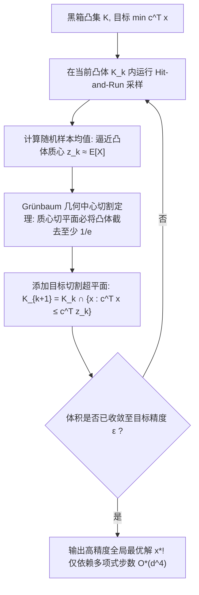

# Lec 9 基于随机游走的凸规划求解与采样加速 (Solving Convex Programs by Random Walks and Accelerated Hit-and-Run)

> MIT 15.099 优化理论文献前沿研讨 · 讲义 9

## TL;DR

- 伯齐马斯（Bertsimas）与文帕拉（Vempala）证明了纯随机游走可作为凸规划的通用一阶多项式求解器。
- 随机游走采样点集的质心（Centroid）天然扮演了切割平面法中的黄金分割预言机。
- 结合自适应各向同性预处理与 Hit-and-Run，摆脱了对显式阻碍函数与二阶 Hessian 矩阵的依赖。
## 凸规划求解范式的演进与困境

求解一般形式的连续凸规划问题：
$$
\min c^\top x \quad \text{s.t.} \quad x \in K
$$
其中 $K \subset \mathbb{R}^d$ 为有界闭凸集。
在 20 世纪下半叶，运筹学界主要依赖两大主流流派：
1. **椭球法（Ellipsoid Method, 1979）**：通过外接椭球体在多项式时间内提供理论存在性证明，但实践运行速度极慢，复杂度为 $O(d^6)$；
2. **内点法（Interior-Point Methods, 1984）**：利用自和谐阻碍函数（Self-Concordant Barriers）实现高效迭代，但高度依赖凸集的显式代数阻碍函数构造，且每步需要求逆巨大的 Hessian 矩阵，内存开销为 $O(d^3)$。

如果凸集 $K$ 仅通过一个弱分离预言机（Separation Oracle）给出（甚至只通过判别点是否在集合内的 Membership Oracle 给出），如何以最轻量级的计算代价求解？
2004 年 Dimitris Bertsimas 与 Santosh Vempala 发表了标志性论文《Solving Convex Programs by Random Walks》，证明了**仅仅依靠在凸体内进行简单的随机游走（Random Walks），便可在多项式时间内完整求解任意凸规划！**

## 质心切割平面与 Grünbaum 几何定理

经典几何凸分析中存在一个著名的理想算法——**质心法（Center-of-Gravity Method, Levin 1965）**：
在每一步，计算当前凸体 $K_k$ 的真实几何质心（Centroid）：
$$
z_k = \frac{1}{\text{Vol}(K_k)} \int_{K_k} x \, dx
$$
并通过过质心且垂直于目标梯度的超平面 $c^\top (x - z_k) \le 0$ 将凸体切半。

::: theorem [Grünbaum 几何切分定理]
对于任意有限维度的凸体 $K \subset \mathbb{R}^d$，任意通过其真实质心 $z$ 的超平面所切分出的两个子凸体 $K^+$ 与 $K^-$，其体积比满足严格常数下界：
$$
\frac{\text{Vol}(K^-)}{\text{Vol}(K)} \ge \left( \frac{d}{d + 1} \right)^d \ge \frac{1}{e} \approx 0.3678
$$
:::

这意味着每次质心切割都保证将凸体的总体积缩减至少 $1 - 1/e \approx 63.2\%$！
只需 $O(d \ln(1/\epsilon))$ 次切割，凸体即收缩至极小值点。
质心法唯一的致命缺陷是：计算高维凸体的精确质心在经典分析中属于 #P-hard 难题。

## Bertsimas-Vempala 随机游走质心逼近

Bertsimas 与 Vempala 的突破在于证明了：**不需要精确计算质心，只需利用 Hit-and-Run 抽取多项式数量的随机漫步样本，其经验平均值即可充当合格的近似质心！**

设在当前凸集内通过 Hit-and-Run 抽取 $M$ 个连续漫步样本 $X_1, \dots, X_M$。定义经验均值：
$$
\bar{z} = \frac{1}{M} \sum_{i=1}^M X_i
$$
当样本量满足 $M = O^*(d)$ 时，由大数定律与鞅极限定理，经验均值 $\bar{z}$ 距离真实质心的马氏距离（Mahalanobis Distance）以高概率小于 $O(1/\sqrt{d})$。

::: theorem [经验随机切割收敛定理]
通过近似经验质心 $\bar{z}$ 施加的超平面切割，以至少 $1 - \delta$ 的概率保证：
$$
\frac{\text{Vol}(K \cap \{x : c^\top (x - \bar{z}) \le 0\})}{\text{Vol}(K)} \le 1 - \frac{1}{2e}
$$
结合各向同性仿射变换预处理（Isotropic Position），整个随机化凸规划求解器的总期望运算时间仅为 $O^*(d^4 \ln(1/\epsilon))$。
:::

::: insight [无导数凸优化的终极统一]
Bertsimas-Vempala 算法颠覆了最优化教材中必须计算一阶导数（Gradient）与二阶导数（Hessian）的传统教条。
随机游走在几何凸体内的漫步本质上是一种“纯测度感知”：粒子在边界的碰撞频率自发编码了集合的法向与曲率信息。优化者无需知道凸集由哪些繁复的非线性不等式构成，只需放出一群布朗粒子自由游弋，凸规划的最优解就会作为高维几何质心的自然坍缩点浮现而出！
:::
