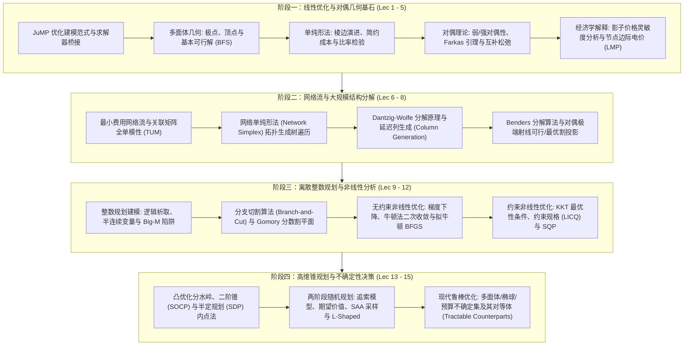

# 15.C57 优化方法 (Optimization Methods)

> MIT Course 15 · Operations Research & Statistics · 与 1.C57、6.C57、IDS.C57 跨院系联合开设

## TL;DR

- MIT 跨院系旗舰级研究生优化核心课（曾用课号 15.093J / 6.255J / IDS.200J）。
- 奠基于多面体几何、单纯形法、对偶理论（Farkas 引理）与大规模分解（DW / Benders）。
- 全景覆盖混合整数规划（分支切割）、二阶锥/半定规划、两阶段随机规划与现代鲁棒优化。

## 课程全景与运筹知识架构

本课程由麻省理工学院斯隆管理学院（Sloan）、电子工程与计算机科学系（EECS）、土木与环境工程系（CEE）以及数据、系统与社会研究所（IDSS）联合开设，是 MIT 全校最具声誉的工程与运筹优化统一基石课程。
课程由 Dimitris Bertsimas、Robert Freund 与 Pablo Parrilo 等国际优化宗师联合打造，旨在建立统一的**优化理论（Theory）、算法（Algorithms）与计算建模（Computation with JuMP）**三维一体知识体系。

在知识演进与方法论进阶上，课程严谨分为四大核心阶段：
从多面体几何与极点出发，建立连续线性规划的单纯形表演进与强对偶影子价格体系；进而切入大规模网络与系统解耦，剖析 Dantzig-Wolfe 列生成与 Benders 割平面投影；第三阶段跨越到离散离散世界与光滑弯曲空间，掌握分支切割树（Branch-and-Cut）与非线性 KKT 乘子机制；最终在高维锥优化（SOCP / SDP）与不确定性优化（两阶段随机规划与对偶鲁棒免疫）中实现运筹优化的全景贯通。

这一课程体系是进入工业软件核心求解器开发（Solver Development）、大规模供应链网络设计、电力现货市场出清、算法交易投资组合优化以及现代自动驾驶轨迹规划的终极必修通行证。

::: insight [运筹优化的三维认识论]
在传统工程教育中，学生往往将优化软件视作一个神秘的“黑盒子”（Black Box），输入矩阵等待数字输出；
而 15.C57 传达的核心哲学是**打开黑盒子、洞察几何本质**：
- 在物理世界中，看清约束的拓扑结构（是全单模网络，还是块角状耦合？）；
- 在几何空间中，感知解的多面体形态（极点是否整数，割平面如何削去小数尖角？）；
- 在对偶空间中，倾听乘子的影子语言（哪项资源是制约系统的死穴，不确定性的护城河该修筑多宽？）。
只有将物理建模、凸几何直觉与矩阵稀疏代数三者融会贯通，才能驾驭数千万级变量的真实复杂系统。
:::

## 讲义全集与教学大纲

| 讲次 | 中文讲义主题 | 核心数学、算法与计算机制 | 状态 | 笔记链接 |
| :--- | :--- | :--- | :--- | :--- |
| **Lec 01** | 优化建模范式与 JuMP 计算环境 | 决策规划通用表达、Julia/JuMP 宏元编程、MOI 锥形式规范化 | `complete` | [优化建模范式与 JuMP 计算环境](lec1.md) |
| **Lec 02** | 多面体几何、极点与基本可行解 | 半空间交集、极点/顶点几何、BFS 代数定义、线性规划基本定理 | `complete` | [多面体几何、极点与基本可行解](lec2.md) |
| **Lec 03** | 单纯形算法、代数演进与检验数 | 棱边缘演进、简约成本向量、最小比率检验、修正单纯形法 | `complete` | [单纯形算法、代数演进与检验数](lec3.md) |
| **Lec 04** | 对偶理论、Farkas 引理与互补松弛性 | 弱对偶/强对偶定理、Farkas 凸锥分离、互补松弛与无偏认证 | `complete` | [对偶理论、Farkas 引理与互补松弛](lec4.md) |
| **Lec 05** | 经济学边际解释、影子价格与灵敏度分析 | 对偶乘子作为边际导数、影子价格、基保持最优之摄动容许区间 | `complete` | [经济学解释、影子价格与灵敏度](lec5.md) |
| **Lec 06** | 网络流模型、全单模性与网络单纯形法 | 最小费用流 (MCF)、关联矩阵全单模性 (TUM)、生成树基拓扑遍历 | `complete` | [网络流模型、全单模性与网络单纯形](lec6.md) |
| **Lec 07** | 大规模线性优化与 Dantzig-Wolfe 分解原理 | 块角状耦合、Minkowski 极点重构、限制主问题 (RMP)、延迟列生成 | `complete` | [大规模优化与 Dantzig-Wolfe 分解](lec7.md) |
| **Lec 08** | Benders 分解算法与延迟约束生成 | 复杂变量投影、二阶段对偶从问题、Benders 可行割与最优割 | `complete` | [Benders 分解算法与延迟约束生成](lec8.md) |
| **Lec 09** | 整数规划建模艺术、逻辑约束与 Big-M 技术 | 混合整数线性规划 (MILP)、0-1 变量表达、Big-M 陷阱与凸包公式化 | `complete` | [整数规划建模艺术与 Big-M 技术](lec9.md) |
| **Lec 10** | 整数规划求解算法：分支定界与 Gomory 割平面 | 分治与连续松弛剪枝、Gomory 分数割代数推导、分支切割 (B&C) | `complete` | [分支定界与 Gomory 割平面](lec10.md) |
| **Lec 11** | 无约束非线性优化：梯度下降与牛顿法 | 泰勒展开曲率、Lipschitz 梯度下降、牛顿法二次收敛、拟牛顿 BFGS | `complete` | [无约束非线性优化与牛顿法](lec11.md) |
| **Lec 12** | 约束非线性优化：KKT 条件与对偶乘子 | 拉格朗日平稳性、KKT 四大组件、约束规格 (LICQ/Slater)、SQP | `complete` | [约束非线性优化与 KKT 条件](lec12.md) |
| **Lec 13** | 凸优化基础、二阶锥 (SOCP) 与半定规划 (SDP) | 洛克菲勒分水岭、洛伦兹锥、线性矩阵不等式 (LMI)、自和谐内点法 | `complete` | [凸优化基础、SOCP 与半定规划](lec13.md) |
| **Lec 14** | 随机规划：两阶段追索模型与机会约束 | Here-and-Now 与 Wait-and-See、期望价值函数、SAA 采样、L-Shaped | `complete` | [随机规划：两阶段追索与机会约束](lec14.md) |
| **Lec 15** | 鲁棒优化：多面体与椭球不确定集及其对等体 | 最坏情况免疫、箱式/椭球对等体 (LP/SOCP)、Bertsimas-Sim 预算集 | `complete` | [鲁棒优化：不确定集与对等体](lec15.md) |

::: definition [自和谐阻碍函数与多项式内点复杂度]
在锥规划内点法理论中，一个定义在开凸集 $C$ 上的严格凸函数 $F: C \\to \\mathbb{R}$ 称为 $\\theta$-自和谐阻碍函数（Self-Concordant Barrier），若其满足导数控制条件：
$$
|D^3 F(x)[h, h, h]| \\le 2 \\left( D^2 F(x)[h, h] \\right)^{3/2}, \\quad \\sup_{h \\neq 0} \\frac{|D F(x)[h]|^2}{D^2 F(x)[h, h]} \\le \\theta
$$
这一理论为非线性凸优化确立了绝对的坐标无关性，证明了原对偶内点法在 $O(\\sqrt{\\theta} \\ln(1/\\epsilon))$ 步内必然收敛。
:::

::: pitfall [模型规模与求解器内存壁垒陷阱]
工业初学者往往认为“只要问题是凸的或线性的，求解器就能无限解下去”。
然而，当变量与约束规模跨越千万级（$10^7$）时，瓶颈往往不再是 CPU 计算时间，而是**内存带宽与缓存命中率（Memory Wall）**！
单纯形法的基矩阵 LU 分解填入元（Fill-in）、内点法牛顿方程的正规方程组 $A D A^\\top$ 交叉乘积，可能瞬间耗尽服务器数百 GB 内存并引发致命 OOM 崩溃。掌握 Dantzig-Wolfe 分解、Benders 延迟约束生成与一阶算子分裂（ADMM），是突破内存物理极限的唯一手段。
:::

---

本资料根据 [MIT Catalog (15.C57)](https://catalog.mit.edu/search/?P=15.C57) 与 MIT 运筹学中心经典研究生教案深度重构，遵循 CC BY-NC-SA 4.0 协议。
