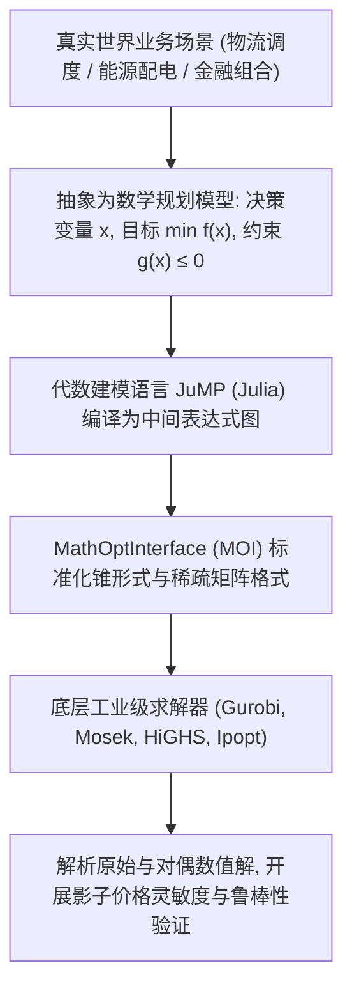

# Lec 1 优化建模范式与 JuMP 计算环境 (Optimization Modeling Paradigm and the JuMP Environment)

> MIT 15.C57 优化方法 · 讲义 1

## TL;DR

- 优化建模将复杂实际决策系统精确映射为决策变量、目标函数与代数约束集合。
- 比较代数建模语言（AML）发展历程，阐明 Julia/JuMP 在宏元编程与底层求解器桥接上的现代优势。
- 建立从确定性生产配比、运输网络到资本预算分配的标准规范型优化数学模型。
## 运筹优化的决策范式

运筹优化（Operations Research and Optimization）是应用数学与现代计算机科学的皇冠明珠。
其根本目标是在相互冲突的有限资源限制与物理/经济法则约束下，从天文数字般的可能决策组合中，**寻找使系统效用最大化或运营成本最小化的数学最优决策方案**。

一个通用的数学规划问题（Mathematical Program）具有统一的符号表达：
$$
\min_{x \in \mathcal{X}} f(x) \quad \text{s.t.} \quad g_i(x) \le 0, \; i=1,\dots,m; \quad h_j(x) = 0, \; j=1,\dots,p
$$
其中 $x = (x_1, x_2, \dots, x_n)^\top$ 为决策变量向量，$\mathcal{X} \subseteq \mathbb{R}^n$ 为变量所属的底空间（连续、离散或混合整数），$f(x)$ 为标量目标函数，$g_i(x)$ 与 $h_j(x)$ 分别为不等式与等式约束。



在 MIT 运筹学研究生体系中，优化方法不再被当作纯粹的象牙塔定理推导，而是被塑造成一套集“物理建模（Modeling）、理论分析（Theory）与计算求解（Computation）”于一体的三维工程方法论。

## 代数建模语言与 Julia/JuMP 生态

在 20 世纪，优化建模主要依赖专有建模语言（如 AMPL、GAMS）或商业矩阵库。
然而，专有语言缺乏现代通用编程语言的面向对象抽象、多重分派与高性能数据流水线，造成了著名的“双语言困境”（Two-Language Problem，即用 Python/Julia 原型设计，再用 C++ 重构工业求解）。

2015 年 Miles Lubin 与 Iain Dunning 在 MIT 运筹学中心（ORC）开创了 **JuMP（Julia for Mathematical Programming）**。
JuMP 利用 Julia 强大的同像性宏系统（Metaprogramming Macros）与即时编译（LLVM JIT），实现了与原生 C 语言持平的模型实例化速度，同时保持了近乎纯数学公式的极致语法优雅度。

```julia
using JuMP
using HiGHS

# 创建优化模型实例
model = Model(HiGHS.Optimizer)

# 定义决策变量 (带下界与二值约束)
@variable(model, x[1:n] >= 0)
@variable(model, y[1:m], Bin)

# 设置目标函数
@objective(model, Min, sum(c[i] * x[i] for i in 1:n) + sum(f[j] * y[j] for j in 1:m))

# 添加业务约束
@constraint(model, capacity[j in 1:m], sum(A[j, i] * x[i] for i in 1:n) <= C[j] * y[j])

# 求解与状态检查
optimize!(model)
@assert is_solved_and_feasible(model)
println("最优目标值: ", objective_value(model))
```

JuMP 的底层核心是 **MathOptInterface (MOI)** 抽象层。MOI 将任意复杂的线性、二次、二阶锥、半正定乃至非线性问题，统一转化为标准的“仿射算子属于凸锥”的形式：
$$
f(x) \in \mathcal{K}
$$
从而实现了上层模型与底层底层商业/开源求解器之间的无缝热拔插切换。

## 典型优化模型结构全景

在工业运筹中，最常见的三类基准模型包括：
1. **连续生产混合线性规划（Diet / Blending Problem）**：
   在满足营养成分与化学配比下界的条件下，极小化原材料采购成本：
   $$
   \min \sum_{j=1}^n c_j x_j \quad \text{s.t.} \quad \sum_{j=1}^n a_{ij} x_j \ge b_i, \; \forall i; \quad x_j \ge 0
   $$
2. **多商品运输流（Multi-Commodity Transportation Flow）**：
   跨越有向图网络调配货物流，确保各节点供需平衡并遵守路段通行能力约束；
3. **固定费用设施选址（Facility Location Problem）**：
   引入连续出货流 $x_{ij}$ 与离散开启决策 $y_i \in \{0, 1\}$，构成典型的混合整数线性规划（MILP）。

::: insight [建模表达力与计算复杂性的权衡哲学]
优化界有一句经典名言：“建模的最高境界不是将物理现实巨细靡遗地完全复制，而是在保留核心因果决策链的同时，让模型落在多项式时间可解的凸集边界之内。”
初学者往往倾向于使用大量指示函数、绝对值、高阶多项式甚至非连续条件分支，导致模型迅速演化为 NP-hard 的非凸非光滑系统。
优秀的运筹工程师懂得如何通过变量替换、Epigraph 次外图变换以及 Big-M 约束将非线性逻辑优雅平顺地松弛为线性凸规划。
:::
