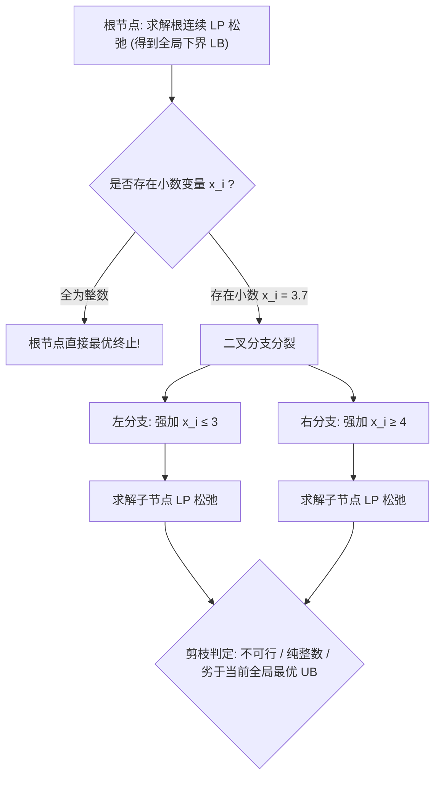

# Lec 10 整数规划求解算法：分支定界与 Gomory 割平面 (Integer Programming Algorithms: Branch-and-Bound and Cutting Planes)

> MIT 15.C57 优化方法 · 讲义 10

## TL;DR

- 分支定界（Branch-and-Bound）通过分治树形枚举与连续松弛下界驱动剪枝。
- 割平面法（Cutting Planes）在不破坏任意整数可行解的前提下动态切除小数极点。
- 阐明戈莫里分数割（Gomory Mixed-Integer Cuts）的代数生成及其与现代分支切割（Branch-and-Cut）的融合。
## 分支定界法 (Branch-and-Bound) 的分治哲学

整数规划在理论上是 NP-hard 的。穷举所有 $2^n$ 种二值组合是不切实际的。
1960 年 Ailsa Land 与 Alison Doig 提出了著名的**分支定界法（Branch-and-Bound, B&B）**，随后由 Little 等人完善，成为现代所有商用整数优化求解器（Gurobi、CPLEX、SCIP）的核心骨架。

分支定界法的哲学极其纯粹：**分而治之（Divide and Conquer）结合智能剪枝（Bounding and Pruning）**：
设原全整数问题为 $(IP): \min \{c^\top x : x \in S\}$。
1. **松弛定界（Bounding）**：
   忽略全部整数约束，求解其连续线性规划松弛 $(LP): \min \{c^\top x : x \in P_{\text{LP}}\}$。
   若 LP 得到的最优解 $x^*$ 恰好全为整数，则原问题彻底解决；
   若存在分量 $x_i^*$ 为非整数（例如 $x_i^* = 3.7$），则其目标值 $z_{\text{LP}}^*$ 为原问题全局最优解的一个**绝对确定性下界（Lower Bound）**；
2. **分支分裂（Branching）**：
   针对小数变量 $x_i$，根据整数的排他性，创建两个互斥的子问题：
   - 左子树：强加约束 $x_i \le \lfloor x_i^* \rfloor = 3$；
   - 右子树：强加约束 $x_i \ge \lceil x_i^* \rceil = 4$；
3. **剪枝准则（Pruning Rules）**：
   在树的遍历过程中，一个节点在遇到以下三种情形之一时被立即**终止剪枝（Pruned）**，无需继续向下衍生分支：
   - **不可行剪枝（Pruned by Infeasibility）**：子问题的连续松弛无可行解；
   - **整数满足剪枝（Pruned by Integrality）**：子问题的连续松弛解恰好全为整数，此时刷新全网当前最优整数上界（Best Upper Bound $z_{\text{IP}}$）；
   - **界限劣质剪枝（Pruned by Bound）**：子问题的连续松弛下界 $z_{\text{node}} \ge z_{\text{IP}}$，说明即便将该子空间完全穷尽搜索，也绝无可能产生比当前已知最佳整数解更优的方案！

## Gomory 割平面法 (Cutting Planes)

单纯的分支定界在遇到高维问题时，树的大小依然可能呈指数膨胀。
1958 年 Ralph Gomory 提出了具有里程碑意义的**纯割平面法（Cutting Plane Method）**：
与其将空间一分为二进行树形递归，不如直接在当前连续松弛多面体中**添加一条新的线性不等式约束（割平面 / Cut）**。
这条割平面必须满足两大铁律：
1. **不伤害性**：原问题的所有整数可行解全部位于割平面的同一侧（即原整数可行解一个都不被切除）；
2. **有效推进性**：当前连续松弛求出的小数极点 $x^*$ 被严格切除在割平面之外！

### Gomory 分数割的代数推导
考虑单纯形表最终达到最优时的一行基变量方程：
$$
x_i + \sum_{j \in \mathcal{N}} \bar{a}_{ij} x_j = \bar{b}_i
$$
若右端项 $\bar{b}_i$ 不是整数（例如 $\bar{b}_i = 4.7$）。我们将实数分解为整数部分与严格小数部分：$u = \lfloor u \rfloor + f(u)$，其中 $0 \le f(u) < 1$。
原方程改写为：
$$
x_i + \sum_{j \in \mathcal{N}} \lfloor \bar{a}_{ij} \rfloor x_j - \lfloor \bar{b}_i \rfloor = f(\bar{b}_i) - \sum_{j \in \mathcal{N}} f(\bar{a}_{ij}) x_j
$$
由于在任意合法整数解下，左侧各项均为整数，因此右侧也必须是整数！
又因为 $f(\bar{b}_i) \in (0, 1)$，且非负非基变量 $x_j \ge 0$ 伴随非负小数 $f(\bar{a}_{ij}) \ge 0$，右侧表达式必然严格小于 1。
一个必须小于 1 的整数，**在数学上必然小于等于 0**！

::: theorem [Gomory 分数割不等式]
对于任意整数解，如下不等式恒成立：
$$
\sum_{j \in \mathcal{N}} f(\bar{a}_{ij}) x_j \ge f(\bar{b}_i)
$$
而对于当前的小数 BFS，由于所有非基变量 $x_j^* = 0$，左侧代入计算严格为 0，而右侧 $f(\bar{b}_i) > 0$，因此当前小数解 $x^*$ 必然被该割平面**当场精确切除**！
:::

## 现代分支切割算法 (Branch-and-Cut)

纯割平面法在历史上由于数值舍入误差曾一度被搁置，而纯分支定界法又面临节点爆炸。
1980 年代，以 Padberg、Grötschel 与 Rinaldi 为代表的学者开创了当今统治工业界的集大成范式——**分支切割法（Branch-and-Cut, B&C）**：
在分支定界树的**每一个节点**上，求解器并不急于立即分支分裂，而是首先调用割平面生成器（Cut Generators），循环注入多轮强效有效不等式（如 Gomory 割、背包覆盖割 Knapsack Cover Cuts、团割 Clique Cuts、MIR 混合整数舍入割）。
只有当割平面的边际收益放缓时，求解器才发起分支，从而将树的规模压缩数个数量级！

::: insight [多面体外包络逼近的终极美感]
分支切割算法是几何分析与离散算法的绝妙融合。
整数规划的难点在于整数解构成的凸包 $\text{conv}(S)$ 极其隐蔽且包含天文数字的刻面；
割平面就像一把锋利的高维手术刀，算法根据当前求解器撞上的小数尖角，**现场定制一把局部的超平面切刀**，一层层削去外围多余的非整数连续肉体，最终让隐藏在内部的纯整数晶体骨架完全裸露出来！
:::
