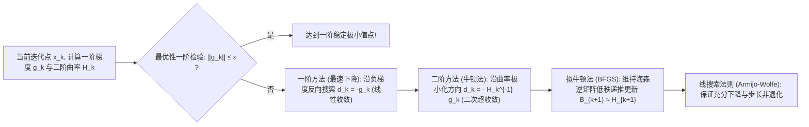

# Lec 11 无约束非线性优化：梯度下降与牛顿法 (Unconstrained Nonlinear Optimization: Gradient Descent and Newton Methods)

> MIT 15.C57 优化方法 · 讲义 11

## TL;DR

- 无约束非线性优化以一阶梯度与二阶 Hessian 矩阵展开为局部二次逼近核心。
- 梯度下降在 Lipschitz 连续梯度假定下保证一阶平稳性，但受制于病态条件数的锯齿震荡。
- 经典牛顿法展现局部二次收敛速度，拟牛顿法（BFGS）通过秩二更新避免显式矩阵求逆。
## 无约束极值的一阶与二阶分析

当目标函数脱离了线性的平坦性，进入具有曲率弯曲的连续空间时，我们进入了**非线性规划（Nonlinear Programming, NLP）**的广阔领域。
考虑无约束极小化问题：
$$
\min_{x \in \mathbb{R}^n} f(x)
$$
其中 $f: \mathbb{R}^n \to \mathbb{R}$ 为充分光滑的实值函数（至少二阶连续可微，记为 $f \in \mathcal{C}^2$）。

在局部微元视界下，多元泰勒展开（Taylor Expansion）是理解函数行为的唯一核心抓手：
$$
f(x + d) = f(x) + \nabla f(x)^\top d + \frac{1}{2} d^\top \nabla^2 f(x) d + o(\|d\|^2)
$$
其中 $\nabla f(x) \in \mathbb{R}^n$ 为一阶梯度向量（指向函数上升最快的方向），$\nabla^2 f(x) \in \mathcal{S}^n$ 为二阶海森矩阵（Hessian Matrix，刻画局部的多维曲率）。

::: theorem [无约束优化最优性微积分极值条件]
1. **一阶必要条件（First-Order Necessary Condition）**：若 $x^*$ 是局部极小点，则梯度必然为零（临界点 / 平稳点）：
   $$
   \nabla f(x^*) = 0
   $$
2. **二阶充分条件（Second-Order Sufficient Condition）**：若 $\nabla f(x^*) = 0$ 且 Hessian 矩阵严格正定：
   $$
   \nabla^2 f(x^*) \succ 0 \iff \lambda_{\min}(\nabla^2 f(x^*)) > 0
   $$
   则 $x^*$ 必然是局部严格极小值点。
:::

## 梯度下降法与病态条件数

最自然也是最古老的迭代算法是柯西（Cauchy, 1847）提出的**最速下降法（Steepest Descent / Gradient Descent）**：
$$
x_{k+1} = x_k - \alpha_k \nabla f(x_k)
$$
其中 $\alpha_k > 0$ 为步长（学习率）。

在理论分析中，若假定目标函数梯度满足 $L$-Lipschitz 连续性（即 $\|\nabla f(x) - \nabla f(y)\| \le L \|x - y\|$），通过选取固定步长 $\alpha = 1/L$，由著名的下降引理（Descent Lemma）：
$$
f(x_{k+1}) \le f(x_k) - \frac{1}{2L} \|\nabla f(x_k)\|^2
$$
可保证目标函数值单调严格递减，并在 $O(1/\epsilon^2)$ 步内使得梯度范数小于 $\epsilon$。

然而，梯度下降的致命弱点在于它对**几何条件数（Condition Number $\kappa = \frac{\lambda_{\max}}{\lambda_{\min}}$）**极度敏感！
当目标函数的等高线是极其狭长扁平的椭球（如狭长山谷）时，负梯度方向近乎垂直于通往真实谷底的轴线，导致算法在两侧山脊之间发生剧烈的横向锯齿震荡（Zig-zagging），前进步长极其缓慢。

## 牛顿法与拟牛顿法 (BFGS)

为了彻底克服一阶方法的盲目性，**牛顿法（Newton's Method）**引入了二阶曲率矫正。
直接对二阶泰勒展开式求导并令其为 0：
$$
\nabla q(d) = \nabla f(x_k) + \nabla^2 f(x_k) d = 0 \implies d_k^{\text{Newton}} = - \left( \nabla^2 f(x_k) \right)^{-1} \nabla f(x_k)
$$

::: theorem [牛顿法局部二次收敛速度 (Quadratic Convergence)]
若 $f(x)$ 满足二阶导数 Lipschitz 连续，且在极值点 $x^*$ 处 Hessian 矩阵严格正定。
当初始点充分接近 $x^*$ 时，标准牛顿法具有**局部二次收敛性（$Q$-Quadratic Convergence）**：
$$
\|x_{k+1} - x^*\| \le C \|x_k - x^*\|^2
$$
其有效有效数字精度在迭代后期呈现翻倍式增长（如误差从 $10^{-2} \to 10^{-4} \to 10^{-8} \to 10^{-16}$），仅需 5-6 步即达机器浮点极限！
:::

标准牛顿法存在两大实际工程痛点：
1. 每一步需要计算 $n \times n$ 的 Hessian 矩阵并求解稠密方程组，单步开销高达 $O(n^3)$；
2. 若远离极值点时 Hessian 出现非正定（负特征值），牛顿方向甚至会指向函数剧烈上升的山峰！

为了解决上述缺陷，运筹学家发明了**拟牛顿法（Quasi-Newton Methods）**，其中最著名的当属 **BFGS 算法（Broyden-Fletcher-Goldfarb-Shanno）**。
BFGS 算法完全不计算真实的二阶导数，而是利用相邻两次迭代的位移 $s_k = x_{k+1} - x_k$ 与梯度变化量 $y_k = \nabla f(x_{k+1}) - \nabla f(x_k)$，维持一个对逆海森矩阵的对称正定近似矩阵 $H_k \approx (\nabla^2 f)^{-1}$，并通过如下秩二（Rank-2）公式进行极速递推：
$$
H_{k+1} = \left( I - \rho_k s_k y_k^\top \right) H_k \left( I - \rho_k y_k s_k^\top \right) + \rho_k s_k s_k^\top, \quad \rho_k = \frac{1}{y_k^\top s_k}
$$
BFGS 既避免了任何矩阵求逆（单步耗时降至 $O(n^2)$），又天然保证了搜索方向的严格下降性，并享有超线性收敛速度（Superlinear Convergence），成为现代科学计算中应用最广的无约束优化工作底座。

::: insight [非线性优化中的坐标不变性追求]
梯度下降法的缺陷本质上是因为**“负梯度并不是一个无坐标依赖的几何内禀对象”**。
若改变变量的量纲或进行线性坐标缩放，原本圆形的等高线就会被拉伸为扁平椭球，梯度方向完全漂移。
而牛顿方向通过在左侧乘以 Hessian 逆矩阵，恰好扮演了曲率自适应各向同性预处理器的角色。无论对空间进行何种非奇异仿射变换，牛顿法的几何迭代轨迹严格保持不变！这种对几何坐标系的超越是二阶优化最具魅力之处。
:::
