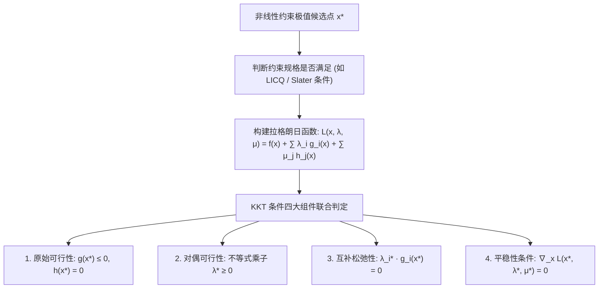

# Lec 12 约束非线性优化：KKT 条件与对偶乘子 (Constrained Nonlinear Optimization: KKT Conditions and Lagrangian Multipliers)

> MIT 15.C57 优化方法 · 讲义 12

## TL;DR

- 卡罗什-库恩-塔克（KKT）条件是一般约束非线性优化极值点的一阶公理化必要条件。
- 约束规格（Constraint Qualifications, 如 LICQ、Slater 条件）保证拉格朗日乘子的存在性。
- 阐明增广拉格朗日法（Augmented Lagrangian）与序列二次规划（SQP）的现代算法构架。
## 约束流形上的微积分几何

考虑通用的约束非线性规划问题（Constrained NLP）：
$$
\begin{aligned}
\min_{x \in \mathbb{R}^n} \quad & f(x) \\
\text{s.t.} \quad & g_i(x) \le 0, \quad i = 1, \dots, m \\
& h_j(x) = 0, \quad j = 1, \dots, p
\end{aligned}
$$
与无约束优化中梯度简单为零不同，在约束集合边界上，最优极值点通常具有非零的下降梯度 $\nabla f(x^*) \neq 0$。
但此时，任何能够使目标函数继续下降的方向，都会由于撞击或穿透可行域边界而被物理法则强制阻断。

这一几何受阻原理在 18 世纪由约瑟夫-路易·拉格朗日（Joseph-Louis Lagrange）建立为等式约束下的乘数法，后在 1939 年由 William Karush（硕士论文）以及 1951 年由 Harold Kuhn 与 Albert Tucker 独立推广为非线性不等式约束下的通用体系，统称为 **KKT 条件（Karush-Kuhn-Tucker Conditions）**。

## KKT 最优性一阶条件

定义全系统的**拉格朗日函数（Lagrangian Function）**：
$$
\mathcal{L}(x, \lambda, \mu) = f(x) + \sum_{i=1}^m \lambda_i g_i(x) + \sum_{j=1}^p \mu_j h_j(x)
$$
其中 $\lambda = (\lambda_1, \dots, \lambda_m)^\top$ 为不等式约束乘子，$\mu = (\mu_1, \dots, \mu_p)^\top$ 为等式约束乘子。

::: theorem [Karush-Kuhn-Tucker (KKT) 一阶必要条件]
设 $x^*$ 为局部最优解，且在 $x^*$ 处满足某种**约束规格（Constraint Qualification）**。
则必然存在对偶乘子向量对 $(\lambda^*, \mu^*)$ 满足如下四大 KKT 支柱方程：
1. **原始可行性（Primal Feasibility）**：
   $$
   g_i(x^*) \le 0, \quad \forall i=1,\dots,m; \qquad h_j(x^*) = 0, \quad \forall j=1,\dots,p
   $$
2. **对偶可行性（Dual Feasibility）**：
   $$
   \lambda_i^* \ge 0, \quad \forall i=1,\dots,m
   $$
3. **互补松弛性（Complementary Slackness）**：
   $$
   \lambda_i^* \cdot g_i(x^*) = 0, \quad \forall i=1,\dots,m
   $$
4. **拉格朗日平稳性（Stationarity）**：
   $$
   \nabla_x \mathcal{L}(x^*, \lambda^*, \mu^*) = \nabla f(x^*) + \sum_{i=1}^m \lambda_i^* \nabla g_i(x^*) + \sum_{j=1}^p \mu_j^* \nabla h_j(x^*) = 0
   $$
:::

在物理直觉上，拉格朗日平稳性表示：**目标函数的引力负梯度 $-\nabla f(x^*)$，被所有当前紧绷（Active）约束的向外法向反作用力 $\nabla g_i(x^*)$ 与双向刚性约束力 $\nabla h_j(x^*)$ 精确代数平衡**！

## 约束规格 (CQ) 的数学必要性

初学者常误认为任何极小点必然满足 KKT。
然而，如果约束曲面在切点处存在奇异自交（Cusp）、退化或切空间坍缩，KKT 乘子可能在数学上根本不存在！
为了保证乘子的存在性，必须施加**约束规格（Constraint Qualifications）**：

- **线性无关约束规格（LICQ）**：所有当前活跃不等式约束 $\{i : g_i(x^*) = 0\}$ 与等式约束的一阶梯度向量组 $\{\nabla g_i(x^*)\} \cup \{\nabla h_j(x^*)\}$ 在 $\mathbb{R}^n$ 中严格线性无关；
- **Slater 条件（凸问题专用）**：对于凸规划，若存在严格内点 $\hat{x}$ 使得所有非线性不等式严格为负 $g_i(\hat{x}) < 0$，则 Slater 条件成立。此时不仅 KKT 必要条件成立，而且**KKT 条件是全局最优解的充分必要条件**！

## 序列二次规划 (SQP) 与增广拉格朗日法

求解非线性约束优化主流算法包含两大家族：

### 1. 增广拉格朗日法 (Augmented Lagrangian Method / ALM)
针对惩罚函数法在惩罚因子趋于无穷时造成的剧烈数值病态，ALM（Powell-Hestenes）在拉格朗日项后追加二次违背惩罚项：
$$
\mathcal{L}_{\rho}(x, \lambda, \mu) = f(x) + \lambda^\top g(x) + \frac{\rho}{2} \|g(x)^+\|^2 + \mu^\top h(x) + \frac{\rho}{2} \|h(x)\|^2
$$
在有限惩罚参数 $\rho < \infty$ 下，通过外层一阶乘子更新即可实现精确可行性，完全免除了刚性发散风险。

### 2. 序列二次规划 (Sequential Quadratic Programming, SQP)
SQP 是约束优化领域的“牛顿法”。
在当前点 $(x_k, \lambda_k, \mu_k)$ 处，直接对拉格朗日函数的平稳性与约束非线性方程组应用全维度牛顿-拉夫逊法，其核心等价于在每一步求解一个**二次规划子问题（QP Subproblem）**：
$$
\begin{aligned}
\min_{d} \quad & \nabla f(x_k)^\top d + \frac{1}{2} d^\top \nabla_{xx}^2 \mathcal{L}(x_k, \lambda_k, \mu_k) d \\
\text{s.t.} \quad & g_i(x_k) + \nabla g_i(x_k)^\top d \le 0 \\
& h_j(x_k) + \nabla h_j(x_k)^\top d = 0
\end{aligned}
$$
SQP 具备与无约束牛顿法持平的超线性收敛速度，被广泛封装于 IPOPT、SNOPT 等顶级非线性工程求解器中。

::: insight [对偶乘子的力学虚功原理]
若从理论力学的角度审视 KKT 条件，拉格朗日乘子 $\lambda_i$ 与 $\mu_j$ 就是达朗贝尔虚功原理（D'Alembert's Principle）中的**理想约束反力（Constraint Reaction Forces）**！
优化问题中的“极小化能量”对应于质点系统的势能极小化，互补松弛性意味着“只有发生刚性接触时才产生法向支撑力，一旦脱离接触反力立即归零”。运筹学与理论力学在此处共享着完全同一套变分几何语言。
:::
